# Capítulo V: Product Implementation, Validation & Deployment

## 5.1. Software Configuration Management

### 5.1.1. Software Development Environment Configuration

Para el desarrollo de Refrio se utilizaron distintas herramientas, cada una con una función específica dentro del proyecto. Estas se organizan según las principales disciplinas de trabajo.

1. Project Management
2. Requirements Management
3. Product UX/UI Design
4. Software Development
5. Software Testing
6. Software Documentation

#### Project Management
Esta disciplina permitió organizar tareas, distribuir responsabilidades y hacer seguimiento al avance del proyecto.


#### Requirements Management
Esta parte estuvo enfocada en documentar, estructurar y dar seguimiento a los requerimientos del proyecto, asegurando que respondan a las necesidades de los segmentos objetivo.


#### Product UX/UI Design
En esta disciplina se trabajó el diseño de la experiencia de usuario y de la interfaz de la plataforma, especialmente en funciones relacionadas con inventario, trazabilidad y monitoreo de productos perecibles.

1. **UXPressia**: Herramienta utilizada para elaborar User Personas, Empathy Maps y Customer Journey Maps de los segmentos objetivo del proyecto.
   Ruta de referencia: https://uxpressia.com/
<p align="center">
  
</p>

2. **Figma**: Herramienta de diseño colaborativo utilizada para crear wireframes, mockups y propuestas visuales de Refrio.
   Ruta de referencia: https://www.figma.com/
<p align="center">
  
</p>

3. **Miro**: Pizarra colaborativa empleada para ordenar ideas, analizar hallazgos y desarrollar dinámicas relacionadas con el proceso de diseño.
   Ruta de referencia: https://miro.com/
<p align="center">
  
</p>

4. **Lucidchart**: Herramienta utilizada para la elaboración de diagramas, wireflows y representaciones visuales de la estructura de navegación del proyecto.
   Ruta de referencia: https://www.lucidchart.com/pages/es
<p align="center">
  
</p>

5. **Structurizr**: Herramienta empleada para representar de manera estructurada la arquitectura y organización de componentes del sistema.
   Ruta de referencia: https://structurizr.com/
<p align="center">
  
</p>


#### Software Development
Aquí se agrupan las herramientas utilizadas para editar archivos, organizar el proyecto y trabajar el contenido técnico y visual del reporte.

1. **GitHub**: Plataforma utilizada para alojar el repositorio del proyecto, gestionar ramas por capítulo, registrar cambios y mantener el control de versiones del trabajo realizado en Refrio.
   Ruta de referencia: GitHub
<p align="center">
  
</p>

2. **WebStorm**: Entorno de desarrollo utilizado para editar archivos del proyecto, organizar carpetas, manejar recursos visuales y trabajar el contenido del reporte de Refrio.
   Ruta de descarga: https://www.jetbrains.com/webstorm/
<p align="center">
  
</p>

3. **HTML, CSS3 y JavaScript**: Tecnologías fundamentales utilizadas para la estructura, el estilo y la interacción de la Landing Page del proyecto Refrio.
   Referencias:
- **HTML:** https://html.spec.whatwg.org/
- **CSS3:** https://www.w3.org/Style/CSS/
- **JavaScript:** https://developer.mozilla.org/es/docs/Web/JavaScript
<p align="center">
  
</p>


#### Software Testing
Esta parte ayudó a revisar que los entregables y componentes trabajados mantuvieran coherencia y funcionaran correctamente dentro del proyecto.

* **Revisión manual de entregables**: Proceso utilizado para verificar la estructura del documento, la navegación entre secciones, la correcta visualización de imágenes, tablas, enlaces internos y componentes del proyecto, asegurando consistencia en los resultados finales.
  Ruta de referencia: No aplica, ya que se trató de una validación manual realizada por el equipo.


#### Software Documentation
La documentación permitió organizar y explicar el contenido del proyecto de manera clara, facilitando su comprensión y continuidad.

* **Markdown**: Formato principal utilizado para redactar y estructurar el reporte por capítulos.
  Ruta de referencia: https://www.markdownguide.org/
<p align="center">
  
</p>

## Corrección editorial TB1 — Versiones y evidencias

> Esta revisión no altera las capturas ni los registros históricos. Las afirmaciones de funcionamiento y despliegue deben sustentarse con enlaces y capturas actuales; el texto del Sprint 2 es un registro académico del equipo, no una auditoría de infraestructura. El puntaje oficial comunicado fue 14,75/20. La matriz completa está en [Subsanación de rúbrica](correcciones/01_MATRIZ_CUMPLIMIENTO_RUBRICA.md).

### 5.1.2. Source Code Management

En esta sección se establecen los medios y esquemas de organización aplicados para el seguimiento de modificaciones del proyecto Refrio. Para ello, se utiliza GitHub como plataforma de alojamiento del repositorio y como sistema de control de versiones distribuido, lo que permite gestionar cambios, mantener trazabilidad y organizar el trabajo colaborativo mediante ramas.

### Repositorios del Proyecto

| Producto | URL del Repositorio |
|---|-|
| Organización en GitHub | https://github.com/upc-pre-202620-1asi0729-7747-refrio |
| Project Report (Informe) | https://github.com/upc-pre-202620-1asi0729-7747-refrio/refrio-report|
| Landing Page | https://github.com/upc-pre-202620-1asi0729-7747-refrio/refrio-website|
| Frontend Web Application | https://github.com/upc-pre-202620-1asi0729-7747-refrio/refrio-frontend |
| Server Side Software (Java/Spring Boot) | https://github.com/upc-pre-202620-1asi0729-7747-refrio/refrio-backend |


### GitFlow Workflow

En Refrio se aplica un modelo de trabajo basado en GitFlow, adaptado a la organización del Project Report por capítulos. Esta estructura permite desarrollar contenido en paralelo, mantener orden en los cambios y facilitar la integración progresiva del trabajo realizado por el equipo.

**Ramas Principales y de soporte:**

- **main:** Rama principal que contiene la versión estable del proyecto y el historial oficial del repositorio.
- **develop:** Rama de integración en la que se consolidan los avances antes de ser incorporados a la rama principal.
- **Feature branches:** se ramifican de develop y vuelven a fusionarse en develop.

### Conventional Commits

Se aplica la especificación Conventional Commits para los mensajes de commit, siguiendo la estructura:

```text
<type>(optional scope): <description>

[optional body]

[optional footer(s)]
````
### Tipos de Commit

| Tipo | Descripción |
|---|---|
| `feat` | Nueva funcionalidad para el usuario |
| `fix` | Corrección de un bug |
| `docs` | Cambios en documentación |
| `style` | Cambios de formato (espacios, comas, etc.) sin afectar lógica |
| `refactor` | Refactorización de código sin cambiar funcionalidad |
| `perf` | Mejoras de rendimiento |
| `test` | Adición o corrección de pruebas |
| `build` | Cambios en sistema de build o dependencias externas |
| `chore` | Tareas de mantenimiento sin afectar código de producción |

### Ejemplos de Commits

```text
feat(auth): add login validation
fix(ui): correct button alignment issue
docs(readme): update installation instructions
build(config): update project settings
chore(repo): clean project structure
```

**Instrucciones rápidas para vincular WebStorm con GitHub (resumen):**

1. VCS > Enable Version Control Integration (seleccionar Git).
2. Agregar cuenta de GitHub desde Settings.
3. Configurar nombre de usuario y realizar commits.
4. Manage Remotes > pegar URL del repositorio.


### 5.1.3. Source Code Style Guide & Conventions

En esta sección se establecen las convenciones de estilo y nomenclatura adoptadas para los recursos y tecnologías utilizadas en el proyecto Refrio. Estas convenciones permiten mantener orden, coherencia visual y uniformidad en la estructura del reporte, en los archivos del proyecto y en los elementos relacionados con la landing page y los recursos gráficos.

#### Referencias de Guías de Estilo Adoptadas

| Lenguaje/Tecnología | Guía de Estilo                                                                       |
|---|--------------------------------------------------------------------------------------|
| Markdown | [Markdown Guide](https://www.markdownguide.org/)                                     |
| HTML/CSS | [Google HTML/CSS Style Guide](https://google.github.io/styleguide/htmlcssguide.html) |
| JavaScript | [Google JavaScript Style Guide](https://google.github.io/styleguide/jsguide.html)    |
| Java | [Google Java Style Guide](https://google.github.io/styleguide/javaguide.html)        |


#### Nomenclatura General
Se usará inglés relacionado con la entidad representada, en minúsculas. Ejemplos:

```css 
.inventory-card {}
.shipment-item {} 
.alert-box {} 
.login-form {}
```

#### Sangría

Se aplica una sangría de **dos espacios** en archivos HTML, CSS y JavaScript para mantener una estructura legible y uniforme. En el caso de Markdown, se respeta una organización limpia del contenido, utilizando niveles de encabezado, listas y bloques de código de manera consistente.

**Ejemplo HTML:**

```html
<section class="hero-section">
  <div class="hero-content">
    <h1>Refrio</h1>
    <p>Inventory and traceability for perishable products.</p>
  </div>
</section>
```

#### HTML

- Declarar `<!DOCTYPE html>` en la primera línea.
- Utilizar minúsculas para nombres de elementos y atributos.
- Utilizar comillas dobles para valores de atributos: `<div class="container">`
- Incluir atributos `alt` en las imágenes para mejorar la accesibilidad.
- No omitir elementos como `<title>` y meta tags.
- Usar líneas en blanco para separar bloques extensos de código.

**Ejemplo HTML:**

```html
<!DOCTYPE html>
<html lang="en">
  <head>
    <meta charset="UTF-8">
    <meta name="viewport" content="width=device-width, initial-scale=1.0">
    <title>Refrio</title>
  </head>
  <body>
    <header class="hero-section">
      <h1>Refrio</h1>
      <p>Inventory and traceability for perishable products.</p>
    </header>
  </body>
</html>
```
#### CSS
- Utilizar shorthand properties cuando sea posible: margin: `10px 20px`;
- Terminar todas las declaraciones con punto y coma.
- Mantener un espacio después de los dos puntos en cada propiedad: color: `#333`;
- Usar nombres de clases en `kebab-case`.
- Organizar las propiedades de manera consistente dentro de cada selector.
- Separar visualmente los bloques de reglas para mejorar la legibilidad.

**Ejemplo CSS:**

```CSS
.hero-section {
  background-color: #3F51B5;
  color: #FFFFFF;
  padding: 24px;
  text-align: center;
}

.feature-card {
  border: 1px solid #BDBDBD;
  margin: 16px;
  padding: 20px;
}
```
#### JavaScript

- Utilizar `const` y `let` en lugar de `var`.
- Mantener espacios alrededor de operadores: `const total = a + b`;
- Colocar punto y coma al final de las instrucciones.
- Usar llaves de apertura en la misma línea de la declaración.
- Emplear nombres descriptivos en `camelCase` para variables y funciones.
- Utilizar funciones claras y breves para facilitar la lectura del código.

**Ejemplo JavaScript:**

```JavaScript
const productStatus = "available";

function showInventoryAlert() {
  console.log("Inventory alert active");
}

function calculateTotalItems(currentItems, newItems) {
  return currentItems + newItems;
}
```
#### Markdown
- Utilizar encabezados jerárquicos de forma ordenada (`#`, `##`, `###`).
- Mantener una estructura clara por secciones y subsecciones.
- Usar listas y tablas solo cuando aporten claridad al contenido.
- Emplear nombres descriptivos en enlaces internos y anchors.
- Mantener consistencia en títulos, numeración y bloques de código.

**Ejemplo Markdown:**

``` Markdown
#### Referencia transversal a Style Guidelines (ver Capítulo IV)

#### General Style Guidelines (remisión al Capítulo IV)

En esta sección se presentan las pautas visuales utilizadas en Refrio.

#### Web Style Guide (remisión al Capítulo IV)

Se describen los componentes y elementos visuales empleados en la interfaz web.
```
#### Gherkin
- Escribir escenarios en inglés.
  Definir un escenario por comportamiento específico.
- Mantener pasos claros, breves y reutilizables.
- Utilizar la estructura Given, When, Then, And.
- Aplicar una sangría uniforme para mejorar la legibilidad.

**Ejemplo Gherkin:**

``` Gherkin
Feature: Inventory Management

Scenario: Register a new perishable product
Given the user is on the inventory form
When the user enters valid product information
And saves the new record
Then the system should store the product successfully
And the product should appear in the inventory list
```
### 5.1.4. Software Deployment Configuration

El despliegue continuo del sitio web de Refrio se gestiona a través de GitHub Pages, garantizando alta disponibilidad, conexión segura vía HTTPS y actualización automática ante nuevos cambios validados en el entorno de integración. El procedimiento de configuración comprende los siguientes pasos:

1. **Selección del Entorno de Despliegue:**  
   En el repositorio `refrio-website` de la organización `upc-pre-202620-1asi0729-7747-refrio`, se accede a la pestaña **Settings** y se selecciona el apartado **Pages** en el menú lateral izquierdo.

2. **Definición de la Fuente de Compilación (Build and deployment):**
   * **Source:** Se selecciona la opción `Deploy from a branch`.
   * **Branch:** Se define la rama `develop` con el directorio raíz (`/root`) como fuente activa de publicación para el servicio de los archivos estáticos (HTML5, CSS3, JavaScript).

3. **Ejecución del Flujo Automatizado:**  
   Al registrar los parámetros, GitHub dispara de forma automática el flujo de trabajo (`pages build and deployment`) mediante GitHub Actions cada vez que se integra código a la rama seleccionada, compilando y sirviendo los assets estáticos.

4. **Verificación y Enlace de Producción:**  
   Se confirma el despliegue verificando la respuesta en el dominio público asignado y la activación automática de la directiva `Enforce HTTPS`:
   * **URL de despliegue:** [https://upc-pre-202620-1asi0729-7747-refrio.github.io/refrio-website/](https://upc-pre-202620-1asi0729-7747-refrio.github.io/refrio-website/)


## 5.2. Landing Page, Services & Applications Implementation

### 5.2.1. Sprint 1

#### 5.2.1.1. Sprint Planning 1

El Sprint 1 está dedicado principalmente a establecer la presencia digital de la startup mediante el diseño, desarrollo y despliegue de la primera versión del Landing Page público de Refrio, iniciando concurrentemente la arquitectura base y servicios de identidad del Core API para habilitar las funcionalidades transaccionales del siguiente ciclo.

| Campo | Detalle |
|:---|:---|
| **Sprint #** | Sprint 1 |
| **Date** | `2026-09-08` |
| **Time** | `7:00 pm` |
| **Location** | Reunión virtual por Discord / Google Meet |
| **Prepared By** | `Alca Morán, César Alejandro` |
| **Attendees** | Alca Morán, César Alejandro / Centeno León, Adriano Samir / Rivas Méndez, Bernie Aarón / Saavedra Flores, Rodrigo Andree / Tello Lima, Jose Alejandro |
| **Sprint 1 Goal** | Establecer la presencia digital pública de Refrio mediante el diseño, maquetación y despliegue de su Landing Page responsive (US01 a US05), comunicando la propuesta de valor centrada en erradicar mermas alimentarias mediante IoT y política FEFO, y comenzar la implementación de los servicios base de autenticación y registro de cuentas (TS01, TS02 y US08) requeridos por la arquitectura. |
| **Team Capacity** | 22 Story Points (Capacidad estimada inicial basada en la disponibilidad horaria del equipo) |
| **Committed Story Points** | 20 Story Points (11 SP completados de Landing Page + 9 SP en desarrollo de Identity/Core API) |
| **Completed Story Points** | 11 Story Points (US01, US02, US03, US04, US05 finalizadas y desplegadas al 100%) |
| **In Progress Story Points** | 9 Story Points (TS01, TS02, US08 en progreso activo para cierre en Sprint 2) |
| **Historical Velocity** | N/A (Sprint inicial; establece la línea base empírica de velocidad en 11 SP completados) |


#### 5.2.1.2. Aspect Leaders and Collaborators

Para este primer Sprint enfocado en el Landing Page y la configuración inicial de los repositorios y estándares de código abierto, la distribución de liderazgo (L) y colaboración (C) es la siguiente:

| Team Member (Last Name, First Name) | GitHub Username | UI/UX Design (Figma) | Landing Page Layout (HTML/CSS) | Landing Page Interactivity (JS) | DevOps & Deployment |
|:-----------------------------------:|:---------------:|:-------------:|:-------------:|:-------------:|:-------------:|
| Alca Morán, César Alejandro | `almocesar-cell` | L | C | L | C |
| Centeno León, Adriano Samir | `Adri11-dk` | C | L | C | C |
| Rivas Méndez, Bernie Aarón | `Arivas3008` | C | L | L | C |
| Saavedra Flores, Rodrigo Andree | `rodrigoxd67` | C | C | C | L |
| Tello Lima, Jose Alejandro | `j4ndrow` | L | C | L | C |

> **L** = Leader &nbsp;|&nbsp; **C** = Collaborator


#### 5.2.1.3. Sprint Backlog 1

El Sprint Backlog 1 consolida las tareas técnicas y de desarrollo para el despliegue del Landing Page público (US01-US05) y el inicio de la arquitectura base del módulo de identidad (TS01, TS02, US08):

| **Sprint 1** | **User / Tech Story** | | **Work-Item / Task** | | | | |
|:--------:|---|---|---|---|---|---|---|
| | **ID** | **Título** | **ID** | **Título** | **Descripción** | **Estimación (h)** | **Asignado a** | **Estado** |
| | US01 | Visualización de Hero Section | T01 | Diseñar UI en Figma | Diseñar el Hero section con propuesta de valor y llamadas a la acción (CTA). | 4 | Centeno, Adriano | Done |
| | US01 | Visualización de Hero Section | T02 | Maquetar estructura base | Maquetar en HTML5 semántico y CSS3 responsive la cabecera y el hero principal. | 5 | Alca, César | Done |
| | US02 | Visualización de Planes y Tarifas | T03 | Programar tarificador interactivo | Implementar tarjetas de planes (Básico, Pro, Empresarial) y toggle de facturación con JS. | 4 | Rivas, Bernie | Done |
| | US03 | Formulario de Demostración B2B | T04 | Maquetar y validar formulario B2B | Construir formulario corporativo con validación de RUC (11 dígitos) y correo corporativo. | 3 | Tello, Jose | Done |
| | US04 | Visualización de Casos de Éxito | T05 | Maquetar carrusel de testimonios | Desarrollar componente responsivo de testimonios y métricas de merma evitada. | 3 | Centeno, Adriano | Done |
| | US05 | Acceso a Plataforma Web / Móvil | T06 | Integrar enlaces de autenticación | Conectar botones de acceso hacia el portal de login y configurar redirección. | 2 | Alca, César | Done |
| | *Task* | Configuración de Repositorios | T07 | Setup GitHub y CI/CD | Estructurar ramas GitFlow y pipeline de despliegue automatizado en GitHub Pages. | 2 | Saavedra, Rodrigo | Done |
| | TS01 | Endpoint Autenticación JWT | T08 | Configurar emisor de tokens JWT | Implementar generación y firma de tokens JWT junto con middleware de autorización. | 6 | Saavedra, Rodrigo | In Progress |
| | TS02 | Endpoint Registro Unificado | T09 | Diseñar endpoints de sign-up | Implementar controladores y validaciones de esquema para registro B2B y B2C. | 5 | Rivas, Bernie | In Progress |
| | US08 | Inicio de Sesión Multi-rol | T10 | Maquetar interfaz base de Login | Diseñar y codificar la vista inicial de login conectada al flujo de sesión por roles. | 4 | Tello, Jose | In Progress |

#### 5.2.1.4. Development Evidence for Sprint Review

Durante el Sprint 1, el equipo implementó la convención formal de Conventional Commits y el flujo de trabajo GitFlow sobre las ramas de características vinculadas a las tareas del Sprint Backlog. La siguiente tabla presenta el registro auditable de contribuciones técnicas:

| Repository | Branch | Commit ID | Commit Message | Committed by (Author) | Committed on (Date) |
|:---:|:---:|:---:|:---|:---:|:---:|
| `refrio-website` | `develop` | `c10a42e` | `chore(setup): initialize project layout, assets structure and gitflow (T07)` | Saavedra Flores, Rodrigo | `2026-09-09` |
| `refrio-website` | `feature/index` | `e052fb4` | `feat(hero): build semantic html5 structure, value prop and cta buttons (T02)` | Alca Morán, César | `2026-09-11` |
| `refrio-website` | `feature/styles` | `f3124db` | `style(landing): implement responsive design, typography and refrio palette (T01)` | Centeno León, Adriano | `2026-09-13` |
| `refrio-website` | `feature/index` | `4d18c9a` | `feat(pricing): add interactive plan comparison cards and contact form (T03, T04)` | Rivas Méndez, Bernie | `2026-09-14` |
| `refrio-website` | `feature/terms-and-conditions` | `a3c91d4` | `feat(legal): add terms and conditions section and privacy policy view (T05)` | Tello Lima, Jose | `2026-09-15` |
| `refrio-website` | `feature/translation` | `bd7d9ab` | `feat(i18n): integrate multi-language translation script for landing content (T06)` | Alca Morán, César | `2026-09-16` |
| `refrio-website` | `develop` | `7e2b8f1` | `merge(staging): integrate feature branches and validate cross-browser UI` | Saavedra Flores, Rodrigo | `2026-09-16` |
| `refrio-website` | `main` | `9eb709b` | `release(v1.0.0): deploy stable landing page to production for sprint 1 review` | Saavedra Flores, Rodrigo | `2026-09-17` |
---

#### 5.2.1.5. Execution Evidence for Sprint Review

En este primer Sprint se completó el diseño y maquetación de la Landing Page pública de Refrio. La interfaz integra las secciones de "Hero", "Propuesta de Valor IoT & FEFO", "Planes de Suscripción (Básico S/ 59, Profesional S/ 129, Empresarial S/ 249)", "Casos de Éxito y Merma Evitada" y el "Formulario de Contacto B2B", siendo 100% responsiva para pantallas móviles y de escritorio.

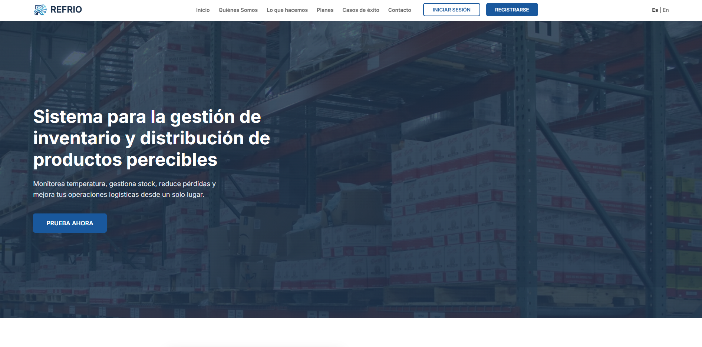
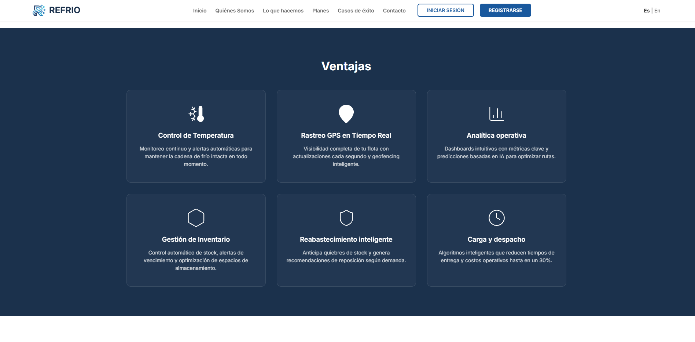
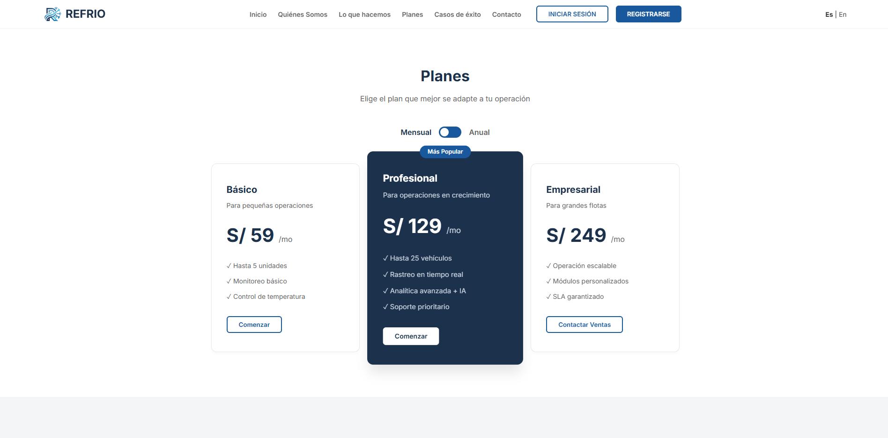
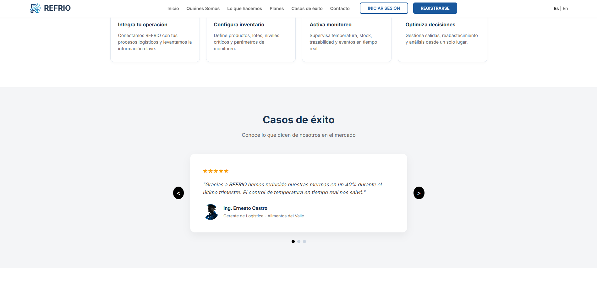
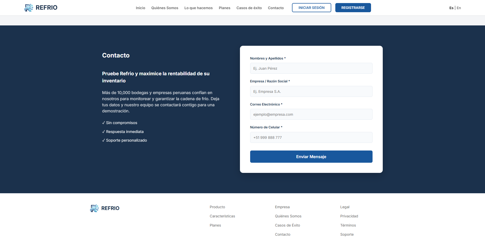
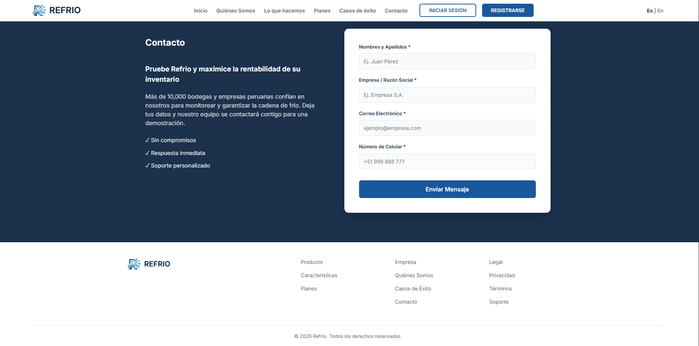


#### 5.2.1.6. Services Documentation Evidence for Sprint Review

> *Para el Sprint 1, enfocado estrictamente en la implementación, estilizado y despliegue del Landing Page estático, esta sección no aplica. La documentación formal de los Web Services y endpoints de la API RESTful (controladores de telemetría IoT, inventario FEFO y autenticación JWT) mediante OpenAPI / Swagger se desarrollará e incorporará a partir de los sprints posteriores.*


#### 5.2.1.7. Software Deployment Evidence for Sprint Review

Durante el Sprint 1 se completó el despliegue del Landing Page utilizando la infraestructura estática de GitHub Pages, siguiendo un flujo reproducible y validado sobre la rama de integración activa:

1. Se consolidaron las características desarrolladas en las distintas ramas (`feature/*`) hacia la rama `develop` mediante Pull Requests revisados por el equipo.
2. En el repositorio `refrio-website`, se ingresó a la sección `Settings > Pages`.
3. En la sección Build and deployment, se configuró la opción `Deploy from a branch`, estableciendo la rama `develop` y la carpeta raíz (`/root`) como origen de publicación.
4. El motor de GitHub Actions ejecutó automáticamente el workflow `pages build and deployment` tras la confirmación de cambios realizada por el responsable de integración (`ARivas3008`).
5. Se verificó el estado activo del servicio (`Your site is live at...`) con la directiva `Enforce HTTPS` habilitada.
6. Se auditó la carga en vivo del sitio web accediendo a la URL pública generada ([https://upc-pre-202620-1asi0729-7747-refrio.github.io/refrio-website/](https://upc-pre-202620-1asi0729-7747-refrio.github.io/refrio-website/)), validando la visualización del Hero section, la navegación responsive y la correcta resolución de estilos y assets.

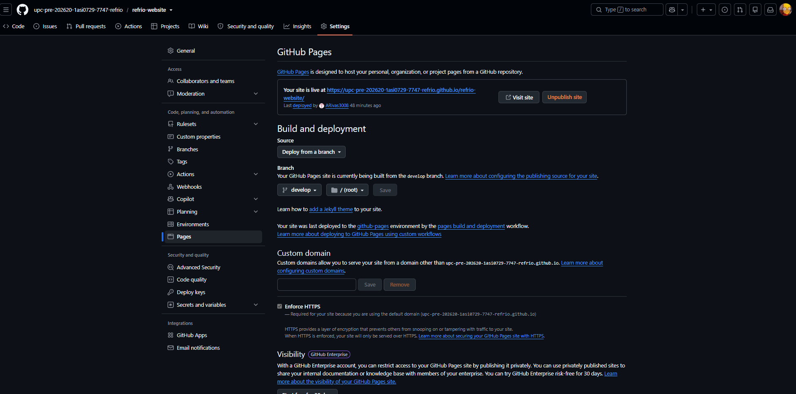
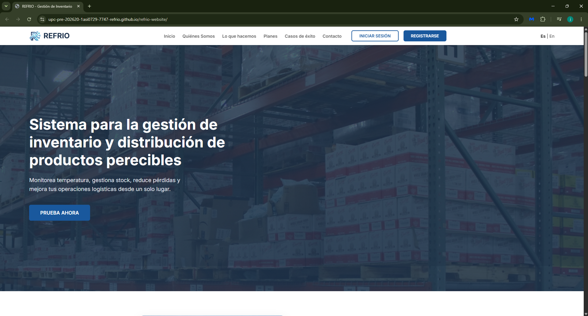


#### 5.2.1.8. Team Collaboration Insights during Sprint

Durante el Sprint 1, la colaboración técnica se gestionó a través de GitHub implementando el modelo de trabajo GitFlow. Cada incremento fue desarrollado en ramas aisladas de características (`feature/*`), las cuales fueron integradas hacia la rama `develop` mediante Pull Requests (PRs) con revisión y aprobación cruzada entre los miembros del equipo, culminando en la consolidación hacia la rama de producción `main`.

A continuación, se detalla la matriz de trazabilidad de los Pull Requests ejecutados y cerrados durante el ciclo:

| PR ID | Título del Pull Request | Rama Origen | Rama Destino | Autor (Developer) | Revisor (Reviewer) | Tareas Vinculadas | Fecha de Cierre | Merge Commit |
|:---:|:---|:---:|:---:|:---|:---|:---:|:---:|:---:|
| **#1** | `Join index` | `feature/index` | `develop` | Centeno León, Adriano | Alca Morán, César | T02, T03, T04 | `2026-09-17` | `98b1e4c` |
| **#2** | `Join styles` | `feature/styles` | `develop` | Centeno León, Adriano | Rivas Méndez, Bernie | T01 | `2026-09-17` | `f3124db` |
| **#3** | `Join translation` | `feature/translation` | `develop` | Centeno León, Adriano | Tello Lima, Jose | T06 | `2026-09-17` | `bd7d9ab` |
| **#4** | `Join terms-and-condition` | `feature/terms-and-conditions` | `develop` | Centeno León, Adriano | Saavedra Flores, Rodrigo | T05 | `2026-09-17` | `a3c91d4` |
| **#5** | `Develop` (Release to Main) | `develop` | `main` | Centeno León, Adriano | Alca Morán, César | T07 (Release v1.0.0) | `2026-09-17` | `9eb709b` |

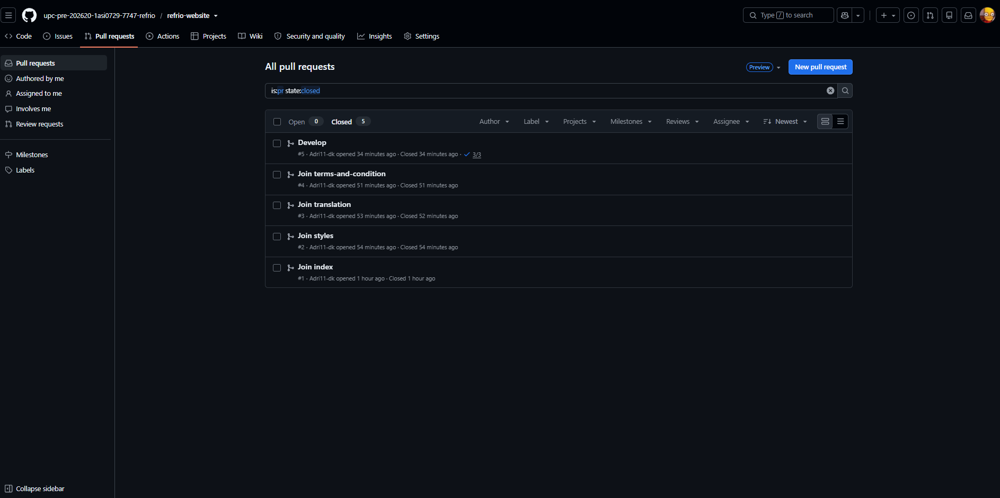

### 5.2.2. Sprint 2

#### 5.2.2.1. Sprint Planning 2

El Sprint Planning 2 se realizó al inicio de la segunda iteración del proyecto, con el equipo reunido virtualmente. Habiendo completado el Landing Page en el Sprint 1, el objetivo de este sprint es implementar y desplegar la primera versión de la **Refrio Frontend Web Application** construida con Angular 22 (versión declarada en el repositorio actual) y Angular Material, consumiendo una **Fake API desplegada en AWS EC2 (Ubuntu)** con `json-server` (IP: `3.142.114.4`), que expone los datos del dominio de Refrio. El resultado esperado al cierre del sprint es que ambos segmentos objetivo —Supervisor Logístico (Distribuidora) y Comerciante Minorista (Bodeguero)— puedan acceder a la aplicación desplegada y operar los flujos esenciales de autenticación multi-rol, alta de lotes perecibles y asignación a unidades de almacenamiento en frío.

Para garantizar rigor metodológico frente a la velocidad demostrada en el ciclo anterior (11 SP completados en el Sprint 1), el equipo formaliza su capacidad operativa diferenciando los compromisos asumidos:

| Campo | Detalle |
|---|---|
| **Sprint #** | Sprint 2 |
| **Date** | 2026-09-22 |
| **Time** | 7:00 PM |
| **Location** | Reunión virtual — Discord |
| **Prepared By** | Alca Morán, César Alejandro |
| **Attendees (to planning meeting)** | Alca Morán, César Alejandro / Centeno León, Adriano Samir / Rivas Méndez, Bernie Aarón / Saavedra Flores, Rodrigo Andree / Tello Lima, Jose Alejandro |
| **Sprint 1 Review Summary** | El Sprint 1 entregó el Landing Page de Refrio completamente implementado y desplegado en GitHub Pages ([https://upc-pre-202620-1asi0729-7747-refrio.github.io/refrio-website/](https://upc-pre-202620-1asi0729-7747-refrio.github.io/refrio-website/)). Se implementaron: Hero Section con propuesta de valor IoT, sección de planes con toggle mensual/anual, formulario de contacto B2B con validación, casos de éxito y CTA de acceso. El equipo completó los 11 SP comprometidos. Se identificaron como oportunidades de mejora: trazabilidad estricta de Conventional Commits vinculados a tareas, evidencia auditable de Pull Requests con revisión cruzada y alineación de Bounded Contexts. |
| **Sprint 1 Retrospective Summary** | El equipo valoró la comunicación fluida por Discord y la temprana distribución de aspectos. Se definieron los siguientes acuerdos de mejora para el Sprint 2: aplicar Conventional Commits asociando cada commit al ID de tarea (`T01`, `T02`...), abrir PRs con plantilla descriptiva requiriendo la aprobación técnica obligatoria de al menos un revisor antes del merge a `develop`, y mantener la correlación estricta con el Product Backlog. |
| **Sprint 2 Goal** | Our focus is on delivering the first functional version of the Refrio Web Application for both target segments, connected to a Fake API deployed on AWS EC2 (Ubuntu). We believe it delivers a tangible working demonstration of Refrio's core value — multi-role authentication, perishable batch registration with expiration dates, and cold storage allocation — to logistics supervisors and retail bodegueros. This will be confirmed when both user roles can log in, navigate their respective dashboards, and operate the core modules of the application, all through the deployed Angular frontend consuming the live API at http://3.142.114.4. |
| **Team Capacity** | 24 Story Points (Capacidad estimada para 5 integrantes en el ciclo) |
| **Historical Velocity** | 11 Story Points (Velocidad empírica demostrada en el Sprint 1) |
| **Committed Story Points** | 21 Story Points (US06: 5 SP, US07: 5 SP, US08: 3 SP, US12: 3 SP, TS03: 3 SP, Tareas Técnicas Frontend: 2 SP) |
| **Completed Story Points** | 21 Story Points (100% del alcance planificado para la entrega TB1) |

---

#### 5.2.2.2. Aspect Leaders and Collaborators

Los aspectos de este Sprint se organizan en torno a los módulos funcionales del proyecto Angular alineados con los Bounded Contexts del dominio de Refrio y la infraestructura de servicios simulados en AWS EC2:

| Team Member (Last Name, First Name) | GitHub Username | IAM & Auth Module (US06, US07, US08) | Inventory Management (US12, US14) | Fake API AWS EC2 & Testing (TS02, TS03) | Frontend Architecture & Deploy (TS01, US01) |
|---|---|:---:|:---:|:---:|:---:|
| Alca Morán, César Alejandro | `almocesar-cell` | **L** | C | **L** | C |
| Centeno León, Adriano Samir | `Adri11-dk` | C | **L** | C | C |
| Rivas Méndez, Bernie Aarón | `Arivas3008` | C | C | C | **L** |
| Saavedra Flores, Rodrigo Andree | `rodrigoxd67` | C | C | **L** | C |
| Tello Lima, Jose Alejandro | `j4ndrow` | **L** | C | C | **L** |

> **L = Leader | C = Collaborator**

La estructura de liderazgo define la responsabilidad sobre la arquitectura de componentes, consumo de servicios REST en `http://3.142.114.4` y la revisión técnica de Pull Requests antes de su integración a `develop`.

---

#### 5.2.2.3. Sprint Backlog 2 — reestructuración y trazabilidad

El Sprint 2 corresponde históricamente a TB1. En la primera versión de la tabla, seis Engineering Tasks figuran estimadas en menos de cuatro horas (T02, T03, T05, T07, T12 y T13). La siguiente versión **normaliza la estimación a intervalos de 4 a 8 horas**, agregando validación y revisión a actividades excesivamente pequeñas. Estas horas son **estimaciones revisadas del paquete de trabajo** y **no acreditan horas efectivamente invertidas**. La declaración histórica “Done” del informe original requiere corroboración con código, tablero y demostración.

| Historia | Task | Engineering Task normalizada y resultado verificable | Est. (h) | Estado histórico declarado | Evidencia a vincular |
|---|---|---|---:|---|---|
| US06 | T01 | Construir formulario empresarial con validación de campos obligatorios y RUC de 11 dígitos; probar mensajes y diseño en móvil | 4 | Done (por verificar) | PR + captura responsive + formulario |
| US06 | T02 | Integrar persistencia de empresa, validación de duplicidad y manejo de respuestas 201/400/409, con prueba de registro | 4 | Done (por verificar) | Endpoint, prueba HTTP y PR |
| US07 | T03 | Implementar alta de usuario minorista y validación accesible de correo, teléfono y contraseña; probar error/éxito | 4 | Done (por verificar) | Capturas y PR |
| US08 | T04 | Implementar inicio de sesión por rol y redirección, diferenciando token de demostración y JWT real | 4 | Done (por verificar) | Ruta sign-in, respuestas de sesión |
| US08 | T05 | Implementar guardias y pruebas de acceso permitido, denegado y sesión expirada para los dos roles | 4 | Done (por verificar) | Guardias + pruebas por rol |
| US12 | T06 | Implementar formulario de lote con identificador, cantidad, unidad, fechas y restricciones de vencimiento | 5 | Done (por verificar) | Vista, pruebas de validación |
| US12 | T07 | Implementar consulta/alta de lotes, tratamiento de errores HTTP y prueba de actualización de inventario | 4 | Done (por verificar) | Servicio, endpoint y PR |
| TS03 | T08 | Estructurar datos de lotes y comprobar orden determinista FEFO por vencimiento y disponibilidad | 4 | Done (por verificar) | JSON de prueba, resultado ordenado |
| US14 | T09 | Implementar asignación de lote a unidad refrigerada con validaciones de capacidad y estado | 5 | Done (por verificar) | Vista, caso válido/inválido |
| TS01 | T10 | Configurar aplicación Angular, rutas por módulos y resolución de servicios, verificando build de producción | 4 | Done (por verificar) | `angular.json`, rutas, build |
| TS02 | T11 | Configurar API simulada, variables de entorno y acceso controlado; registrar prueba HTTP desde entorno cliente | 4 | Done (por verificar) | Configuración, endpoint y captura |
| TS03 | T12 | Preparar build Angular, rutas SPA para GitHub Pages y comprobación responsive de navegación/errores | 4 | Done (por verificar) | Workflow + URL pública + capturas |
| US01 | T13 | Revisar CTAs de la Landing Page, destinos válidos y navegación en 375/768/1440 px; corregir enlaces y verificar el flujo | 4 | Done (por verificar) | Sitio, tres capturas y PR |
| | | **Total de esfuerzo REESTIMADO (no ejecutado)** | **54** | | |

### Relación entre estimaciones, Story Points y estados

Las horas se estiman **por Engineering Task** y los Story Points se estiman **por User Story/Technical Story**. No son la misma unidad. El reporte original declara 21 Story Points comprometidos y terminados; esa cifra es histórica, pero debe vincularse con los criterios de aceptación y resultados comprobables. Este reajuste a 54 horas no implica cambio automático de Story Points ni valida retroactivamente el estado Done.

### Flujo de tablero requerido por la rúbrica

| Estado | Regla de entrada | Regla para salir |
|---|---|---|
| **To Do** | Historia aceptada, tarea descompuesta y estimada en 4–8 h | Responsable inicia y registra rama |
| **In Process** | Commit inicial asociado a ID de tarea | Prueba local y PR creado |
| **To Review** | PR, descripción de cambio y comprobación adjunta | Aprobación o devolución documentada |
| **Done** | Criterios de aceptación comprobados; PR integrado en develop | Evidencia de funcionamiento y versión |
| **Blocked** *(estado auxiliar opcional)* | Dependencia o defecto que impide avanzar | Motivo, responsable y próxima acción |

**Registros necesarios del tablero:** enlace real, captura de fechas/columnas, historial de movimiento de al menos una tarjeta, responsable, horas, historia vinculada, criterio Gherkin y PR. El enlace `https://trello.com/b/refrio-sprint2` que figura en el reporte no debe considerarse verificado hasta que el equipo pruebe su accesibilidad.

### Aceptación técnica mínima (ejemplos Gherkin)

**US12 — Registro de lote:** Given que el supervisor tiene permisos y datos de producto válidos, When registra un lote con cantidad mayor que cero y fecha de caducidad posterior a la recepción, Then el sistema confirma el alta y el lote aparece en el inventario. Given que la caducidad precede al ingreso, When envía el formulario, Then se rechaza con error comprensible sin alterar el stock.

**US08 — Acceso multirrol:** Given un usuario Supervisor autenticado, When ingresa, Then navega al dashboard de supervisión. Given un usuario Minorista autenticado, When accede, Then navega al panel de su rol. Given credenciales inválidas, When intenta ingresar, Then recibe error sin crear sesión.

**TS03 — FEFO:** Given lotes aptos con distinta caducidad, When se solicita un plan para una cantidad disponible, Then se selecciona primero el lote que vence antes y se respeta la cantidad disponible. Given un lote vencido o inmovilizado, When se planifica, Then no se asignan unidades de ese lote.

### Enlace exigido: tareas con evidencia

| Tarea | Owner | Board | Commit real | PR real | Prueba | Resultado |
|---|---|---|---|---|---|---|
| T01–T13 | Según la asignación histórica del Sprint 2 | [PENDIENTE: URL/captura] | [PENDIENTE] | [PENDIENTE] | [PENDIENTE] | **No verificado** |

La documentación anterior debe actualizarse a partir de la herramienta de desarrollo utilizada efectivamente; nunca fabricar IDs de commits, fechas o aprobaciones.

#### 5.2.2.4. Development Evidence for Sprint Review — rectificación de evidencias

La aplicación existente se revisó contra los archivos públicos actuales: `refrio-frontend/package.json` declara Angular `^22.2.3`, y `src/app/app.routes.ts` contiene rutas de IAM, inventario, envíos, proveedores, alertas, analítica y eventos. No se encontró la dependencia directa `@angular/material` en dicho `package.json`. Por tanto, las menciones anteriores a "Angular 22 (versión declarada en el repositorio actual) con Angular Material" no describen fielmente la revisión del repositorio actual; deben entenderse como afirmaciones históricas sin soporte de esa versión.

El Sprint 2 documentó una API de demostración basada en `json-server`. La migración a Spring Boot/Java corresponde a una línea de trabajo posterior y no convierte retroactivamente las respuestas de la Fake API en respuestas de una API de producción.

La versión anterior del informe contenía supuestos identificadores de commits que no son SHA hexadecimales válidos. Esa tabla se retira en esta revisión, y se reemplaza por la evidencia verificable siguiente:

| Verificación | Fuente verificable | Resultado documental | Evidencia restante |
|---|---|---|---|
| Existencia de frontend | [Repositorio Angular](https://github.com/upc-pre-202620-1asi0729-7747-refrio/refrio-frontend) | Fuente disponible | Build y capturas fechadas |
| Versión de Angular | `package.json` (dependencias `@angular/*: ^22.2.3`) | Versión declarada en código | Build ejecutado y lockfile |
| Rutas principales | `src/app/app.routes.ts` | Rutas declaradas | Navegación real por rol |
| API de datos de TB1 | `db.json` y `json-server` | Demo documentada | URI vigente, HTTPs y smoke test |
| Commits por Engineering Task | Historia y PR de GitHub | **No verificado desde tabla anterior** | Commit SHA real/URL por tarea |
| Cobertura de User Flows | [Matriz de flujos](correcciones/04_FRONTEND_FLUJOS_Y_RESPONSIVE.md) | Mapeo estático | Video de cada recorrido y caso alternativo |

**Registro pendiente por tarea:** T01–T13 → rama real → SHA real → PR real → revisor → prueba → resultado. No se presentan IDs ficticios ni se afirma que todos los PR fueron aprobados sin evidencia.

#### 5.2.2.5. Execution Evidence for Sprint Review

> **Nota de verificación:** las pantallas, enlaces y el video citados son evidencias históricas de TB1. Sin pruebas actuales de navegador no puede afirmarse que cada User Flow esté cubierto de extremo a extremo ni que los datos persistan en servidor real. Consultar [auditoría de frontend](correcciones/04_FRONTEND_FLUJOS_Y_RESPONSIVE.md).


Al cierre del Sprint 2, se cuenta con la primera versión funcional de la Refrio Frontend Web Application desplegada y accesible públicamente, conectada a la Fake API en producción (AWS EC2, IP pública: `3.142.114.4`). A continuación se describen las principales vistas implementadas por módulo:

**Módulo IAM (Identity & Access Management)**
Se implementaron tres flujos de autenticación. El `LoginComponent` permite el acceso unificado mediante email y contraseña; el sistema consulta `GET /users` en la Fake API de AWS, valida las credenciales contra los registros existentes (usuario Supervisor: `admin@refrio.com` / `admin`; usuario Minorista: `bodega@refrio.com` / `bodega`) y redirige automáticamente al dashboard correspondiente al rol del usuario. El `RegisterComponent` permite crear nuevos usuarios mediante `POST /users`. El `ProfileComponent` muestra los datos del usuario autenticado (nombre, rol, plan de suscripción, sede) recuperados de `localStorage`.

**Módulo Inventory — Vista Supervisor Logístico**
El `InventoryListComponent` muestra la tabla de inventario del segmento Supervisor consumiendo `GET /inventory` desde AWS. Los productos se ordenan por fecha de caducidad ascendente (criterio FEFO): Fresh Strawberries (caducidad 2026-04-28), Organic Lettuce (2026-04-25) y Fresh Milk (2026-04-24) aparecen con sus respectivos badges de color de frescura (rojo para <3 días, amarillo para 3–7 días, verde para >7 días) calculados dinámicamente en el frontend. El `BatchListComponent` muestra los lotes de `GET /batches`: BT-4501 con estado "Vender ya" (badge rojo, vence 2026-04-28), BT-4512 con "En espera" (badge amarillo) y BT-4530 con "Fresh" (badge verde).

**Módulo Inventory — Vista Bodeguero (Minorista)**
El `BodegueroInventoryComponent` consume `GET /bodeguero-inventory` y presenta los productos propios del segmento minorista en tarjetas: Coca Cola 500ml (Bebidas, 50 unidades, 7°C), Helado D'Onofrio (Congelados, -18°C), Fresh Milk (Dairy), Cheese y Dulce de leche. Cada tarjeta muestra el semáforo de frescura y el almacén asignado, con un botón para registrar nuevo producto.

**Módulo Alerting**
El `AlertListComponent` consume `GET /alerts` y presenta las 7 alertas activas del sistema con sus badges de severidad: 2 alertas Critical (Temperature en Warehouse North y Cold Chain Breach en tránsito), 4 alertas Medium (Delayed Shipment, Low Stock Warning, Telemetry Loss, Maintenance Suggested) y 1 alerta Low (Approaching Delivery). El número de alertas críticas se muestra como badge rojo en el ícono del sidebar de navegación.

**Módulo Telemetry — Dashboard Principal**
El `TelemetryDashboardComponent` presenta cuatro KPI cards que cruzan datos de múltiples endpoints: temperatura activa monitoreada (de `/inventory`), alertas activas totales (de `/alerts`), envíos en tránsito (de `/shipments`) y lotes por vencer (de `/batches`). Los datos se obtienen en paralelo con `forkJoin` de RxJS para optimizar el tiempo de carga.

**Módulo Traceability — Seguimiento de Envíos**
El `ShipmentListComponent` consume `GET /shipments` y muestra los 5 envíos activos: FK-1023 (Berries Lima→Surco, 3°C, In Transit), FK-1024 (Lettuce Callao→Miraflores, Delivered), FK-1025 (Dairy Lima→San Isidro, Delayed), FK-1026 (Chicken Surco→Barranco, In Transit) y FK-1027 (Frozen Shrimp -18°C, In Transit). Los badges de estado diferencian visualmente el estado de cada envío.

**Módulo Analytics — Clientes y Proveedores**
El `ClientListComponent` muestra los 5 clientes registrados (consumiendo `GET /clients`): Bodega San José, Minimarket El Sol, Distribuidora Central Lima, Supermercado La Esquina y Bodega Doña Rosa, con sus respectivos tipos de negocio y número de pedidos. El `SupplierListComponent` muestra los 7 proveedores de `GET /suppliers`, incluyendo los registrados dinámicamente (Andrés S.A.C y Pedrito S.A.C, agregados vía `POST /suppliers`), con badges de rating y un modal para registro de nuevos proveedores.

**Enlace al video de navegación del Sprint 2:** [Ver demostración de Refrio — Sprint 2](https://upcedupe-my.sharepoint.com/:v:/g/personal/u20241d811_upc_edu_pe/IQDFS9viyA1ZToIoZGzYmzhOAR4tEmknvDD_W2eJ9p4jrQg?e=Zn1kC3&nav=eyJyZWZlcnJhbEluZm8iOnsicmVmZXJyYWxBcHAiOiJTdHJlYW1XZWJBcHAiLCJyZWZlcnJhbFZpZXciOiJTaGFyZURpYWxvZy1MaW5rIiwicmVmZXJyYWxBcHBQbGF0Zm9ybSI6IldlYiIsInJlZmVycmFsTW9kZSI6InZpZXcifX0%3D)
---

#### 5.2.2.6. Services Documentation Evidence for Sprint Review

> **Alcance del servicio:** esta sección describe exclusivamente la Fake API `json-server` usada para demostración TB1; no equivale al backend Spring Boot/Java, al esquema JPA ni a Swagger de una versión posterior.


Para el Sprint 2, los Web Services corresponden a la **Fake API implementada con json-server** desplegada en una instancia **AWS EC2 (Ubuntu 22.04, t2.micro)** con IP pública `3.142.114.4`, accesible mediante el protocolo HTTP en el puerto 80. Esta API expone las mismas colecciones y estructura de datos del archivo `db.json` que reside en el repositorio del frontend, garantizando la alineación entre el código fuente y los datos en producción. Todos los endpoints soportan las operaciones estándar de json-server: `GET`, `POST`, `PUT`, `PATCH` y `DELETE`.

**URL base de la Fake API (producción):** `http://3.142.114.4`

**Repositorio del Frontend:** [https://github.com/upc-pre-202620-1asi0729-7747-refrio/refrio-frontend.git](https://github.com/upc-pre-202620-1asi0729-7747-refrio/refrio-frontend.git)

| Bounded Context | Endpoint | Verbo HTTP | Descripción | Parámetros soportados | Ejemplo de Response |
|---|---|---|---|---|---|
| IAM | `GET /users` | GET | Retorna todos los usuarios registrados. Usado para autenticación simulada filtrando por email y password. | Query: `?email=`, `?password=`, `?role=` | `[{ "id": "1", "username": "admin", "email": "admin@refrio.com", "role": "Supervisor", "subscriptionPlan": "Profesional", "sede": "Lima Central", "token": "mock-jwt-token-distrib" }]` |
| IAM | `POST /users` | POST | Registra un nuevo usuario en el sistema. | Body: `{ username, password, email, firstName, lastName, role, subscriptionPlan, sede }` | `{ "id": "3", "username": "nuevo", "email": "nuevo@refrio.com", "role": "Supervisor" }` |
| Inventory & FEFO | `GET /inventory` | GET | Retorna el inventario de productos del Supervisor Logístico, ordenado por fecha de caducidad. | Query: `?category=`, `?warehouse=`, `?_sort=exp&_order=asc` | `[{ "id": "PRD-001", "name": "Fresh Strawberries", "category": "Fruits", "stock": "450", "temp": "3°C", "exp": "2026-04-28", "warehouse": "Lima Central" }]` |
| Inventory & FEFO | `POST /inventory` | POST | Registra un nuevo producto en el inventario del Supervisor. | Body: `{ name, category, stock, temp, exp, warehouse }` | `{ "id": "PRD-004", "name": "Nuevo Producto", "category": "...", "stock": "...", "exp": "..." }` |
| Inventory & FEFO | `GET /batches` | GET | Retorna los lotes de productos perecibles con su estado FEFO y ubicación en almacén. | Query: `?status=`, `?supplier=`, `?productId=` | `[{ "id": "BT-4501", "productId": "PRD-001", "quantity": "150", "weight": "300 kg", "receptionDate": "2026-04-10", "expirationDate": "2026-04-28", "supplier": "Fresh Farms Co.", "location": "Rampa 01", "status": "Vender ya" }]` |
| Inventory & FEFO | `PATCH /batches/:id` | PATCH | Actualiza el estado de un lote (ej. de "En espera" a "Vender ya" o "Descartado"). | Path: `id` / Body: `{ status }` | `{ "id": "BT-4512", "status": "Vender ya" }` |
| Inventory Minorista | `GET /bodeguero-inventory` | GET | Retorna el inventario del segmento Minorista (bodegueros). Colección separada del inventario de distribuidoras. | Query: `?category=`, `?warehouse=` | `[{ "id": "PRD-001", "name": "Coca Cola 500ml", "category": "Bebidas", "stock": "50", "temp": "7°C", "exp": "2026-12-01", "warehouse": "Bodega Principal", "status": "Active" }]` |
| Inventory Minorista | `POST /bodeguero-inventory` | POST | Registra un nuevo producto en el inventario del bodeguero. | Body: `{ name, category, stock, temp, exp, warehouse }` | `{ "id": "PRD-006", "name": "Nuevo", "category": "...", "stock": "...", "exp": "..." }` |
| Alerting | `GET /alerts` | GET | Retorna todas las alertas activas del sistema ordenadas por severidad. | Query: `?severity=`, `?location=` | `[{ "id": "ALT-2841", "type": "Temperature", "time": "2h ago", "location": "Warehouse North", "severity": "Critical" }]` |
| Alerting | `POST /alerts` | POST | Crea una nueva alerta en el sistema. | Body: `{ type, time, location, severity }` | `{ "id": "ALT-2842", "type": "...", "severity": "..." }` |
| Traceability & Shipments | `GET /shipments` | GET | Retorna todos los envíos activos con ruta, temperatura de transporte y estado. | Query: `?status=`, `?driver=` | `[{ "id": "FK-1023", "product": "Berries", "route": "Lima → Surco", "temperature": "3°C", "eta": "12:30 PM", "status": "In Transit", "driver": "Juan Pérez", "vehicle": "REF-001" }]` |
| Traceability & Shipments | `PATCH /shipments/:id` | PATCH | Actualiza el estado de un envío (ej. de "In Transit" a "Delivered"). | Path: `id` / Body: `{ status }` | `{ "id": "FK-1025", "status": "Delivered" }` |
| Analytics — Clients | `GET /clients` | GET | Retorna el listado de clientes registrados con tipo de negocio y número de pedidos. | Query: `?type=`, `?province=` | `[{ "id": "CLI-001", "name": "Bodega San José", "type": "Bodega", "orders": 48, "province": "Lima", "district": "Surco" }]` |
| Analytics — Suppliers | `GET /suppliers` | GET | Retorna el listado de proveedores con categoría, historial de entregas y rating de calidad. | Query: `?category=` | `[{ "id": "SUP-001", "name": "Fresh Farms Co.", "category": "Fruits & Vegetables", "deliveries": 48, "score": 98, "rating": "4.8" }]` |
| Analytics — Suppliers | `POST /suppliers` | POST | Registra un nuevo proveedor en el sistema. | Body: `{ code, name, category, deliveries, score, rating }` | `{ "id": "7hnJSU1tMsw", "name": "Andrés S.A.C", "category": "Lácteos", "rating": "5.0" }` |

*Nota: La documentación formal en OpenAPI/Swagger sobre el backend real en Spring Boot se implementará en AV2. En este sprint, la Fake API expone los mismos contratos de request/response que serán respetados por el backend de producción, garantizando que la integración del frontend no requiera cambios cuando se sustituya la Fake API.*

---

#### 5.2.2.7. Software Deployment Evidence for Sprint Review

> **Estado histórico:** los pasos y direcciones IP siguientes se reportaron en TB1. La disponibilidad pública vigente y la compatibilidad HTTP/HTTPS exigen nueva comprobación fechada y capturas, según [matriz de evidencias](correcciones/08_EVIDENCIAS_Y_DESPLIEGUE.md).


Durante el Sprint 2 se gestionaron tres despliegues: la Fake API en AWS EC2, la Frontend Web Application en GitHub Pages, y la actualización del Landing Page.

**1. Fake API (json-server) — AWS EC2 Ubuntu**

Se aprovisionó una instancia EC2 de Amazon Web Services con sistema operativo Ubuntu 22.04 LTS (tipo t2.micro, capa gratuita). La configuración del Security Group de la instancia habilitó el tráfico HTTP entrante en el puerto 80 desde cualquier IP (`0.0.0.0/0`), permitiendo que la Web Application Angular consuma la API desde cualquier cliente. Se instalaron Node.js y json-server en la instancia, y se desplegó el archivo `db.json` del proyecto con las ocho colecciones del dominio de Refrio.

Pasos realizados:
1. Lanzamiento de instancia EC2: AWS Console → EC2 → Launch Instance → Ubuntu Server 22.04 LTS (t2.micro). Se generó un par de claves `.pem` para acceso SSH.
2. Configuración del Security Group: se agregó regla de entrada HTTP (puerto 80, TCP, fuente 0.0.0.0/0).
3. Conexión SSH: `ssh -i refrio-key.pem ubuntu@3.142.114.4`.
4. Instalación de Node.js: `curl -fsSL https://deb.nodesource.com/setup_18.x | sudo -E bash - && sudo apt-get install -y nodejs`.
5. Instalación de json-server: `sudo npm install -g json-server`.
6. Transferencia del `db.json` al servidor mediante SCP.
7. Inicio del servidor: `sudo json-server --watch db.json --port 80 --host 0.0.0.0`.
8. Verificación de endpoints: `curl http://3.142.114.4/users` y endpoints restantes.

**URL histórica declarada para la Fake API (estado actual sin verificar):** `http://3.142.114.4`

Endpoints verificados y activos:
- `http://3.142.114.4/users`
- `http://3.142.114.4/inventory`
- `http://3.142.114.4/alerts`
- `http://3.142.114.4/shipments`
- `http://3.142.114.4/clients`
- `http://3.142.114.4/suppliers`
- `http://3.142.114.4/bodeguero-inventory`
- `http://3.142.114.4/batches`

**2. Frontend Web Application (Angular) — GitHub Pages**

Se utilizó la herramienta `angular-cli-ghpages` para desplegar el build de producción Angular directamente en GitHub Pages desde el repositorio `refrio-frontend` de la organización. Se configuró el `base-href` con el nombre del repositorio para que el enrutamiento de Angular SPA funcione correctamente desde la URL de GitHub Pages.

Pasos realizados:
1. Instalación de la herramienta de despliegue: `ng add angular-cli-ghpages`.
2. Build de producción: `ng build --configuration production`.
3. Despliegue: `npx ng deploy --base-href=/refrio-frontend/`.
4. GitHub Pages activado automáticamente en la rama `gh-pages` del repositorio.
5. Verificación de la URL pública y prueba de flujos de autenticación, inventario, alertas, envíos, clientes y proveedores contra la Fake API de AWS.

**Repositorio del Frontend:** [https://github.com/upc-pre-202620-1asi0729-7747-refrio/refrio-frontend.git](https://github.com/upc-pre-202620-1asi0729-7747-refrio/refrio-frontend.git)

**URL de la Web Application (GitHub Pages):** *(insertar URL pública generada tras el deploy, con formato: `https://upc-pre-202620-1asi0729-7747-refrio.github.io/refrio-frontend/`)*

**3. Landing Page v2 — GitHub Pages (actualización)**

Se actualizaron los botones CTA del Landing Page (`refrio-website`) para redirigir a la URL pública del frontend Angular, garantizando que los visitantes del Landing Page sean dirigidos directamente a la aplicación desplegada al hacer clic en "Ingresar" o "Comenzar". El despliegue se realizó con `npm run deploy` actualizando la rama `gh-pages` del repositorio `refrio-website`.

**URL del Landing Page:** `https://upc-pre-202620-1asi0729-7747-refrio.github.io/refrio-website/`

---

#### 5.2.2.8. Team Collaboration Insights during Sprint

> **Precisión editorial:** no es válido dar por probada la aprobación cruzada de todos los Pull Requests sin sus URLs y revisores. En la próxima iteración se registrará cada PR real con autor, revisor, fecha y prueba; la imagen histórica no reemplaza estos identificadores.


Durante el Sprint 2, la colaboración técnica se gestionó mediante GitFlow en el repositorio [https://github.com/upc-pre-202620-1asi0729-7747-refrio/refrio-frontend.git](https://github.com/upc-pre-202620-1asi0729-7747-refrio/refrio-frontend.git). Cada integrante desarrolló el módulo asignado en una rama `feature/[descripción]`, la cual fue integrada mediante Pull Request con al menos una aprobación de un compañero diferente al autor antes de mergear a `develop`. Al concluir el sprint se creó la rama `release/v0.2.0` desde `develop`, que fue mergeada a `main` y etiquetada con `v0.2.0`, marcando la versión de entrega para TB1.

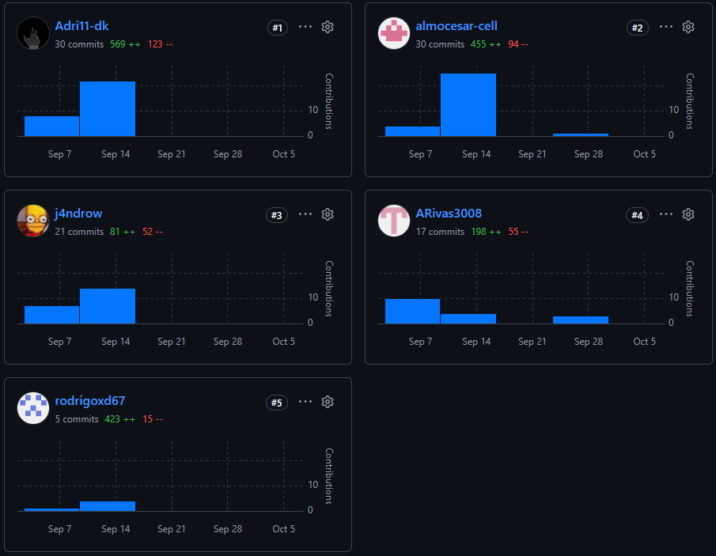


#### Nota de subsanaciones TB1 incorporadas

Las correcciones posteriores a la retroalimentación se detallan en: [rúbrica](correcciones/01_MATRIZ_CUMPLIMIENTO_RUBRICA.md), [Sprint Backlog](correcciones/02_SPRINT_BACKLOG_NORMALIZADO.md), [Landing](correcciones/03_LANDING_RESPONSIVE_Y_CONTENIDO.md), [Frontend](correcciones/04_FRONTEND_FLUJOS_Y_RESPONSIVE.md), [mejora continua](correcciones/05_MEJORA_CONTINUA_TRAZABILIDAD.md), [comunicación](correcciones/06_COMUNICACION_DEMO_Y_OUTCOME.md), [DDD](correcciones/07_ARQUITECTURA_7_A_8_CONTEXTOS.md) y [evidencias](correcciones/08_EVIDENCIAS_Y_DESPLIEGUE.md). Se conserva el relato histórico de TB1 en el resto del capítulo; los resultados posteriores requieren prueba y fecha.

---

> **Entrega 3 (AV2):** el contenido siguiente procede de la rama `feature/chapter5` de `refrio-report` (commit `1e28de56901d8c90c1edcd357db38da3d9cb917f`). Se preservan las secciones de TB1 y sus correcciones. Las tablas con `⟦⟧` son plantillas pendientes de evidencias; no constituyen resultados ejecutados. Los 58 SP reflejan el Product Backlog asignado, no la velocidad ni los SP completados.

### 5.2.3. Sprint 3


El Sprint 3 de Refrio propone elevar el alcance de la aplicación hacia flujos centrales de protección de la cadena de frío: respuesta a alertas térmicas, rotación FEFO, preparación de despachos y trazabilidad consultable. La incorporación de la primera versión real de Web Services con Spring Boot permite reemplazar progresivamente la capa de simulación `json-server` utilizada en TB1 por contratos persistentes, autorizados y documentados mediante OpenAPI/Swagger. Debido a la amplitud de historias asignadas originalmente al Sprint 3, el equipo debe registrar explícitamente el alcance comprometido, el alcance despriorizado y la evidencia de cada actividad completada.


#### 5.2.3.1. Sprint Planning 3


| Campo | Planificación propuesta / dato pendiente |
|---|---|
| Sprint # | Sprint 3 |
| Date / Time / Location | ⟦POR VERIFICAR: acta de reunión real⟧ |
| Prepared By | ⟦POR VERIFICAR⟧ |
| Equipo involucrado | Adriano — Integrante N.º 1; Bernie — N.º 2; José — N.º 3; Rodrigo — N.º 4; César — N.º 5. **La asistencia efectiva al Sprint Planning debe verificarse con acta o grabación.** |
| Sprint 2 Review Summary | TB1 describe una Frontend Web Application con alta de usuarios, login, gestión inicial de lotes y asignación de almacenamiento, apoyada en una Fake API `json-server` desplegada en AWS EC2. La API Spring Boot/Swagger se dejó expresamente para AV2. |
| Sprint 2 Retrospective Summary | **Propuesta para discutir y documentar**: revisar discrepancias entre versiones del frontend y documentación; corregir commits no verificables; comprobar públicamente las URLs y fortalecer la trazabilidad entre Product Backlog, tareas y PRs. |
| Sprint 3 Goal | **Our focus is on** implementar servicios REST documentados para la gestión de incidencias, inventario FEFO, preparación y validación de despachos y trazabilidad térmica. **We believe it delivers** una base operativa modular DDD para Refrio. **This will be confirmed when** los siete ítems seleccionados superen pruebas Maven/HTTP, integración Angular, revisión de código y comprobación en el despliegue, documentadas en la Sprint Review. |
| Sprint 3 Velocity | ⟦POR VERIFICAR: capacidad/velocidad aprobada por el equipo⟧ |
| Sum of Story Points | **58 SP** en las 13 historias originalmente asignadas al Sprint 3; **31 SP** correspondientes a las 7 historias seleccionadas según el backend DDD v4, y **27 SP replanificados**. Los SP completados están **pendientes de verificar** mediante criterios de aceptación, PR y ejecución. |


**Principio de planificación.** El objetivo se centrará en valor de negocio para distribuidores y bodegas, no en el mero despliegue de un framework. Al decidir qué historias implementar, priorizar un flujo vertical demostrable (*alerta térmica → revisión → cierre* o *inventario → FEFO → picking*) antes que comenzar todas las historias sin completarlas.


#### 5.2.3.2. Aspect Leaders and Collaborators

La asignación de la tercera entrega toma como fuente la **separación equilibrada del backend DDD v4 en cinco archivos RAR**. Cada paquete reúne archivos originales distintos y el equipo debe integrarlos mediante GitFlow. Los nombres se asignan a los números establecidos por el equipo; esta matriz identifica **responsabilidad sobre archivos asignados**, no autoría comprobada en GitHub ni asistencia confirmada a reuniones.

| Integrante | Responsable | Paquete original | Archivos asignados (sin README) | Tareas del Sprint 3 | Horas propuestas |
|:---:|---|---|---:|---|---:|
| **1** | **Adriano** | `Refrio_Integrante_1_Todos_los_8_Bounded_Contexts.rar` | **42** | T01, T05, T09 | **15 h** |
| **2** | **Bernie** | `Refrio_Integrante_2_Todos_los_8_Bounded_Contexts.rar` | **42** | T02, T07, T12 | **14 h** |
| **3** | **José** | `Refrio_Integrante_3_Todos_los_8_Bounded_Contexts.rar` | **42** | T06, T10, T14 | **15 h** |
| **4** | **Rodrigo** | `Refrio_Integrante_4_Todos_los_8_Bounded_Contexts.rar` | **43** | T08, T11, T15 | **16 h** |
| **5** | **César** | `Refrio_Integrante_5_Todos_los_8_Bounded_Contexts.rar` | **43** | T03, T04, T13 | **14 h** |
| | **Total** | **5 paquetes** | **212** | **15 Engineering Tasks** | **74 h** |

El único `README.md` del backend corresponde a **Rodrigo (Integrante N.º 4)** como responsable de su incorporación a `develop` y **no se cuenta** entre los 43 archivos. El material original suma **213 archivos únicos** (212 distribuidos + README).

**Participación planificada por rama:** los cinco integrantes tienen archivos de código o pruebas en cada uno de los ocho *bounded contexts*. La cantidad de archivos permite explicar la distribución técnica del trabajo; no equivale a commits o PR completados.

| Rama / destino | Adriano (1) | Bernie (2) | José (3) | Rodrigo (4) | César (5) | Total |
|---|---:|---:|---:|---:|---:|---:|
| `feature/iam` | 5 | 5 | 4 | 4 | 4 | 22 |
| `feature/inventory` | 5 | 5 | 5 | 6 | 6 | 27 |
| `feature/operations` | 7 | 6 | 6 | 7 | 7 | 33 |
| `feature/alerting` | 3 | 3 | 3 | 3 | 2 | 14 |
| `feature/traceability` | 3 | 3 | 4 | 3 | 3 | 16 |
| `feature/analytics` | 2 | 2 | 2 | 2 | 3 | 11 |
| `feature/public-portal` | 2 | 2 | 3 | 2 | 3 | 12 |
| `feature/events` | 2 | 3 | 2 | 2 | 2 | 11 |
| `develop` (base compartida) | 13 | 13 | 13 | 14 | 13 | 66 |
| **Total sin README** | **42** | **42** | **42** | **43** | **43** | **212** |

**Ejemplos comprobables de archivos distribuidos:** 

Adriano: `inventory/domain/services/FefoPolicy.java`, `alerting/application/commands/ManageIncidentCommand.java` y `operations/interfaces/rest/ShipmentCommandController.java` 

Bernie: `alerting/interfaces/rest/AlertingV1Controller.java`, `operations/OperationsIntegrationTest.java` y `traceability/domain/model/TemperatureEvidence.java`

José: `inventory/application/InventoryCommandService.java`, `operations/domain/model/aggregates/ShipmentAggregate.java` y `traceability/interfaces/rest/TraceabilityV1Controller.java` 

Rodrigo: `operations/application/OperationsApplicationService.java`, `traceability/application/CertificationService.java` y `shared/interfaces/OpenApiConfiguration.java`

César: `alerting/application/AlertingApplicationService.java`, `inventory/interfaces/rest/InventoryV1Controller.java` y `traceability/domain/services/ShipmentTemperaturePolicy.java`. 

Las rutas Java indicadas son relativas a `src/main/java/com/refrio/platform/`, salvo las clases de prueba de `src/test/java/com/refrio/platform/`.

**Colaboración y control de versiones:** crear las ocho ramas `feature/*` desde `develop`; integrar la base común y el README una sola vez en `develop`; cada integrante revisa y confirma exclusivamente sus propios archivos mediante su cuenta; abrir PRs y realizar revisión cruzada antes de fusionar en `develop` y posteriormente en `main`. No se atribuyen commits, implementaciones o revisiones no acreditadas por el historial real.

#### 5.2.3.3. Sprint Backlog 3

**Sprint:** N.º 3 (tercera entrega, AV2). **Sprint Goal:** desarrollar y documentar el backend REST de Refrio con Java, Spring Boot y DDD, priorizando incidencias, rotación FEFO, preparación/validación de despachos y trazabilidad térmica. La integración con Angular, los tests integrales, el despliegue y las evidencias de GitFlow deben verificarse antes del cierre.

Las **siete User Stories/Technical Stories** se seleccionaron del Product Backlog por su correspondencia con el código de Refrio backend DDD v4. Suman **31 SP** de los **58 SP** originalmente asignados al Sprint 3; los **27 SP** restantes no se consideran terminados.

| Story ID | User Story / Technical Story | SP | Correspondencia con backend v4 |
|:---:|---|---:|---|
| **US27** | Confirmación y Cierre de Alerta | 3 | Servicios, comandos, repositorios y controladores de incidentes. |
| **US29** | Visualización de Inventario Ordenado por FEFO | 3 | API de consulta FEFO; la visualización efectiva en Angular debe comprobarse. |
| **TS04** | Algoritmo y Endpoint de Priorización FEFO | 5 | `FefoPolicy`, servicios de inventario y validación de despacho. |
| **US30** | Generación de Lista de Picking Sugerida | 5 | Asignación FEFO durante la creación de despachos; lista independiente pendiente. |
| **US33** | Validación de Lote en Despacho mediante Escaneo | 5 | Validaciones de códigos y lotes en backend; cámara/lector móvil no verificado. |
| **US34** | Hoja de Ruta Térmica de Lote Despachado | 5 | Evidencias de temperatura, políticas de certificación y trazabilidad. |
| **TS08** | Endpoint Público de Certificado de Trazabilidad | 5 | Consulta de certificados por QR con JWT; falta comprobar acceso público sin autenticación. |
| **Total** | **7 historias seleccionadas** | **31** | **No equivale a 31 SP completados**. |

**Engineering Tasks:** estimadas entre **4 y 6 horas** conforme a la observación de la rúbrica. Cada responsable coincide con el paquete RAR que contiene los archivos citados. Los estados son **propuestos según la presencia de código en el ZIP**, no extraídos de un tablero real.

| Task ID | Story ID | Engineering Task y archivos asignados | BC / rama | Est. (h) | Responsable | Estado documental |
|:---:|:---:|---|---|---:|---|---|
| T01 | US27 | Preparar comando de gestión de incidentes y adaptadores de persistencia (`ManageIncidentCommand`, `IncidentRepositoryAdapter`). | Alerting | 5 | **Adriano (1)** | To Review |
| T02 | US27 | Exponer API de alertas e implementar pruebas del servicio (`AlertingV1Controller`, `AlertingApplicationServiceTest`). | Alerting | 4 | **Bernie (2)** | To Review |
| T03 | US27 | Aplicar cambios de estado y reglas del agregado de incidente (`AlertingApplicationService`, `IncidentAggregate`). | Alerting | 5 | **César (5)** | To Review |
| T04 | US29 | Exponer la consulta de inventario priorizado por vencimiento mediante controlador REST (`InventoryV1Controller`). | Inventory | 4 | **César (5)** | To Review |
| T05 | TS04 | Definir política FEFO y distribución de existencias por vencimiento (`FefoPolicy`, `Allocation`). | Inventory | 6 | **Adriano (1)** | To Review |
| T06 | TS04 | Implementar comandos y validaciones de stock/lote que alimentan la priorización FEFO (`InventoryCommandService`, `StockQuantity`). | Inventory | 5 | **José (3)** | To Review |
| T07 | TS04 | Probar integración de reglas FEFO en operaciones y comportamiento HTTP de despachos (`OperationsIntegrationTest`, `ShipmentRestIntegrationTest`). | Operations / Inventory | 4 | **Bernie (2)** | To Review |
| T08 | US30 | Orquestar selección FEFO y preparación del despacho (`OperationsApplicationService`, `OperationsQueryService`); precisar lista de picking independiente. | Operations | 6 | **Rodrigo (4)** | In Process |
| T09 | US30 | Exponer contratos REST de creación del despacho y resultados para Angular (`ShipmentCommandController`, `OperationsV1Controller`). | Operations | 4 | **Adriano (1)** | In Process |
| T10 | US33 | Validar identidad y orden de lotes en el agregado y las reglas de despacho (`ShipmentAggregate`, `ShipmentPolicy`). | Operations | 5 | **José (3)** | To Review |
| T11 | US33 | Gestionar transacciones, estados y errores HTTP del despacho (`OperationsApplicationService`, `ApiErrorHandler`). | Operations / Shared | 4 | **Rodrigo (4)** | To Review |
| T12 | US34 | Modelar evidencia térmica y su persistencia en certificados (`TemperatureEvidence`, `CertificateRepositoryAdapter`). | Traceability | 6 | **Bernie (2)** | To Review |
| T13 | US34 | Aplicar reglas de elegibilidad térmica y asegurar integridad del certificado (`ShipmentTemperaturePolicy`, `ColdChainCertificateAggregate`). | Traceability | 5 | **César (5)** | To Review |
| T14 | TS08 | Exponer consulta de certificados por QR (`CertificatesController`, `TraceabilityV1Controller`) y documentar la brecha de acceso público. | Traceability | 5 | **José (3)** | In Process |
| T15 | TS08 | Orquestar certificación y describir su contrato Swagger/OpenAPI (`CertificationService`, `OpenApiConfiguration`, `pom.xml`). | Traceability / Shared | 6 | **Rodrigo (4)** | To Review |

**Resumen de planificación:** **15 Engineering Tasks / 74 horas**. Distribución: **Adriano: 3 tareas, 15 h; Bernie: 3 tareas, 14 h; José: 3 tareas, 15 h; Rodrigo: 3 tareas, 16 h; César: 3 tareas, 14 h**. Las **31 SP** corresponden al alcance seleccionado, no a trabajo validado como `Done`.

El reparto de los ocho contextos incluye contribuciones adicionales a IAM, Analytics, Public Portal y Events, así como infraestructura `shared`, tests, OpenAPI, Maven, Docker y CI. Esas piezas forman parte del soporte transversal y del trabajo de integración **sin duplicar Story Points** ni convertir artificialmente cada archivo en una historia adicional. La distribución completa figura en 5.2.3.2.

**Historias originalmente previstas que siguen sin cierre verificable en v4:** **US23** (activación automática de alerta térmica), **TS07** (notificaciones WhatsApp/SMS/Push), **US13** (lector móvil), **US31** (semáforo visual frontend), **US36** (consulta QR anónima) y **US35** (exportación PDF). Son **27 SP pendientes de replanificación**. El código parcial que pudiera existir no acredita la aceptación íntegra.

**Estados y condiciones de cierre:** `To Review` = archivos del alcance preparados, todavía sin revisión/PR/prueba integral demostrada; `In Process` = código disponible parcialmente, pero falta parte del criterio de aceptación. `Done` solo procede con prueba de aceptación, integración, captura, commit/PR y registro de cierre verificables. **La copia o distribución de archivos no acredita autoría ni ejecución individual.**

**Sprint Board:** ⟦URL real de Trello/Jira/YouTrack y captura con evolución `To Do → In Process → To Review → Done`⟧. Los responsables deberán actualizar su estado real conforme a la evidencia, manteniendo el ID de cada tarea asociado a su User Story.

#### 5.2.3.4. Development Evidence for Sprint Review

En el backend DDD v4 se prepararon ocho contextos (`iam`, `inventory`, `operations`, `alerting`, `traceability`, `analytics`, `publicportal`, `events`), sus capas de dominio y casos de uso, persistencia PostgreSQL/JPA mediante Flyway, autenticación JWT y configuración Docker/CI. Las verificaciones disponibles en su entrega fueron: **58 archivos de dominio compilados con Java 21 y 27 verificaciones de reglas superadas**. **Maven, integración HTTP, Docker y despliegue público no se comprobaron**. Las contribuciones por integrante y los commits reales deberán incorporarse desde las ramas publicadas, sin sustituirlos por hashes ficticios.


| Repository | Branch | Commit Id | Commit Message | Commit Message Body | Committed on |
|---|---|---|---|---|---|
| `refrio-backend` | ⟦feature/...⟧ | ⟦SHA real⟧ | ⟦feat: / docs: / test:⟧ | ⟦módulo efectivo Spring Boot⟧ | ⟦fecha⟧ |
| `refrio-frontend` | ⟦feature/...⟧ | ⟦SHA real⟧ | ⟦Conventional Commit⟧ | ⟦flujo integrado efectivo⟧ | ⟦fecha⟧ |
| `refrio-website` | ⟦feature/...⟧ | ⟦SHA real⟧ | ⟦Conventional Commit⟧ | ⟦actualización Landing y CTA⟧ | ⟦fecha⟧ |


Se debe conservar la relación entre historias, tareas, commits, Pull Requests y productos. Los commits que figuran en TB1 con IDs no válidos deben reemplazarse por hashes reales antes de ampliar la evidencia. Incorporar capturas de la actividad durante el Sprint 3, no solo gráficos acumulados desde AV1.

**Trazabilidad de la distribución v4:** la asignación verificada en los cinco RAR es Adriano (I1: 42 archivos), Bernie (I2: 42), José (I3: 42), Rodrigo (I4: 43 + README único), César (I5: 43). Cada integrante tiene archivos en las ocho ramas de contexto. Para acreditar su trabajo técnico, se debe agregar la URL del PR o commit **publicado por cada integrante**, no un nombre de archivo aislado.

| Integrante / paquete | Ramas en que tiene archivos | Evidencia de aporte asignado a comprobar en GitHub |
|---|---|---|
| **Adriano / I1** | Las 8 ramas `feature/*` | T01, T05, T09; código `FefoPolicy` y controladores Operations; SHA/PR ⟦⟧ |
| **Bernie / I2** | Las 8 ramas `feature/*` | T02, T07, T12; API Alerting, tests Operations y certificados; SHA/PR ⟦⟧ |
| **José / I3** | Las 8 ramas `feature/*` | T06, T10, T14; `ShipmentAggregate`, `InventoryCommandService`, controladores de trazabilidad; SHA/PR ⟦⟧ |
| **Rodrigo / I4** | Las 8 ramas `feature/*` + base `develop` | T08, T11, T15; `OperationsApplicationService`, `CertificationService`, `pom.xml`, `README.md` único; SHA/PR ⟦⟧ |
| **César / I5** | Las 8 ramas `feature/*` | T03, T04, T13; servicio Alerting, controlador Inventory y política térmica; SHA/PR ⟦⟧ |

**Evidencias pendientes:** ejecución de `mvn clean verify`, capturas de Swagger en ejecución, pruebas de integración Spring Boot–PostgreSQL–Angular, historial de commits por autor y ocho PRs fusionados a `develop`. Los archivos del ZIP son una base de implementación, no pruebas de esas actividades.


#### 5.2.3.5. Execution Evidence for Sprint Review


**Escenarios de prueba propuestos**, sujetos al alcance aprobado: A) Supervisor: inicio de sesión, cámara/unidad de almacenamiento, lectura térmica, alerta crítica y cierre documentado; B) responsable de inventario: consulta ordenada FEFO y generación de picking; C) comerciante minorista: visualización de caducidades por semáforo; D) consulta pública controlada de trazabilidad, **solo si está implementada**. En cada video se debe registrar el resultado observable y la URL real utilizada.


| Evidencia | Pantalla/flujo | Captura / enlace |
|---|---|---|
| REF-FE-AV2-01 | Landing Page y CTA para ambos segmentos | ⟦⟧ |
| REF-FE-AV2-02 | Autenticación y panel según rol | ⟦⟧ |
| REF-FE-AV2-03 | Lotes perecibles y almacenes en frío | ⟦⟧ |
| REF-FE-AV2-04 | Alerta térmica y confirmación/cierre | ⟦si implementado⟧ |
| REF-FE-AV2-05 | FEFO y picking | ⟦si implementado⟧ |
| REF-FE-AV2-06 | Interfaz responsive y estado de error | ⟦⟧ |
| REF-VID-AV2-01 | Grabación de navegación, timings y URL privada de Stream | ⟦⟧ |


#### 5.2.3.6. Services Documentation Evidence for Sprint Review

La versión DDD v4 conserva la API compatible que utiliza Angular (`/api/operations`) y define rutas REST tipadas por contexto (`/api/v1/...`). La documentación técnica se produce mediante **Springdoc OpenAPI y Swagger UI**, que es lo solicitado por el curso; **Scalar no forma parte de la versión entregada**. Las rutas siguientes se tomaron de `docs/API_CONTRACT.md` del backend v4. **Están definidas en el código; sus respuestas reales, capturas, pruebas completas y URL desplegada siguen sin verificar.**

| Contexto / Story | HTTP | Ruta del backend v4 | Acción y evidencia por documentar |
|---|---|---|---|
| IAM (transversal) | POST | `/api/session` | Autenticación JWT; request y response con datos de prueba |
| Inventory (US29, TS04) | GET | `/api/v1/inventory/batches/fefo` | Prioridad FEFO y manejo de lotes vencidos |
| Alerting (US27) | PATCH | `/api/v1/alerting/incidents/{id}` | Transición y cierre de incidencias; permisos y errores |
| Operations (US30, US33) | POST | `/api/v1/operations/shipments` | Creación con FEFO y códigos escaneados; `201` según contrato |
| Operations (US33) | POST | `/api/v1/operations/shipments/{id}/advance` | Cambio de estado autorizado |
| Operations (US30) | POST | `/api/v1/operations/shipments/{id}/receipt` | Recepción con cantidad aceptada, observada o rechazada |
| Traceability (US34, TS08) | GET | `/api/v1/traceability/certificates` | Consulta de certificados térmicos |
| Traceability (TS08) | GET | `/api/v1/traceability/certificates/qr/{code}` | Consulta por código con JWT; **aún no es acceso público** |
| API compatible con Angular | GET | `/api/operations` | Snapshot filtrado para roles; contrato legado |
| API compatible con Angular | POST | `/api/operations/updateIncident` | Comando de incidencia con `{ "args": [...] }` |
| API compatible con Angular | POST | `/api/operations/createShipment` | Creación de despacho con `{ "args": [...] }` |

**URLs de documentación previstas al ejecutar localmente:** `http://localhost:8080/swagger-ui.html` y `http://localhost:8080/v3/api-docs`. Para cada endpoint efectivamente probado adjuntar método HTTP, URL real, parámetros, body, código de estado, ejemplo de JSON, captura de Swagger y referencia al commit/PR. No utilizar tokens reales en las capturas.

**Repositorio de servicios:** https://github.com/upc-pre-202620-1asi0729-7747-refrio/refrio-backend. **Despliegue verificable:** [agregar URL pública HTTPS del servicio, Swagger, versión y captura una vez publicado]. No confundir la Fake API del TB1 con el backend Java. La compilación de clases puras de dominio y las pruebas locales incluidas en el ZIP no sustituyen `mvn verify`, integración y despliegue.

#### 5.2.3.7. Software Deployment Evidence for Sprint Review


| Producto | Referencia existente / pendiente | Evidencia a incorporar |
|---|---|---|
| Landing Page | https://upc-pre-202620-1asi0729-7747-refrio.github.io/refrio-website/ | CTA, actualización e integración visual |
| Frontend Web Application | https://upc-pre-202620-1asi0729-7747-refrio.github.io/refrio-frontend/ | build actual Angular, funcionalidad real, commit |
| Backend Spring Boot | ⟦POR VERIFICAR: repo `main` sin implementación más allá de README⟧ | URL del servicio, Swagger y respuesta ejecutada |
| BD relacional | ⟦POR VERIFICAR⟧ | esquema, disponibilidad, procedimiento seguro |


La IP citada en TB1 (`3.142.114.4`) corresponde a la Fake API allí documentada; verificar su vigencia y no presentarla como despliegue de Spring Boot. Documentar el paso a paso de despliegue real en texto, con capturas de plataforma cloud, prueba de conectividad, acceso a la aplicación y URL de documentación.


#### 5.2.3.8. Team Collaboration Insights during Sprint

La organización del Sprint 3 se basó en un reparto equilibrado del backend DDD v4 en **cinco RAR**, con trabajo asignado en los **ocho bounded contexts** a cada integrante. La matriz refleja **archivos atribuidos por el reparto**, mientras que la colaboración realmente ejecutada requiere capturas de GitHub Insights, tablero, revisión cruzada y PRs. El orden es el acordado por el equipo: **Adriano 1, Bernie 2, José 3, Rodrigo 4 y César 5**.

| Integrante | Paquete y alcance asignado | Tareas Sprint 3 | Evidencia de colaboración real |
|---|---|---|---|
| **Adriano (1)** | 42 archivos; FEFO, comando de incidentes y controladores de Operations | T01, T05, T09 | ⟦Commits propios, PRs y revisiones en las 8 ramas⟧ |
| **Bernie (2)** | 42 archivos; controladores Alerting, pruebas Operations, evidencia térmica y repositorio de certificados | T02, T07, T12 | ⟦Commits propios, PRs y revisiones en las 8 ramas⟧ |
| **José (3)** | 42 archivos; comandos Inventory, agregados y políticas Shipment, API de certificados, CI y contratos | T06, T10, T14 | ⟦Commits propios, PRs y revisiones en las 8 ramas⟧ |
| **Rodrigo (4)** | 43 archivos + README único no contabilizado; servicios Operations/Certification, configuración OpenAPI, Maven e integración | T08, T11, T15 | ⟦Commits propios, README en develop, PRs y revisiones⟧ |
| **César (5)** | 43 archivos; servicio de incidencias, Inventory REST, política térmica, pruebas y diagramas | T03, T04, T13 | ⟦Commits propios, PRs y revisiones en las 8 ramas⟧ |

**Comprobación sugerida para la Sprint Review:** presentar la captura de colaboradores y commits de `refrio-backend`, el historial de cada `feature/*`, ocho PRs orientados a `develop`, las revisiones cruzadas y los resultados del tablero por tarea. Solo después de comprobar esos registros se describirá la participación como efectivamente realizada. La asignación de 212 archivos y un README no demuestra por sí misma aportes individuales ni el despliegue del servidor.

## 5.3. Validation Interviews


El objetivo de las validaciones es comprobar que los usuarios de Refrio comprendan la propuesta de valor y puedan interpretar datos de temperatura y caducidad para decidir sobre almacenamiento, despacho o recepción. Las sesiones deben realizarse con **3 a 5 participantes por cada segmento**, mostrando Landing Page y aplicación. Registrar explícitamente qué tareas estaban disponibles en el producto en la fecha de la sesión; las tareas aún no implementadas podrán validarse como prototipo, **pero no deben presentarse como interacción con un módulo operativo**.


### 5.3.1. Diseño de Entrevistas


El diseño de validación de Refrio conserva la amplitud del cuestionario original de la sección 2.2.1 de *Requirements Elicitation & Analysis*: **23 preguntas para las empresas distribuidoras de perecibles y 22 preguntas para tiendas y bodegas**. El enfoque cambia del descubrimiento de problemas a la evaluación de comprensión, usabilidad y pertinencia de una solución que articula inventario, vencimientos, cadena de frío y distribución. Las preguntas están agrupadas según los mismos ámbitos operativos del primer diseño; su redacción privilegia observaciones y experiencias concretas, en lugar de inducir respuestas positivas.


La validación integra el **Landing Page y la Web Application** a través de recorridos identificados por segmento. Antes de cada sesión se debe comprobar qué flujos existen en la versión presentada: una vista implementada podrá probarse como funcionalidad; una vista no implementada solo podrá mostrarse como **prototipo claramente señalado**. Se solicitará consentimiento para grabar y se observarán comprensión, tiempo, errores, retrocesos, solicitudes de ayuda y percepción del usuario. La evaluación heurística complementaria se registrará en el apartado 5.3.3 conforme al Anexo D.


#### Segmento 1: Empresas distribuidoras de productos perecibles


**Objetivo de la entrevista:** Evaluar si responsables de operaciones y logística comprenden la propuesta de Refrio, pueden identificar y gestionar lotes, reconocer las condiciones de conservación, interpretar avisos de riesgo térmico y utilizar la información de prioridad FEFO y trazabilidad en una secuencia coherente de trabajo.


**Perfil del entrevistado:** Supervisor logístico, responsable de distribución, encargado de almacén o profesional de una empresa que comercializa y transporta perecibles. Se buscarán experiencias con distintos métodos de inventario y control térmico, desde sistemas empresariales hasta registros manuales.


**Elementos a validar y user flows:**


- **UF-REF-S1-01 — Descubrimiento y acceso:** Landing Page → beneficios / planes → CTA empresarial → registro de distribuidora o inicio de sesión.
- **UF-REF-S1-02 — Gestión de lotes:** panel de distribución → inventario → alta o consulta de lote → fecha de vencimiento y unidad de almacenamiento.
- **UF-REF-S1-03 — Condiciones térmicas:** unidad de almacenamiento → temperatura y estado → interpretación de lectura y desviación → historial, cuando exista.
- **UF-REF-S1-04 — Preparación de despacho:** inventario → orden FEFO → selección de lote → sugerencia de picking / comprobación de caducidad, cuando esté disponible.
- **UF-REF-S1-05 — Alertas y trazabilidad:** aviso térmico → revisión y cierre del incidente → ficha de lote → consulta o certificado de trazabilidad, si está implementado.


#### Datos del entrevistado y contexto digital


1. ¿Podría indicar su nombre, edad y el distrito en el que realiza sus actividades dentro de una empresa de distribución de productos perecibles?
2. ¿Cuál es su cargo o función y qué responsabilidad tiene sobre el inventario, el almacén o las entregas a clientes?
3. ¿Qué tipos de productos perecibles gestiona y qué exigencias de conservación considera más importantes en su operación?
4. ¿Con qué frecuencia registra lotes, revisa fechas de caducidad o coordina salidas de productos durante una jornada habitual?
5. ¿Qué sistemas, dispositivos o registros utiliza actualmente para administrar esas actividades y qué experiencia tiene con aplicaciones web de logística?
6. ¿Desde qué tipo de dispositivo utilizaría una solución como Refrio y qué limitaciones de conectividad o tiempo suele enfrentar durante el trabajo?


#### Gestión de inventario y navegación


7. Tras revisar la Landing Page, ¿cómo describiría el propósito de Refrio y qué diferencias observa entre la propuesta para distribuidoras y la propuesta para bodegas?
8. ¿Qué botón elegiría para acceder como empresa distribuidora y qué impresión le produce el recorrido de registro o inicio de sesión?
9. Al llegar al panel de gestión, ¿cómo localizaría los lotes y qué datos considera necesarios para distinguir productos con diferentes fechas de vencimiento?
10. Al crear o revisar un lote de ejemplo, ¿qué campos entiende con facilidad y en qué paso requiere aclaraciones sobre cantidades, unidades o ubicaciones de almacenamiento?


#### Control de temperatura y cadena de frío


11. Si necesitara conocer la condición de una cámara de conservación, ¿dónde buscaría la temperatura y cómo interpretaría el valor y su fecha de actualización?
12. Frente a una lectura que exceda el rango permitido en un escenario de prueba, ¿cómo identificaría la anomalía y qué procedimiento esperaría poder registrar en el sistema?
13. Al revisar una alerta térmica o un historial de mediciones, ¿qué elementos visuales o mensajes le permiten distinguir un riesgo urgente de una situación normal?


#### Logística, rotación y distribución


14. ¿Cómo intentaría obtener un listado de productos ordenado por proximidad de vencimiento y qué entiende que significa la priorización FEFO mostrada?
15. Si tuviera que preparar un despacho, ¿qué información comprobaría antes de seleccionar un lote y cómo utilizaría una lista sugerida de picking, de estar disponible?
16. ¿Cómo consultaría los antecedentes o la trazabilidad de un lote, y qué valor tendrían esos datos al justificar la condición de un producto entregado?


#### Impacto operativo y facilidad de uso


17. ¿En qué parte del recorrido se detuvo, retrocedió o pidió apoyo y qué esperaba que sucediera después de su acción?
18. ¿Qué consecuencias tendría para su operación interpretar incorrectamente un estado de lote o una alerta, y cómo podría la interfaz ayudarle a evitarlo?
19. ¿Qué tan viable sería utilizar estas pantallas durante un turno real y qué cambios de legibilidad, navegación o vocabulario serían necesarios?


#### Disposición hacia la solución digital y cierre


20. Tras usar las pantallas disponibles, ¿qué funciones considera útiles para su empresa y cuáles no encajan con el procedimiento que siguen hoy?
21. ¿Qué datos o comprobaciones adicionales necesitaría antes de confiar en los avisos térmicos, la prioridad de salida de lotes o los certificados de trazabilidad?
22. ¿Qué mejoras priorizaría en la secuencia de tareas, presentación de información o mensajes para que su equipo opere sin asistencia?
23. ¿Hay alguna necesidad de la distribución de perecibles o dificultad de uso que no le hayamos preguntado y que debamos tener en cuenta al mejorar Refrio?


---


#### Segmento 2: Tiendas y bodegas con productos perecibles


**Objetivo de la entrevista:** Verificar que propietarios y responsables de bodegas comprendan la propuesta de Refrio y puedan identificar existencias, vencimientos, estados de conservación y prioridades de venta o reposición sin una carga de trabajo excesiva ni necesidad de conocimientos técnicos especializados.


**Perfil del entrevistado:** Propietario, encargado o trabajador que realiza personalmente el control de mercadería perecible en una tienda, bodega o comercio pequeño, mediante teléfono móvil, cuaderno, hojas de cálculo o una aplicación de gestión.


**Elementos a validar y user flows:**


- **UF-REF-S2-01 — Landing Page y registro minorista:** Landing Page → beneficios y planes → CTA de bodega → registro / inicio de sesión.
- **UF-REF-S2-02 — Inventario del local:** panel minorista → lista de productos → detalle o registro de lote → cantidad y fecha de caducidad.
- **UF-REF-S2-03 — Prevención de vencimientos:** inventario → filtro / orden por fecha → indicador de frescura → identificación de lote prioritario.
- **UF-REF-S2-04 — Alertas y conservación:** producto o unidad de frío → condición o alerta → comprensión de acción sugerida, si está disponible.
- **UF-REF-S2-05 — Consulta de trazabilidad:** lote recibido → QR / ficha pública de cadena de frío → interpretación de datos, solo si el módulo está disponible.


#### Datos del entrevistado y contexto de trabajo


1. ¿Podría indicar su nombre, edad y el distrito donde atiende su tienda o bodega?
2. ¿Cuánto tiempo lleva administrando el negocio y qué responsabilidades tiene sobre compras, almacenamiento y atención al público?
3. ¿Cuáles son los principales productos perecibles que comercializa y cómo organiza la mercadería según la rapidez con que se vende?
4. ¿Cuántas personas intervienen en el control de stock y qué tan frecuente es registrar entradas o salidas durante el día?
5. ¿Administra un solo local o varios puntos de venta, y qué dificultades le presenta mantener actualizada la información de sus productos?
6. ¿Qué dispositivo utiliza más para su negocio y qué aplicaciones o formas de registro le resultan familiares?


#### Control de inventario y comprensión de la interfaz


7. Tras observar la Landing Page, ¿qué problema considera que Refrio intenta resolver para una bodega y qué parte de la página lo comunica mejor?
8. ¿Cómo encontraría el acceso para comerciantes minoristas y qué le resultó sencillo o difícil del registro o inicio de sesión?
9. Al ingresar al listado de existencias, ¿cómo identificaría la cantidad disponible, el producto y su fecha de vencimiento?
10. Si necesitara registrar o localizar un nuevo lote, ¿qué pasos seguiría y qué campos o etiquetas deberían explicarse de manera más sencilla?


#### Fechas de vencimiento y pérdidas


11. Si dos lotes del mismo producto tienen fechas diferentes, ¿cómo decidiría cuál vender primero utilizando la información mostrada en Refrio?
12. Al observar un indicador de frescura o una alerta de vencimiento en un escenario de prueba, ¿qué entiende que significa y qué decisión tomaría sobre ese producto?
13. ¿Cómo comprobaría en la plataforma que un producto requiere atención sin revisar individualmente todos los registros de inventario?


#### Organización y errores frecuentes durante las tareas


14. ¿Qué parte del recorrido le hizo dudar, retroceder o buscar ayuda, y qué esperaba encontrar en esa pantalla?
15. ¿Cómo interpreta los colores, iconos, fechas y estados de la aplicación, y cuáles podrían confundirse al consultar rápidamente desde un teléfono?
16. Cuando intenta registrar o revisar productos mientras atiende clientes, ¿qué pasos le parecen innecesarios y cuáles son imprescindibles para evitar errores?


#### Impacto en ventas y decisiones del negocio


17. ¿Qué información visible en la plataforma le ayudaría a decidir si debe vender, separar, retirar o reponer un producto perecible?
18. ¿En qué situaciones considera que una alerta o un listado de lotes ordenado podría evitarle una pérdida o una venta fallida, y por qué?


#### Disposición hacia una solución digital y cierre


19. Después de explorar la demostración, ¿qué funcionalidad utilizaría primero en su bodega y qué actividad cotidiana le permitiría realizar de otro modo?
20. ¿Qué necesita ver o comprobar para confiar en la información sobre vencimientos, stock o conservación que presenta la plataforma?
21. ¿Qué ajustes recomendaría en tamaño de letra, nombres de opciones, botones o cantidad de pasos para que un comerciante pueda usar Refrio sin ayuda?
22. ¿Hay algún problema de control de mercadería o alguna recomendación sobre esta experiencia que no hayamos conversado y que le gustaría compartir?


---


**Protocolo y criterios de observación:** La entrevista debe iniciar con consentimiento informado para grabación, datos del entrevistado y contextualización. El moderador solicita completar los recorridos en la Landing Page y en las vistas de la aplicación que efectivamente estén disponibles; durante la interacción observa comprensión de funciones, errores, tiempo, retrocesos, necesidad de asistencia y comentarios espontáneos. En caso de usar prototipos, debe quedar registrado que no constituyen funcionalidades ejecutables. En cada sesión se documentarán tareas realizadas, apreciaciones textuales o paráfrasis fieles, capturas del video, URL de Microsoft Stream, tiempo de inicio, duración y relación con los problemas heurísticos observados. Los resultados y porcentajes solo se redactarán después de ejecutar las entrevistas.


### 5.3.2. Registro de Entrevistas

A continuación, se presenta el registro de las entrevistas de validación de Refrio, organizado de la misma manera que el apartado 2.2.2 de las entrevistas iniciales: primero tres entrevistas del **Segmento 1 (empresas distribuidoras)** y, a continuación, tres del **Segmento 2 (tiendas y bodegas)**. En esta etapa se evalúa la interacción de los participantes con la Landing Page y con las funcionalidades disponibles de la Web Application.

Los datos personales, las fechas, los enlaces, los tiempos de grabación, las capturas y los resultados se mantienen **sin completar** hasta realizar las sesiones y reunir sus evidencias. Los resúmenes deben explicar los recorridos probados, la comprensión de la interfaz, las dificultades observadas y las recomendaciones aportadas por cada participante; no deben reutilizarse como si fueran resultados nuevos los hallazgos de las entrevistas exploratorias de AV1.

#### Entrevista 1: Segmento 1 - Empresas distribuidoras de productos perecibles

| Campo | Detalle |
| :--- | :--- |
| **Nombres y Apellidos** |  |
| **Edad** |  |
| **Distrito** |  |
| **Fecha de entrevista** |  |
| **Enlace al video (Microsoft Stream)** |  |
| **Timing de inicio y duración** |  |
| **User flows evaluados** |  |
| **Evidencia fotográfica** |  |

**Resumen de la entrevista:**

<!-- Completar solo después de la sesión: perfil y rol; recorrido por Landing Page y Web Application; funciones probadas; opiniones; problemas de usabilidad; recomendaciones; evidencias. -->


---

#### Entrevista 2: Segmento 1

| Campo | Detalle |
| :--- | :--- |
| **Nombres y Apellidos** |  |
| **Edad** |  |
| **Distrito** |  |
| **Fecha de entrevista** |  |
| **Enlace al video (Microsoft Stream)** |  |
| **Timing de inicio y duración** |  |
| **User flows evaluados** |  |
| **Evidencia fotográfica** |  |

**Resumen de la entrevista:**

<!-- Completar solo después de la sesión: perfil y rol; recorrido por Landing Page y Web Application; funciones probadas; opiniones; problemas de usabilidad; recomendaciones; evidencias. -->


---

#### Entrevista 3: Segmento 1

| Campo | Detalle |
| :--- | :--- |
| **Nombres y Apellidos** |  |
| **Edad** |  |
| **Distrito** |  |
| **Fecha de entrevista** |  |
| **Enlace al video (Microsoft Stream)** |  |
| **Timing de inicio y duración** |  |
| **User flows evaluados** |  |
| **Evidencia fotográfica** |  |

**Resumen de la entrevista:**

<!-- Completar solo después de la sesión: perfil y rol; recorrido por Landing Page y Web Application; funciones probadas; opiniones; problemas de usabilidad; recomendaciones; evidencias. -->


---

#### Entrevista 1: Segmento 2 - Tiendas y bodegas con productos perecibles

| Campo | Detalle |
| :--- | :--- |
| **Nombres y Apellidos** | Ariel León |
| **Edad** | 27 |
| **Distrito** | Santa Anita |
| **Fecha de entrevista** | 11/11/26 |
| **Enlace al video (Microsoft Stream)** | https://upcedupe-my.sharepoint.com/:v:/g/personal/u20241d920_upc_edu_pe/IQBATIr98SteSLouikfXF4L1AVA6AZ_sjA225ytD1ulcEFE?nav=eyJyZWZlcnJhbEluZm8iOnsicmVmZXJyYWxBcHAiOiJPbmVEcml2ZUZvckJ1c2luZXNzIiwicmVmZXJyYWxBcHBQbGF0Zm9ybSI6IldlYiIsInJlZmVycmFsTW9kZSI6InZpZXciLCJyZWZlcnJhbFZpZXciOiJNeUZpbGVzTGlua0NvcHkifX0&e=QV4v0h |
| **Timing de inicio y duración** | Inicio: 00:00 - Duración: 20:56 minutos |
| **User flows evaluados** | • Exploración de Landing Page y propuesta de valor<br>• Registro e Inicio de Sesión (IAM)<br>• Visualización del Panel de Control (Dashboard)<br>• Gestión de Inventario y Registro de Productos<br>• Flujo Completo de Pedido y Despacho<br>• Gestión de Mermas / Baja por Vencimiento<br>• Monitoreo de Alertas y Registro de Proveedores |
| **Evidencia fotográfica** | <p>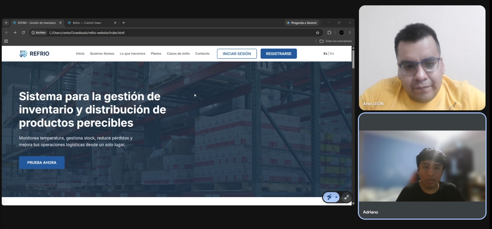 </p> |

**Resumen de la entrevista:**

<!-- Completar solo después de la sesión: perfil y rol; recorrido por Landing Page y Web Application; funciones probadas; opiniones; problemas de usabilidad; recomendaciones; evidencias. -->


---

#### Entrevista 2: Segmento 2

| Campo | Detalle |
| :--- | :--- |
| **Nombres y Apellidos** | Farit Santoyo |
| **Edad** | 33 |
| **Distrito** | Surco |
| **Fecha de entrevista** | 12/11/2026 |
| **Enlace al video (Microsoft Stream)** | https://upcedupe-my.sharepoint.com/:v:/g/personal/u20241f109_upc_edu_pe/IQCtjoimP7EGRJ0goFpz9NxtAfL0G8yIkZRU-fqumIfDKbE?nav=eyJyZWZlcnJhbEluZm8iOnsicmVmZXJyYWxBcHAiOiJPbmVEcml2ZUZvckJ1c2luZXNzIiwicmVmZXJyYWxBcHBQbGF0Zm9ybSI6IldlYiIsInJlZmVycmFsTW9kZSI6InZpZXciLCJyZWZlcnJhbFZpZXciOiJNeUZpbGVzTGlua0NvcHkifX0&e=2WFy21 |
| **Timing de inicio y duración** | Inicio: 00:00 - Duración: 8:36 minutos |
| **User flows evaluados** |  |
| **Evidencia fotográfica** | <p>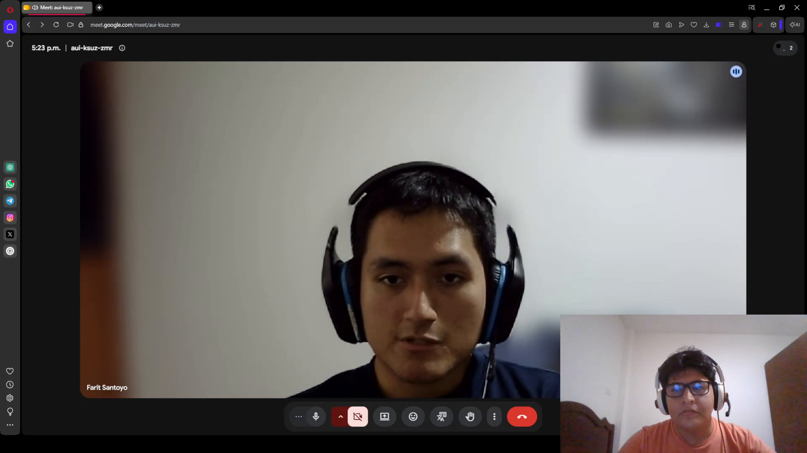 </p> |

**Resumen de la entrevista:**

Farit Alejandro Santoyo Espejo, de 33 años, es un comerciante del distrito de Santiago de Surco que, según el registro anterior del proyecto, administra desde hace ocho años una bodega dedicada a la comercialización de productos perecibles, entre ellos lácteos, embutidos y verduras frescas. Su actividad requiere controlar las existencias, organizar la reposición de mercadería y revisar las fechas de vencimiento de los productos.

En su entrevista inicial, se documentaron dificultades relacionadas con la actualización manual del inventario, la identificación de productos próximos a vencer y el desabastecimiento de artículos de alta rotación. Estas situaciones pueden ocasionar pérdidas económicas y afectar la atención a los clientes. Por ello, la nueva entrevista de validación se orienta a evaluar si la propuesta de Refrio presenta de manera comprensible las herramientas destinadas a mejorar el control de existencias.

Los aspectos centrales de la validación comprenden la consulta de productos y cantidades disponibles, el registro de lotes, la interpretación de fechas de vencimiento y la identificación de alertas. También se considera la facilidad para navegar por la plataforma desde un teléfono móvil, especialmente durante una jornada de trabajo en la que el comerciante debe atender clientes y administrar simultáneamente su mercadería. El análisis de las respuestas permitirá establecer qué elementos de la interfaz son intuitivos, cuáles presentan dificultades y qué mejoras podrían contribuir a reducir las pérdidas por vencimiento y los problemas de reposición.

---

#### Entrevista 3: Segmento 2

| Campo | Detalle |
| :--- | :--- |
| **Nombres y Apellidos** |  |
| **Edad** |  |
| **Distrito** |  |
| **Fecha de entrevista** |  |
| **Enlace al video (Microsoft Stream)** |  |
| **Timing de inicio y duración** |  |
| **User flows evaluados** |  |
| **Evidencia fotográfica** |  |

**Resumen de la entrevista:**

<!-- Completar solo después de la sesión: perfil y rol; recorrido por Landing Page y Web Application; funciones probadas; opiniones; problemas de usabilidad; recomendaciones; evidencias. -->


---

### 5.3.3. Evaluaciones según heurísticas


**Formato del Anexo D — UX Heuristics & Principles Evaluation.** Carrera: Ingeniería de Software; curso: 1ASI0729 Desarrollo de Aplicaciones Open Source; NRC y profesor: ⟦confirmar⟧; auditor: Equipo Refrio; clientes: ⟦lista real⟧; aplicaciones: Landing Page / Web Application.


**Tareas evaluadas:** acceso por rol, registro/login, alta de lote, revisión de temperatura, priorización FEFO, manejo de alerta, consulta de trazabilidad (si está implementada). **Tareas excluidas:** ⟦indicar cualquier flujo sin implementación verificable⟧.


| Nivel | Interpretación del enunciado |
|---:|---|
| 1 | Superficial o fácilmente superable |
| 2 | Menor; prioridad baja |
| 3 | Mayor; requiere prioridad alta |
| 4 | Muy grave; bloquea la utilización y debe corregirse antes del lanzamiento |


| ID | Problema efectivamente observado | Severidad | Principio vulnerado | Captura | Recomendación / estado |
|---|---|---:|---|---|---|
| REF-H01 | ⟦⟧ | ⟦⟧ | ⟦Usability: retroalimentación de estado, consistencia, control del usuario, etc.⟧ | ⟦⟧ | ⟦⟧ |
| REF-H02 | ⟦⟧ | ⟦⟧ | ⟦Information Architecture: encontrabilidad, etiquetado, navegación⟧ | ⟦⟧ | ⟦⟧ |
| REF-H03 | ⟦⟧ | ⟦⟧ | ⟦Inclusive Design: accesibilidad, alternativas y comprensión⟧ | ⟦⟧ | ⟦⟧ |


**Ficha individual de problema:** ID, tarea y paso observado; severidad con fundamento, heurística específica, screenshot; impacto para distribuidora/bodega; corrección recomendada y prioridad. No reportar problemas hipotéticos como resultados de sesiones.


## 5.4. Video About-the-Product


La primera versión expondrá el problema de pérdidas por manejo de perecibles y la solución Refrio mediante inventario y supervisión de temperatura. Se recomienda orientar la explicación a dos beneficios concretos: visibilidad operativa de una distribuidora y facilidad de interpretación para una bodega. **Duración exigida: 1–3 minutos.** Debe incluir una opinión real por cada segmento, enlaces a Stream y YouTube, captura y video incrustado en la Landing Page.


| Tiempo propuesto | Contenido | Material demostrable |
|---|---|---|
| 00:00–00:20 | Problema: control térmico y caducidad | Situación propia / gráfica identificada |
| 00:20–00:40 | Qué ofrece Refrio para los dos segmentos | Landing Page y CTA |
| 00:40–01:20 | Distribuidora: lotes, monitoreo, alertas o FEFO según función real | Captura de interfaz operativa |
| 01:20–01:45 | Bodega: estado de inventario y decisiones de reposición | Captura de interfaz operativa |
| 01:45–02:10 | Opiniones documentadas de usuarios de ambos segmentos | Clips reales con consentimiento |
| 02:10–02:25 | Cierre de propuesta de valor | Logo y enlace público |


**Stream:** ⟦URL⟧. **YouTube:** ⟦URL⟧. **Duración efectiva:** ⟦⟧. **Screenshot y evidencia de inserción en Landing Page:** ⟦⟧.
