# Capítulo V: Product Implementation, Validation & Deployment

## 5.1. Software Configuration Management

### 5.1.1. Software Development Environment Configuration

Para el desarrollo de Refrio se utilizaron distintas herramientas, cada una con una función específica dentro del proyecto. Estas se organizan según las principales disciplinas de trabajo.

1. Project Management
2. Requirements Management
3. Product UX/UI Design
4. Software Development
5. Software Testing
6. Software Documentation

#### Project Management
Esta disciplina permitió organizar tareas, distribuir responsabilidades y hacer seguimiento al avance del proyecto.


#### Requirements Management
Esta parte estuvo enfocada en documentar, estructurar y dar seguimiento a los requerimientos del proyecto, asegurando que respondan a las necesidades de los segmentos objetivo.


#### Product UX/UI Design
En esta disciplina se trabajó el diseño de la experiencia de usuario y de la interfaz de la plataforma, especialmente en funciones relacionadas con inventario, trazabilidad y monitoreo de productos perecibles.

1. **UXPressia**: Herramienta utilizada para elaborar User Personas, Empathy Maps y Customer Journey Maps de los segmentos objetivo del proyecto.
   Ruta de referencia: https://uxpressia.com/
<p align="center">
  
</p>

2. **Figma**: Herramienta de diseño colaborativo utilizada para crear wireframes, mockups y propuestas visuales de Refrio.
   Ruta de referencia: https://www.figma.com/
<p align="center">
  
</p>

3. **Miro**: Pizarra colaborativa empleada para ordenar ideas, analizar hallazgos y desarrollar dinámicas relacionadas con el proceso de diseño.
   Ruta de referencia: https://miro.com/
<p align="center">
  
</p>

4. **Lucidchart**: Herramienta utilizada para la elaboración de diagramas, wireflows y representaciones visuales de la estructura de navegación del proyecto.
   Ruta de referencia: https://www.lucidchart.com/pages/es
<p align="center">
  
</p>

5. **Structurizr**: Herramienta empleada para representar de manera estructurada la arquitectura y organización de componentes del sistema.
   Ruta de referencia: https://structurizr.com/
<p align="center">
  
</p>


#### Software Development
Aquí se agrupan las herramientas utilizadas para editar archivos, organizar el proyecto y trabajar el contenido técnico y visual del reporte.

1. **GitHub**: Plataforma utilizada para alojar el repositorio del proyecto, gestionar ramas por capítulo, registrar cambios y mantener el control de versiones del trabajo realizado en Refrio.
   Ruta de referencia: GitHub
<p align="center">
  
</p>

2. **WebStorm**: Entorno de desarrollo utilizado para editar archivos del proyecto, organizar carpetas, manejar recursos visuales y trabajar el contenido del reporte de Refrio.
   Ruta de descarga: https://www.jetbrains.com/webstorm/
<p align="center">
  
</p>

3. **HTML, CSS3 y JavaScript**: Tecnologías fundamentales utilizadas para la estructura, el estilo y la interacción de la Landing Page del proyecto Refrio.
   Referencias:
- **HTML:** https://html.spec.whatwg.org/
- **CSS3:** https://www.w3.org/Style/CSS/
- **JavaScript:** https://developer.mozilla.org/es/docs/Web/JavaScript
<p align="center">
  
</p>


#### Software Testing
Esta parte ayudó a revisar que los entregables y componentes trabajados mantuvieran coherencia y funcionaran correctamente dentro del proyecto.

* **Revisión manual de entregables**: Proceso utilizado para verificar la estructura del documento, la navegación entre secciones, la correcta visualización de imágenes, tablas, enlaces internos y componentes del proyecto, asegurando consistencia en los resultados finales.
  Ruta de referencia: No aplica, ya que se trató de una validación manual realizada por el equipo.


#### Software Documentation
La documentación permitió organizar y explicar el contenido del proyecto de manera clara, facilitando su comprensión y continuidad.

* **Markdown**: Formato principal utilizado para redactar y estructurar el reporte por capítulos.
  Ruta de referencia: https://www.markdownguide.org/
<p align="center">
  
</p>

### 5.1.2. Source Code Management

En esta sección se establecen los medios y esquemas de organización aplicados para el seguimiento de modificaciones del proyecto Refrio. Para ello, se utiliza GitHub como plataforma de alojamiento del repositorio y como sistema de control de versiones distribuido, lo que permite gestionar cambios, mantener trazabilidad y organizar el trabajo colaborativo mediante ramas.

### Repositorios del Proyecto

| Producto | URL del Repositorio |
|---|-|
| Organización en GitHub | https://github.com/upc-pre-202620-1asi0729-7747-refrio |
| Project Report (Informe) | https://github.com/upc-pre-202620-1asi0729-7747-refrio/refrio-report|
| Landing Page | https://github.com/upc-pre-202620-1asi0729-7747-refrio/refrio-website|
| Frontend Web Application | https://github.com/upc-pre-202620-1asi0729-7747-refrio/refrio-frontend |
| Server Side Software (Java/Spring Boot) | https://github.com/upc-pre-202620-1asi0729-7747-refrio/refrio-backend |


### GitFlow Workflow

En Refrio se aplica un modelo de trabajo basado en GitFlow, adaptado a la organización del Project Report por capítulos. Esta estructura permite desarrollar contenido en paralelo, mantener orden en los cambios y facilitar la integración progresiva del trabajo realizado por el equipo.

**Ramas Principales y de soporte:**

- **main:** Rama principal que contiene la versión estable del proyecto y el historial oficial del repositorio.
- **develop:** Rama de integración en la que se consolidan los avances antes de ser incorporados a la rama principal.
- **Feature branches:** se ramifican de develop y vuelven a fusionarse en develop.

### Conventional Commits

Se aplica la especificación Conventional Commits para los mensajes de commit, siguiendo la estructura:

```text
<type>(optional scope): <description>

[optional body]

[optional footer(s)]
````
### Tipos de Commit

| Tipo | Descripción |
|---|---|
| `feat` | Nueva funcionalidad para el usuario |
| `fix` | Corrección de un bug |
| `docs` | Cambios en documentación |
| `style` | Cambios de formato (espacios, comas, etc.) sin afectar lógica |
| `refactor` | Refactorización de código sin cambiar funcionalidad |
| `perf` | Mejoras de rendimiento |
| `test` | Adición o corrección de pruebas |
| `build` | Cambios en sistema de build o dependencias externas |
| `chore` | Tareas de mantenimiento sin afectar código de producción |

### Ejemplos de Commits

```text
feat(auth): add login validation
fix(ui): correct button alignment issue
docs(readme): update installation instructions
build(config): update project settings
chore(repo): clean project structure
```

**Instrucciones rápidas para vincular WebStorm con GitHub (resumen):**

1. VCS > Enable Version Control Integration (seleccionar Git).
2. Agregar cuenta de GitHub desde Settings.
3. Configurar nombre de usuario y realizar commits.
4. Manage Remotes > pegar URL del repositorio.


### 5.1.3. Source Code Style Guide & Conventions

En esta sección se establecen las convenciones de estilo y nomenclatura adoptadas para los recursos y tecnologías utilizadas en el proyecto Refrio. Estas convenciones permiten mantener orden, coherencia visual y uniformidad en la estructura del reporte, en los archivos del proyecto y en los elementos relacionados con la landing page y los recursos gráficos.

#### Referencias de Guías de Estilo Adoptadas

| Lenguaje/Tecnología | Guía de Estilo                                                                       |
|---|--------------------------------------------------------------------------------------|
| Markdown | [Markdown Guide](https://www.markdownguide.org/)                                     |
| HTML/CSS | [Google HTML/CSS Style Guide](https://google.github.io/styleguide/htmlcssguide.html) |
| JavaScript | [Google JavaScript Style Guide](https://google.github.io/styleguide/jsguide.html)    |
| Java | [Google Java Style Guide](https://google.github.io/styleguide/javaguide.html)        |


#### Nomenclatura General
Se usará inglés relacionado con la entidad representada, en minúsculas. Ejemplos:

```css 
.inventory-card {}
.shipment-item {} 
.alert-box {} 
.login-form {}
```

#### Sangría

Se aplica una sangría de **dos espacios** en archivos HTML, CSS y JavaScript para mantener una estructura legible y uniforme. En el caso de Markdown, se respeta una organización limpia del contenido, utilizando niveles de encabezado, listas y bloques de código de manera consistente.

**Ejemplo HTML:**

```html
<section class="hero-section">
  <div class="hero-content">
    <h1>Refrio</h1>
    <p>Inventory and traceability for perishable products.</p>
  </div>
</section>
```

#### HTML

- Declarar `<!DOCTYPE html>` en la primera línea.
- Utilizar minúsculas para nombres de elementos y atributos.
- Utilizar comillas dobles para valores de atributos: `<div class="container">`
- Incluir atributos `alt` en las imágenes para mejorar la accesibilidad.
- No omitir elementos como `<title>` y meta tags.
- Usar líneas en blanco para separar bloques extensos de código.

**Ejemplo HTML:**

```html
<!DOCTYPE html>
<html lang="en">
  <head>
    <meta charset="UTF-8">
    <meta name="viewport" content="width=device-width, initial-scale=1.0">
    <title>Refrio</title>
  </head>
  <body>
    <header class="hero-section">
      <h1>Refrio</h1>
      <p>Inventory and traceability for perishable products.</p>
    </header>
  </body>
</html>
```
#### CSS
- Utilizar shorthand properties cuando sea posible: margin: `10px 20px`;
- Terminar todas las declaraciones con punto y coma.
- Mantener un espacio después de los dos puntos en cada propiedad: color: `#333`;
- Usar nombres de clases en `kebab-case`.
- Organizar las propiedades de manera consistente dentro de cada selector.
- Separar visualmente los bloques de reglas para mejorar la legibilidad.

**Ejemplo CSS:**

```CSS
.hero-section {
  background-color: #3F51B5;
  color: #FFFFFF;
  padding: 24px;
  text-align: center;
}

.feature-card {
  border: 1px solid #BDBDBD;
  margin: 16px;
  padding: 20px;
}
```
#### JavaScript

- Utilizar `const` y `let` en lugar de `var`.
- Mantener espacios alrededor de operadores: `const total = a + b`;
- Colocar punto y coma al final de las instrucciones.
- Usar llaves de apertura en la misma línea de la declaración.
- Emplear nombres descriptivos en `camelCase` para variables y funciones.
- Utilizar funciones claras y breves para facilitar la lectura del código.

**Ejemplo JavaScript:**

```JavaScript
const productStatus = "available";

function showInventoryAlert() {
  console.log("Inventory alert active");
}

function calculateTotalItems(currentItems, newItems) {
  return currentItems + newItems;
}
```
#### Markdown
- Utilizar encabezados jerárquicos de forma ordenada (`#`, `##`, `###`).
- Mantener una estructura clara por secciones y subsecciones.
- Usar listas y tablas solo cuando aporten claridad al contenido.
- Emplear nombres descriptivos en enlaces internos y anchors.
- Mantener consistencia en títulos, numeración y bloques de código.

**Ejemplo Markdown:**

``` Markdown
#### Referencia transversal a Style Guidelines (ver Capítulo IV)

#### General Style Guidelines (remisión al Capítulo IV)

En esta sección se presentan las pautas visuales utilizadas en Refrio.

#### Web Style Guide (remisión al Capítulo IV)

Se describen los componentes y elementos visuales empleados en la interfaz web.
```
#### Gherkin
- Escribir escenarios en inglés.
  Definir un escenario por comportamiento específico.
- Mantener pasos claros, breves y reutilizables.
- Utilizar la estructura Given, When, Then, And.
- Aplicar una sangría uniforme para mejorar la legibilidad.

**Ejemplo Gherkin:**

``` Gherkin
Feature: Inventory Management

Scenario: Register a new perishable product
Given the user is on the inventory form
When the user enters valid product information
And saves the new record
Then the system should store the product successfully
And the product should appear in the inventory list
```
### 5.1.4. Software Deployment Configuration

El despliegue continuo del sitio web de Refrio se gestiona a través de GitHub Pages, garantizando alta disponibilidad, conexión segura vía HTTPS y actualización automática ante nuevos cambios validados en el entorno de integración. El procedimiento de configuración comprende los siguientes pasos:

1. **Selección del Entorno de Despliegue:**  
   En el repositorio `refrio-website` de la organización `upc-pre-202620-1asi0729-7747-refrio`, se accede a la pestaña **Settings** y se selecciona el apartado **Pages** en el menú lateral izquierdo.

2. **Definición de la Fuente de Compilación (Build and deployment):**
   * **Source:** Se selecciona la opción `Deploy from a branch`.
   * **Branch:** Se define la rama `develop` con el directorio raíz (`/root`) como fuente activa de publicación para el servicio de los archivos estáticos (HTML5, CSS3, JavaScript).

3. **Ejecución del Flujo Automatizado:**  
   Al registrar los parámetros, GitHub dispara de forma automática el flujo de trabajo (`pages build and deployment`) mediante GitHub Actions cada vez que se integra código a la rama seleccionada, compilando y sirviendo los assets estáticos.

4. **Verificación y Enlace de Producción:**  
   Se confirma el despliegue verificando la respuesta en el dominio público asignado y la activación automática de la directiva `Enforce HTTPS`:
   * **URL de despliegue:** [https://upc-pre-202620-1asi0729-7747-refrio.github.io/refrio-website/](https://upc-pre-202620-1asi0729-7747-refrio.github.io/refrio-website/)


## 5.2. Landing Page, Services & Applications Implementation

### Criterios de cierre y trazabilidad del Product Backlog (TB2)

El cierre de Refrio se documenta manteniendo los cuatro sprints originales y reconciliando los identificadores del Product Backlog. El total de las 50 historias (40 User Stories y 10 Technical Stories) es **184 Story Points** según la suma de sus estimaciones individuales: 20 + 59 + 58 + 47. La cifra de 185 SP de la introducción del Product Backlog debe corregirse en el Capítulo III. La planificación original asignaba 8, 16, 13 y 13 historias; la conciliación retrospectiva distingue esa distribución del trabajo realmente desarrollado. Los Story Points se contabilizan una sola vez por historia.

Se toman como referencia las versiones finales de [Landing Page](https://github.com/upc-pre-202620-1asi0729-7747-refrio/refrio-website/tree/378e4ece344769c73b5259eee7851088dc114ba1), [Frontend Web Application](https://github.com/upc-pre-202620-1asi0729-7747-refrio/refrio-frontend/tree/7fae0efb35b8d050ff9102534a5656bc0bb2050d) y [RESTful API](https://github.com/upc-pre-202620-1asi0729-7747-refrio/refrio-backend/tree/e0e3c9eadc70d27922ccc5b26cd163ecd3622c2d), consultadas el 27/11/2026. W = Website, F = Frontend, B = Backend. El despliegue final de los tres productos y su integración están confirmados por el equipo.

Para el cierre documental TB2 se registra el estado **Done** de las 50 historias, por indicación del responsable del informe. Este estado declarado se distingue de la verificación técnica independiente de los criterios originales del Capítulo III, que se conserva en una columna separada. Los estados de planificación de cada sprint son históricos y no se sustituyen retroactivamente por los del cierre final.

### 5.2.1. Sprint 1

#### 5.2.1.1. Sprint Planning 1

El Sprint 1 está dedicado principalmente a establecer la presencia digital de la startup mediante el diseño, desarrollo y despliegue de la primera versión del Landing Page público de Refrio, iniciando concurrentemente la arquitectura base y servicios de identidad del Core API para habilitar las funcionalidades transaccionales del siguiente ciclo.

| Campo | Detalle |
|:---|:---|
| **Sprint #** | Sprint 1 |
| **Date** | `2026-09-08` |
| **Time** | `7:00 pm` |
| **Location** | Reunión virtual por Discord / Google Meet |
| **Prepared By** | `Alca Morán, César Alejandro` |
| **Attendees** | Alca Morán, César Alejandro / Centeno León, Adriano Samir / Rivas Méndez, Bernie Aarón / Saavedra Flores, Rodrigo Andree / Tello Lima, Jose Alejandro |
| **Sprint 1 Goal** | Establecer la presencia digital pública de Refrio mediante el diseño, maquetación y despliegue de su Landing Page responsive (US01 a US05), comunicando la propuesta de valor centrada en erradicar mermas alimentarias mediante IoT y política FEFO, y comenzar la implementación de los servicios base de autenticación y registro de cuentas (TS01, TS02 y US08) requeridos por la arquitectura. |
| **Team Capacity** | 22 Story Points (Capacidad estimada inicial basada en la disponibilidad horaria del equipo) |
| **Committed Story Points** | 20 Story Points (11 SP completados de Landing Page + 9 SP en desarrollo de Identity/Core API) |
| **Completed Story Points** | 11 Story Points (US01, US02, US03, US04, US05 finalizadas y desplegadas al 100%) |
| **In Progress Story Points** | 9 Story Points (TS01, TS02, US08 en progreso activo para cierre en Sprint 2) |
| **Historical Velocity** | N/A (Sprint inicial; establece la línea base empírica de velocidad en 11 SP completados) |


#### 5.2.1.2. Aspect Leaders and Collaborators

Para este primer Sprint enfocado en el Landing Page y la configuración inicial de los repositorios y estándares de código abierto, la distribución de liderazgo (L) y colaboración (C) es la siguiente:

| Team Member (Last Name, First Name) | GitHub Username | UI/UX Design (Figma) | Landing Page Layout (HTML/CSS) | Landing Page Interactivity (JS) | DevOps & Deployment |
|:-----------------------------------:|:---------------:|:-------------:|:-------------:|:-------------:|:-------------:|
| Alca Morán, César Alejandro | `almocesar-cell` | L | C | L | C |
| Centeno León, Adriano Samir | `Adri11-dk` | C | L | C | C |
| Rivas Méndez, Bernie Aarón | `Arivas3008` | C | L | L | C |
| Saavedra Flores, Rodrigo Andree | `rodrigoxd67` | C | C | C | L |
| Tello Lima, Jose Alejandro | `j4ndrow` | L | C | L | C |

> **L** = Leader &nbsp;|&nbsp; **C** = Collaborator


#### 5.2.1.3. Sprint Backlog 1

La reconstrucción del trabajo ejecutado se basa en las versiones, Pull Requests y commits de la iteración. Los identificadores S1-T son referencias documentales de esta conciliación; las horas son estimaciones de esfuerzo, no horas registradas. Los nombres de autores o integradores se consignan conforme a los commits/PR o las asignaciones previas del informe; la autoría de un PR no demuestra autoría exclusiva de sus archivos. Se marca **Done** únicamente el work-item delimitado que está implementado o cuyo resultado de automatización está acreditado.

| Story ID(s) | Work-Item ID | Título | Descripción del resultado | Est. (h) | Responsable / referencia | Estado | Evidencia |
|---|---|---|---|---:|---|---|---|
| US01 | S1-T01 | Hero y estructura de la Landing Page | Maquetación HTML, propuesta de valor y navegación principal | 5 | Rivas / Centeno / Alca | Done | [b180d31](https://github.com/upc-pre-202620-1asi0729-7747-refrio/refrio-website/commit/b180d31) · [PR #1](https://github.com/upc-pre-202620-1asi0729-7747-refrio/refrio-website/pull/1) |
| US01, US05 | S1-T02 | Estilos y adaptación responsive | Integrar estilos de la página y navegación de escritorio/móvil | 5 | Rivas / Centeno | Done | [f3124db](https://github.com/upc-pre-202620-1asi0729-7747-refrio/refrio-website/commit/f3124db) · [PR #2](https://github.com/upc-pre-202620-1asi0729-7747-refrio/refrio-website/pull/2) |
| US02 | S1-T03 | Planes y periodicidad | Implementar tarjetas y alternancia de precios mensual/anual | 4 | Equipo Website (asignación histórica: Rivas) | Done | [35e2b29](https://github.com/upc-pre-202620-1asi0729-7747-refrio/refrio-website/commit/35e2b29) |
| US03 | S1-T04 | Formulario comercial | Maquetar campos de contacto, correo y teléfono; sin afirmar persistencia de leads en esta etapa | 4 | Equipo Website (asignación histórica: Tello) | Done | [35e2b29](https://github.com/upc-pre-202620-1asi0729-7747-refrio/refrio-website/commit/35e2b29) |
| US04 | S1-T05 | Carrusel de testimonios | Implementar presentación y navegación del carrusel | 4 | Equipo Website (asignación histórica: Centeno) | Done | [35e2b29](https://github.com/upc-pre-202620-1asi0729-7747-refrio/refrio-website/commit/35e2b29) |
| US01–US05 | S1-T06 | Internacionalización y términos | Integrar recursos de idioma y página de términos | 5 | Rivas / Alca / Centeno | Done | [150398b](https://github.com/upc-pre-202620-1asi0729-7747-refrio/refrio-website/commit/150398b) · [PR #3](https://github.com/upc-pre-202620-1asi0729-7747-refrio/refrio-website/pull/3) · [PR #4](https://github.com/upc-pre-202620-1asi0729-7747-refrio/refrio-website/pull/4) |
| US05 | S1-T07 | Publicación inicial | Integración de ramas y publicación GitHub Pages | 4 | Centeno (integración PR) | Done | [PR #5](https://github.com/upc-pre-202620-1asi0729-7747-refrio/refrio-website/pull/5) · [GitHub Actions #35298538151](https://github.com/upc-pre-202620-1asi0729-7747-refrio/refrio-website/actions/runs/35298538151) |

**Resultado del trabajo identificado:** 7 paquetes de trabajo Done; 31 horas estimadas. No se suman Story Points por tarea ni se duplica una historia por haber tenido una fase de diseño, implementación e integración.

**Trazabilidad de historias originales.** La asignación primaria se establece retrospectivamente según la etapa en que se materializó su alcance principal; el sprint del Product Backlog inicial se conserva para que no se confunda la planificación histórica con la ejecución. Las historias cuya implementación específica no pudo localizarse permanecen en la etapa de referencia original. El estado al cierre es el declarado para TB2; la columna de verificación registra por separado el alcance respaldado por las fuentes.

| ID | Historia original | SP | Sprint original | Alcance observado en la release / diferencia | Estado TB2 (declarado) | Verificación de criterios originales | Fuente |
|---|---|---:|---:|---|---|---|---|
| US01 | Visualización de Hero Section | 2 | 1 | Maquetar hero responsive, propuesta y CTA — CTA actual «Prueba ahora» dirige al registro, no necesariamente al formulario B2B original; contrastar destino del criterio. | Done | Cobertura parcial | [W: index.html](https://github.com/upc-pre-202620-1asi0729-7747-refrio/refrio-website/blob/378e4ece344769c73b5259eee7851088dc114ba1/index.html)<br>[W: app.js](https://github.com/upc-pre-202620-1asi0729-7747-refrio/refrio-website/blob/378e4ece344769c73b5259eee7851088dc114ba1/assets/js/app.js) |
| US02 | Visualización de Planes y Tarifas | 3 | 1 | Mostrar tres planes y cambiar periodicidad — Tarifas y selector mensual/anual presentes; planes Básico, Profesional y Empresarial. | Done | Correspondencia sustantiva | [W: index.html](https://github.com/upc-pre-202620-1asi0729-7747-refrio/refrio-website/blob/378e4ece344769c73b5259eee7851088dc114ba1/index.html)<br>[W: app.js](https://github.com/upc-pre-202620-1asi0729-7747-refrio/refrio-website/blob/378e4ece344769c73b5259eee7851088dc114ba1/assets/js/app.js) (updatePricing) |
| US03 | Formulario de Demostración B2B | 3 | 1 | Construir formulario de contacto y contrato de leads — Formulario y API presentes; falta acreditar RUC, envío integrado y persistencia desde la Landing Page. | Done | Cobertura parcial | [W: index.html](https://github.com/upc-pre-202620-1asi0729-7747-refrio/refrio-website/blob/378e4ece344769c73b5259eee7851088dc114ba1/index.html) (#contactForm)<br>[B: LeadsController.java](https://github.com/upc-pre-202620-1asi0729-7747-refrio/refrio-backend/blob/e0e3c9eadc70d27922ccc5b26cd163ecd3622c2d/src/main/java/com/refrio/platform/publicportal/interfaces/rest/LeadsController.java)<br>[B: LeadsControllerValidationTest.java](https://github.com/upc-pre-202620-1asi0729-7747-refrio/refrio-backend/blob/e0e3c9eadc70d27922ccc5b26cd163ecd3622c2d/src/test/java/com/refrio/platform/publicportal/LeadsControllerValidationTest.java) |
| US04 | Visualización de Casos de Éxito y Ahorro | 2 | 1 | Mostrar carrusel y contenido de testimonios — Carrusel presente; autenticidad de testimonios y métricas no acreditada por código. | Done | Cobertura parcial | [W: index.html](https://github.com/upc-pre-202620-1asi0729-7747-refrio/refrio-website/blob/378e4ece344769c73b5259eee7851088dc114ba1/index.html) (#testimonials)<br>[W: app.js](https://github.com/upc-pre-202620-1asi0729-7747-refrio/refrio-website/blob/378e4ece344769c73b5259eee7851088dc114ba1/assets/js/app.js) (updateSlider) |
| US05 | Acceso a Plataforma Web / Móvil | 1 | 1 | Conectar CTA de acceso y registro con rutas Angular — Enlaces presentes; confirmar acceso a despliegue definitivo y redirección automática con sesión válida. | Done | Cobertura parcial | [W: index.html](https://github.com/upc-pre-202620-1asi0729-7747-refrio/refrio-website/blob/378e4ece344769c73b5259eee7851088dc114ba1/index.html)<br>[F: iam.routes.ts](https://github.com/upc-pre-202620-1asi0729-7747-refrio/refrio-frontend/blob/7fae0efb35b8d050ff9102534a5656bc0bb2050d/src/app/iam/presentation/iam.routes.ts)<br>[F: iam.store.ts](https://github.com/upc-pre-202620-1asi0729-7747-refrio/refrio-frontend/blob/7fae0efb35b8d050ff9102534a5656bc0bb2050d/src/app/iam/application/iam.store.ts) |

**Trazabilidad primaria:** 5 historias; 11 SP del alcance original, no velocidad ejecutada.

#### 5.2.1.4. Development Evidence for Sprint Review

Durante el Sprint 1, el equipo implementó la convención formal de Conventional Commits y el flujo de trabajo GitFlow sobre las ramas de características vinculadas a las tareas del Sprint Backlog. La siguiente tabla presenta el registro auditable de contribuciones técnicas:

| Repository | Branch | Commit ID | Commit Message | Committed by (Author) | Committed on (Date) |
|:---:|:---:|:---:|:---|:---:|:---:|
| `refrio-website` | `develop` | `c10a42e` | `chore(setup): initialize project layout, assets structure and gitflow (T07)` | Saavedra Flores, Rodrigo | `2026-09-09` |
| `refrio-website` | `feature/index` | `e052fb4` | `feat(hero): build semantic html5 structure, value prop and cta buttons (T02)` | Alca Morán, César | `2026-09-11` |
| `refrio-website` | `feature/styles` | `f3124db` | `style(landing): implement responsive design, typography and refrio palette (T01)` | Centeno León, Adriano | `2026-09-13` |
| `refrio-website` | `feature/index` | `4d18c9a` | `feat(pricing): add interactive plan comparison cards and contact form (T03, T04)` | Rivas Méndez, Bernie | `2026-09-14` |
| `refrio-website` | `feature/terms-and-conditions` | `a3c91d4` | `feat(legal): add terms and conditions section and privacy policy view (T05)` | Tello Lima, Jose | `2026-09-15` |
| `refrio-website` | `feature/translation` | `bd7d9ab` | `feat(i18n): integrate multi-language translation script for landing content (T06)` | Alca Morán, César | `2026-09-16` |
| `refrio-website` | `develop` | `7e2b8f1` | `merge(staging): integrate feature branches and validate cross-browser UI` | Saavedra Flores, Rodrigo | `2026-09-16` |
| `refrio-website` | `main` | `9eb709b` | `release(v1.0.0): deploy stable landing page to production for sprint 1 review` | Saavedra Flores, Rodrigo | `2026-09-17` |
---

#### 5.2.1.5. Execution Evidence for Sprint Review

En este primer Sprint se completó el diseño y maquetación de la Landing Page pública de Refrio. La interfaz integra las secciones de "Hero", "Propuesta de Valor IoT & FEFO", "Planes de Suscripción (Básico S/ 59, Profesional S/ 129, Empresarial S/ 249)", "Casos de Éxito y Merma Evitada" y el "Formulario de Contacto B2B", siendo 100% responsiva para pantallas móviles y de escritorio.

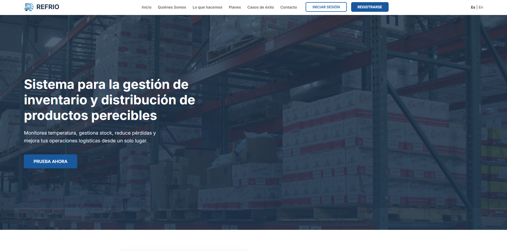
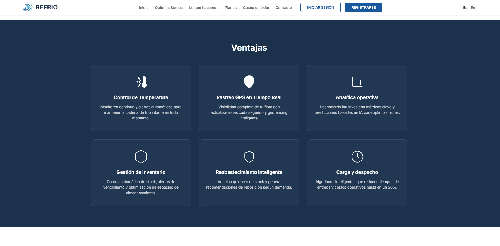
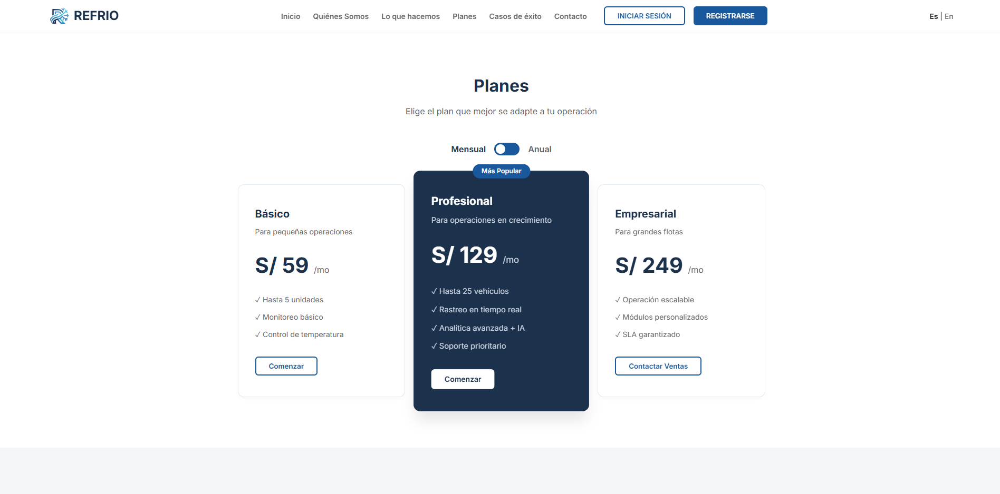
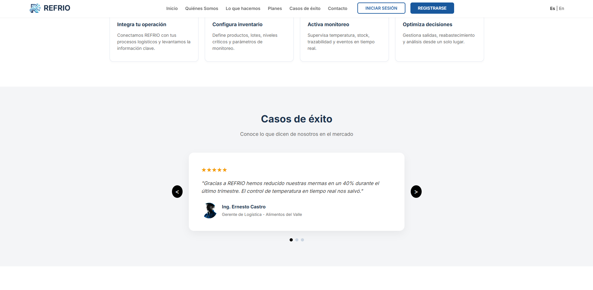
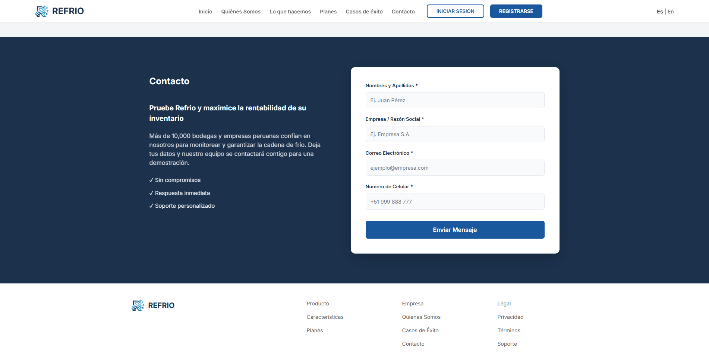
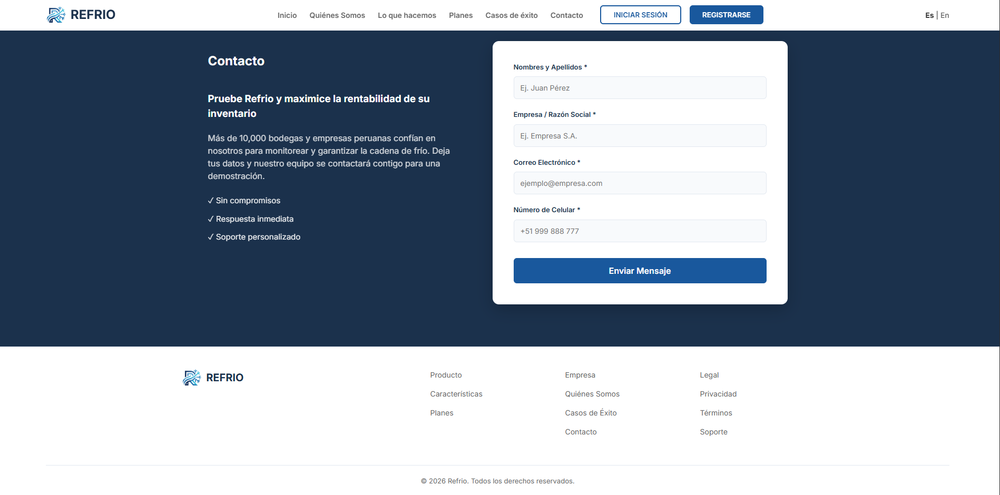


#### 5.2.1.6. Services Documentation Evidence for Sprint Review

> *Para el Sprint 1, enfocado estrictamente en la implementación, estilizado y despliegue del Landing Page estático, esta sección no aplica. La documentación formal de los Web Services y endpoints de la API RESTful (controladores de telemetría IoT, inventario FEFO y autenticación JWT) mediante OpenAPI / Swagger se desarrollará e incorporará a partir de los sprints posteriores.*


#### 5.2.1.7. Software Deployment Evidence for Sprint Review

Durante el Sprint 1 se completó el despliegue del Landing Page utilizando la infraestructura estática de GitHub Pages, siguiendo un flujo reproducible y validado sobre la rama de integración activa:

1. Se consolidaron las características desarrolladas en las distintas ramas (`feature/*`) hacia la rama `develop` mediante Pull Requests revisados por el equipo.
2. En el repositorio `refrio-website`, se ingresó a la sección `Settings > Pages`.
3. En la sección Build and deployment, se configuró la opción `Deploy from a branch`, estableciendo la rama `develop` y la carpeta raíz (`/root`) como origen de publicación.
4. El motor de GitHub Actions ejecutó automáticamente el workflow `pages build and deployment` tras la confirmación de cambios realizada por el responsable de integración (`ARivas3008`).
5. Se verificó el estado activo del servicio (`Your site is live at...`) con la directiva `Enforce HTTPS` habilitada.
6. Se auditó la carga en vivo del sitio web accediendo a la URL pública generada ([https://upc-pre-202620-1asi0729-7747-refrio.github.io/refrio-website/](https://upc-pre-202620-1asi0729-7747-refrio.github.io/refrio-website/)), validando la visualización del Hero section, la navegación responsive y la correcta resolución de estilos y assets.

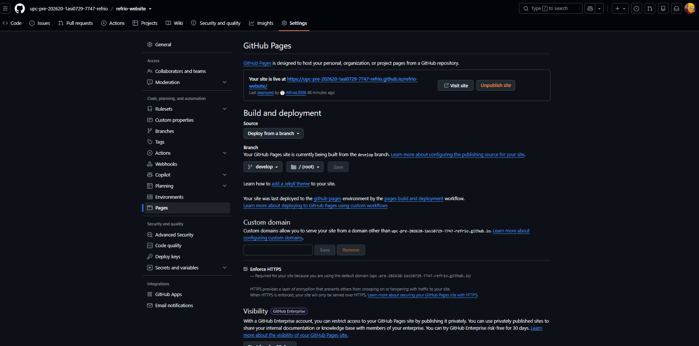
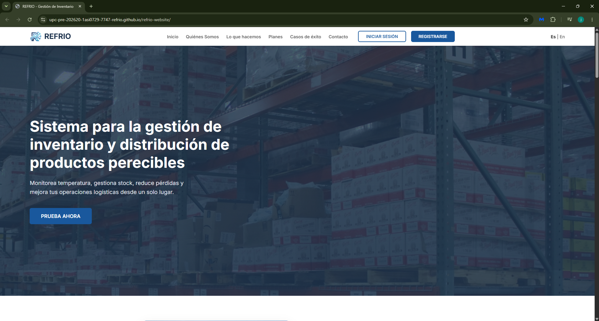


#### 5.2.1.8. Team Collaboration Insights during Sprint

Durante el Sprint 1, la colaboración técnica se gestionó a través de GitHub implementando el modelo de trabajo GitFlow. Cada incremento fue desarrollado en ramas aisladas de características (`feature/*`), las cuales fueron integradas hacia la rama `develop` mediante Pull Requests (PRs) con revisión y aprobación cruzada entre los miembros del equipo, culminando en la consolidación hacia la rama de producción `main`.

A continuación, se detalla la matriz de trazabilidad de los Pull Requests ejecutados y cerrados durante el ciclo:

| PR ID | Título del Pull Request | Rama Origen | Rama Destino | Autor (Developer) | Revisor (Reviewer) | Tareas Vinculadas | Fecha de Cierre | Merge Commit |
|:---:|:---|:---:|:---:|:---|:---|:---:|:---:|:---:|
| **#1** | `Join index` | `feature/index` | `develop` | Centeno León, Adriano | Alca Morán, César | T02, T03, T04 | `2026-09-17` | `98b1e4c` |
| **#2** | `Join styles` | `feature/styles` | `develop` | Centeno León, Adriano | Rivas Méndez, Bernie | T01 | `2026-09-17` | `f3124db` |
| **#3** | `Join translation` | `feature/translation` | `develop` | Centeno León, Adriano | Tello Lima, Jose | T06 | `2026-09-17` | `bd7d9ab` |
| **#4** | `Join terms-and-condition` | `feature/terms-and-conditions` | `develop` | Centeno León, Adriano | Saavedra Flores, Rodrigo | T05 | `2026-09-17` | `a3c91d4` |
| **#5** | `Develop` (Release to Main) | `develop` | `main` | Centeno León, Adriano | Alca Morán, César | T07 (Release v1.0.0) | `2026-09-17` | `9eb709b` |

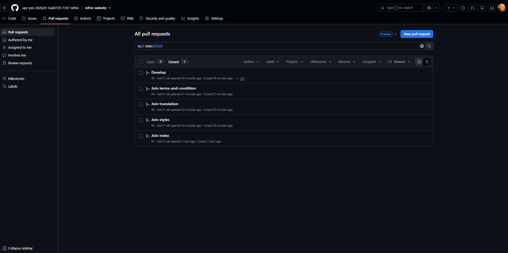

### 5.2.2. Sprint 2

#### 5.2.2.1. Sprint Planning 2

El Sprint Planning 2 se realizó al inicio de la segunda iteración del proyecto, con el equipo reunido virtualmente. Habiendo completado el Landing Page en el Sprint 1, el objetivo de este sprint es implementar y desplegar la primera versión de la **Refrio Frontend Web Application** construida con Angular 22 (versión declarada en el repositorio actual) y Angular Material, consumiendo una **Fake API desplegada en AWS EC2 (Ubuntu)** con `json-server` (IP: `3.142.114.4`), que expone los datos del dominio de Refrio. El resultado esperado al cierre del sprint es que ambos segmentos objetivo —Supervisor Logístico (Distribuidora) y Comerciante Minorista (Bodeguero)— puedan acceder a la aplicación desplegada y operar los flujos esenciales de autenticación multi-rol, alta de lotes perecibles y asignación a unidades de almacenamiento en frío.

Para garantizar rigor metodológico frente a la velocidad demostrada en el ciclo anterior (11 SP completados en el Sprint 1), el equipo formaliza su capacidad operativa diferenciando los compromisos asumidos:

| Campo | Detalle |
|---|---|
| **Sprint #** | Sprint 2 |
| **Date** | 2026-09-22 |
| **Time** | 7:00 PM |
| **Location** | Reunión virtual — Discord |
| **Prepared By** | Alca Morán, César Alejandro |
| **Attendees (to planning meeting)** | Alca Morán, César Alejandro / Centeno León, Adriano Samir / Rivas Méndez, Bernie Aarón / Saavedra Flores, Rodrigo Andree / Tello Lima, Jose Alejandro |
| **Sprint 1 Review Summary** | El Sprint 1 entregó el Landing Page de Refrio completamente implementado y desplegado en GitHub Pages ([https://upc-pre-202620-1asi0729-7747-refrio.github.io/refrio-website/](https://upc-pre-202620-1asi0729-7747-refrio.github.io/refrio-website/)). Se implementaron: Hero Section con propuesta de valor IoT, sección de planes con toggle mensual/anual, formulario de contacto B2B con validación, casos de éxito y CTA de acceso. El equipo completó los 11 SP comprometidos. Se identificaron como oportunidades de mejora: trazabilidad estricta de Conventional Commits vinculados a tareas, evidencia auditable de Pull Requests con revisión cruzada y alineación de Bounded Contexts. |
| **Sprint 1 Retrospective Summary** | El equipo valoró la comunicación fluida por Discord y la temprana distribución de aspectos. Se definieron los siguientes acuerdos de mejora para el Sprint 2: aplicar Conventional Commits asociando cada commit al ID de tarea (`T01`, `T02`...), abrir PRs con plantilla descriptiva requiriendo la aprobación técnica obligatoria de al menos un revisor antes del merge a `develop`, y mantener la correlación estricta con el Product Backlog. |
| **Sprint 2 Goal** | Our focus is on delivering the first functional version of the Refrio Web Application for both target segments, connected to a Fake API deployed on AWS EC2 (Ubuntu). We believe it delivers a tangible working demonstration of Refrio's core value — multi-role authentication, perishable batch registration with expiration dates, and cold storage allocation — to logistics supervisors and retail bodegueros. This will be confirmed when both user roles can log in, navigate their respective dashboards, and operate the core modules of the application, all through the deployed Angular frontend consuming the live API at http://3.142.114.4. |
| **Team Capacity** | 24 Story Points (Capacidad estimada para 5 integrantes en el ciclo) |
| **Historical Velocity** | 11 Story Points (Velocidad empírica demostrada en el Sprint 1) |
| **Committed Story Points** | 21 Story Points (US06: 5 SP, US07: 5 SP, US08: 3 SP, US12: 3 SP, TS03: 3 SP, Tareas Técnicas Frontend: 2 SP) |
| **Completed Story Points** | 21 Story Points (100% del alcance planificado para la entrega TB1) |

---

#### 5.2.2.2. Aspect Leaders and Collaborators

Los aspectos de este Sprint se organizan en torno a los módulos funcionales del proyecto Angular alineados con los Bounded Contexts del dominio de Refrio y la infraestructura de servicios simulados en AWS EC2:

| Team Member (Last Name, First Name) | GitHub Username | IAM & Auth Module (US06, US07, US08) | Inventory Management (US12, US14) | Fake API AWS EC2 & Testing (TS02, TS03) | Frontend Architecture & Deploy (TS01, US01) |
|---|---|:---:|:---:|:---:|:---:|
| Alca Morán, César Alejandro | `almocesar-cell` | **L** | C | **L** | C |
| Centeno León, Adriano Samir | `Adri11-dk` | C | **L** | C | C |
| Rivas Méndez, Bernie Aarón | `Arivas3008` | C | C | C | **L** |
| Saavedra Flores, Rodrigo Andree | `rodrigoxd67` | C | C | **L** | C |
| Tello Lima, Jose Alejandro | `j4ndrow` | **L** | C | C | **L** |

> **L = Leader | C = Collaborator**

La estructura de liderazgo define la responsabilidad sobre la arquitectura de componentes, consumo de servicios REST en `http://3.142.114.4` y la revisión técnica de Pull Requests antes de su integración a `develop`.

---

#### 5.2.2.3. Sprint Backlog 2

La reconstrucción del trabajo ejecutado se basa en las versiones, Pull Requests y commits de la iteración. Los identificadores S2-T son referencias documentales de esta conciliación; las horas son estimaciones de esfuerzo, no horas registradas. Los nombres de autores o integradores se consignan conforme a los commits/PR o las asignaciones previas del informe; la autoría de un PR no demuestra autoría exclusiva de sus archivos. Se marca **Done** únicamente el work-item delimitado que está implementado o cuyo resultado de automatización está acreditado.

| Story ID(s) | Work-Item ID | Título | Descripción del resultado | Est. (h) | Responsable / referencia | Estado | Evidencia |
|---|---|---|---|---:|---|---|---|
| US06, US07, US08, US09 | S2-T01 | IAM frontend | Formularios de registro, acceso, recuperación inicial, estado de sesión y guardias | 6 | Equipo IAM; integración Centeno | Done | [PR #6](https://github.com/upc-pre-202620-1asi0729-7747-refrio/refrio-frontend/pull/6) · [804312d](https://github.com/upc-pre-202620-1asi0729-7747-refrio/refrio-frontend/commit/804312d) |
| US11, US12, US14, US15, US16, US29, US37 | S2-T02 | Inventory frontend | Vistas de inventario, registro de productos y lotes, detalle y mermas; alcance de interfaz | 8 | Equipo Inventory; integración Centeno | Done | [PR #7](https://github.com/upc-pre-202620-1asi0729-7747-refrio/refrio-frontend/pull/7) · [804312d](https://github.com/upc-pre-202620-1asi0729-7747-refrio/refrio-frontend/commit/804312d) |
| US17, US18, US19, US20, US21 | S2-T03 | Telemetría de prototipo | Modelos y store con lecturas de demostración y corrección; rama histórica, no sensor real | 5 | Rivas (PR) | Done | [PR #1](https://github.com/upc-pre-202620-1asi0729-7747-refrio/refrio-frontend/pull/1) · [PR #2](https://github.com/upc-pre-202620-1asi0729-7747-refrio/refrio-frontend/pull/2) |
| US23, US24, US25, US27, US28, US31 | S2-T04 | Alerting frontend | Construcción de vistas y modelos de alertas e incidentes | 6 | Equipo Alerting; integración Centeno | Done | [PR #9](https://github.com/upc-pre-202620-1asi0729-7747-refrio/refrio-frontend/pull/9) · [804312d](https://github.com/upc-pre-202620-1asi0729-7747-refrio/refrio-frontend/commit/804312d) |
| US38, US39, TS09 | S2-T05 | Analytics frontend | Vistas y modelos de métricas operativas | 5 | Equipo Analytics; integración Centeno | Done | [PR #10](https://github.com/upc-pre-202620-1asi0729-7747-refrio/refrio-frontend/pull/10) · [804312d](https://github.com/upc-pre-202620-1asi0729-7747-refrio/refrio-frontend/commit/804312d) |
| US34, US36, TS08 | S2-T06 | Traceability frontend | Modelo de certificado y store de consulta de trazabilidad inicial | 5 | Equipo Traceability; integración Centeno | Done | [PR #11](https://github.com/upc-pre-202620-1asi0729-7747-refrio/refrio-frontend/pull/11) |
| US30, US33, US05 | S2-T07 | Shared y navegación operativa | Construir layout y vistas de envíos, proveedores, historial y dashboards | 8 | Tello / equipo Shared | Done | [PR #5](https://github.com/upc-pre-202620-1asi0729-7747-refrio/refrio-frontend/pull/5) · [804312d](https://github.com/upc-pre-202620-1asi0729-7747-refrio/refrio-frontend/commit/804312d) |
| US03 | S2-T08 | Public Portal frontend | Modelo de lead y store inicial | 4 | Tello / Rivas | Done | [PR #4](https://github.com/upc-pre-202620-1asi0729-7747-refrio/refrio-frontend/pull/4) · [6ad12eb](https://github.com/upc-pre-202620-1asi0729-7747-refrio/refrio-frontend/commit/6ad12eb) |
| TS01, TS02, TS03 | S2-T09 | Configuración inicial de servicios | Entorno, contrato simulado y despliegue SPA; no equivale a backend Spring Boot | 5 | Tello / Rivas | Done | [804312d](https://github.com/upc-pre-202620-1asi0729-7747-refrio/refrio-frontend/commit/804312d) · [00b716b](https://github.com/upc-pre-202620-1asi0729-7747-refrio/refrio-frontend/commit/00b716b) · [PR #17](https://github.com/upc-pre-202620-1asi0729-7747-refrio/refrio-frontend/pull/17) |
| US05 | S2-T10 | Build y despliegue frontend | Integración de ramas y workflow GitHub Pages | 4 | Rivas / Centeno (integración) | Done | [PR #13](https://github.com/upc-pre-202620-1asi0729-7747-refrio/refrio-frontend/pull/13) · [PR #17](https://github.com/upc-pre-202620-1asi0729-7747-refrio/refrio-frontend/pull/17) · [GitHub Actions #37583830389](https://github.com/upc-pre-202620-1asi0729-7747-refrio/refrio-frontend/actions/runs/37583830389) |

**Resultado del trabajo identificado:** 10 paquetes de trabajo Done; 56 horas estimadas. No se suman Story Points por tarea ni se duplica una historia por haber tenido una fase de diseño, implementación e integración.

**Trazabilidad de historias originales.** La asignación primaria se establece retrospectivamente según la etapa en que se materializó su alcance principal; el sprint del Product Backlog inicial se conserva para que no se confunda la planificación histórica con la ejecución. Las historias cuya implementación específica no pudo localizarse permanecen en la etapa de referencia original. El estado al cierre es el declarado para TB2; la columna de verificación registra por separado el alcance respaldado por las fuentes.

| ID | Historia original | SP | Sprint original | Alcance observado en la release / diferencia | Estado TB2 (declarado) | Verificación de criterios originales | Fuente |
|---|---|---:|---:|---|---|---|---|
| US08 | Inicio de Sesión Multi-rol | 3 | 1 | Autenticar usuarios, proteger rutas y emitir sesión JWT — Código acredita autenticación, roles y respuesta 401; conservar prueba de ejecución final. | Done | Correspondencia sustantiva | [F: iam.store.ts](https://github.com/upc-pre-202620-1asi0729-7747-refrio/refrio-frontend/blob/7fae0efb35b8d050ff9102534a5656bc0bb2050d/src/app/iam/application/iam.store.ts)<br>[F: iam.guard.ts](https://github.com/upc-pre-202620-1asi0729-7747-refrio/refrio-frontend/blob/7fae0efb35b8d050ff9102534a5656bc0bb2050d/src/app/iam/infrastructure/iam.guard.ts)<br>[B: IamController.java](https://github.com/upc-pre-202620-1asi0729-7747-refrio/refrio-backend/blob/e0e3c9eadc70d27922ccc5b26cd163ecd3622c2d/src/main/java/com/refrio/platform/iam/interfaces/rest/IamController.java)<br>[B: AuthenticationIntegrationTest.java](https://github.com/upc-pre-202620-1asi0729-7747-refrio/refrio-backend/blob/e0e3c9eadc70d27922ccc5b26cd163ecd3622c2d/src/test/java/com/refrio/platform/iam/AuthenticationIntegrationTest.java) |
| US06 | Registro de Distribuidora Mediana | 5 | 2 | Implementar registro de usuario Supervisor y datos de sede — Registro por rol y sede; no se acredita RUC único, razón social ni correo de bienvenida. | Done | Cobertura parcial | [F: sign-up-form.ts](https://github.com/upc-pre-202620-1asi0729-7747-refrio/refrio-frontend/blob/7fae0efb35b8d050ff9102534a5656bc0bb2050d/src/app/iam/presentation/views/sign-up-form/sign-up-form.ts)<br>[B: IamController.java](https://github.com/upc-pre-202620-1asi0729-7747-refrio/refrio-backend/blob/e0e3c9eadc70d27922ccc5b26cd163ecd3622c2d/src/main/java/com/refrio/platform/iam/interfaces/rest/IamController.java) |
| US07 | Registro de Comerciante Minorista (Bodega) | 5 | 2 | Habilitar registro Minorista con usuario, correo y contraseña — Registro Minorista presente; no se acredita verificación mediante código SMS. | Done | Cobertura parcial | [F: sign-up-form.ts](https://github.com/upc-pre-202620-1asi0729-7747-refrio/refrio-frontend/blob/7fae0efb35b8d050ff9102534a5656bc0bb2050d/src/app/iam/presentation/views/sign-up-form/sign-up-form.ts)<br>[B: IamApplicationService.java](https://github.com/upc-pre-202620-1asi0729-7747-refrio/refrio-backend/blob/e0e3c9eadc70d27922ccc5b26cd163ecd3622c2d/src/main/java/com/refrio/platform/iam/application/IamApplicationService.java) |
| US12 | Alta de Lote Perecible (Batch) | 3 | 2 | Registrar lote con cantidad, fechas, ubicación y actualización de stock — Alta y stock transaccional presentes; verificar rechazo de vencidos en todos los contratos (el servicio tipado no comprueba explícitamente fecha actual). | Done | Cobertura parcial | [F: inventory-detail.ts](https://github.com/upc-pre-202620-1asi0729-7747-refrio/refrio-frontend/blob/7fae0efb35b8d050ff9102534a5656bc0bb2050d/src/app/inventory/presentation/views/inventory-detail/inventory-detail.ts)<br>[B: InventoryCommandService.java](https://github.com/upc-pre-202620-1asi0729-7747-refrio/refrio-backend/blob/e0e3c9eadc70d27922ccc5b26cd163ecd3622c2d/src/main/java/com/refrio/platform/inventory/application/InventoryCommandService.java) |
| US14 | Asignación de Lote a Unidad de Almacenamiento | 5 | 2 | Registrar ubicación de lote y sede en inventario — Campo location presente; capacidad física, mantenimiento y asociación a cámara no acreditados. | Done | Cobertura parcial | [F: operations.rules.ts](https://github.com/upc-pre-202620-1asi0729-7747-refrio/refrio-frontend/blob/7fae0efb35b8d050ff9102534a5656bc0bb2050d/src/app/operations/domain/operations.rules.ts)<br>[B: StockBatch.java](https://github.com/upc-pre-202620-1asi0729-7747-refrio/refrio-backend/blob/e0e3c9eadc70d27922ccc5b26cd163ecd3622c2d/src/main/java/com/refrio/platform/inventory/domain/model/aggregates/StockBatch.java) |
| US11 | Registro de Categoría de Alimento | 2 | 2 | Registrar categoría al crear/editar producto — Categoría presente; catálogo corporativo con límites configurables y validación de mínimo/máximo no acreditado. | Done | Cobertura parcial | [F: inventory-list.ts](https://github.com/upc-pre-202620-1asi0729-7747-refrio/refrio-frontend/blob/7fae0efb35b8d050ff9102534a5656bc0bb2050d/src/app/inventory/presentation/views/inventory-list/inventory-list.ts)<br>[B: InventoryCommandService.java](https://github.com/upc-pre-202620-1asi0729-7747-refrio/refrio-backend/blob/e0e3c9eadc70d27922ccc5b26cd163ecd3622c2d/src/main/java/com/refrio/platform/inventory/application/InventoryCommandService.java) |
| US17 | Vinculación de Nodo Sensor IoT | 3 | 2 | Lectura por producto no equivale a emparejamiento de sensor; no se encontró implementación específica. Existe un modelo de demostración en feature/telemetry, pero no emparejamiento operativo. | Done | No incorporado / no acreditado | [B: TemperatureReading.java](https://github.com/upc-pre-202620-1asi0729-7747-refrio/refrio-backend/blob/e0e3c9eadc70d27922ccc5b26cd163ecd3622c2d/src/main/java/com/refrio/platform/inventory/domain/model/aggregates/TemperatureReading.java) · [PR #2](https://github.com/upc-pre-202620-1asi0729-7747-refrio/refrio-frontend/pull/2) |
| US15 | Parametrización de Ventana Crítica de Expiración | 2 | 2 | Calcular vencimiento próximo y alertas por fechas — Ventanas fijas de 3/7 días; no se acredita edición persistente por categoría ni validación de días positivos. | Done | Cobertura parcial | [F: inventory-list.ts](https://github.com/upc-pre-202620-1asi0729-7747-refrio/refrio-frontend/blob/7fae0efb35b8d050ff9102534a5656bc0bb2050d/src/app/inventory/presentation/views/inventory-list/inventory-list.ts)<br>[F: operational-monitoring.service.ts](https://github.com/upc-pre-202620-1asi0729-7747-refrio/refrio-frontend/blob/7fae0efb35b8d050ff9102534a5656bc0bb2050d/src/app/events/application/operational-monitoring.service.ts) |
| US16 | Ajuste Manual de Inventario por Daño Físico | 2 | 2 | Descontar unidades por merma justificada y validar saldo — Débito de lote, causa, persistencia y control de cantidad; escenario de saldo insuficiente comprobable con pruebas de dominio. | Done | Correspondencia sustantiva | [F: inventory-batch-detail.ts](https://github.com/upc-pre-202620-1asi0729-7747-refrio/refrio-frontend/blob/7fae0efb35b8d050ff9102534a5656bc0bb2050d/src/app/inventory/presentation/views/inventory-batch-detail/inventory-batch-detail.ts)<br>[B: InventoryCommandService.java](https://github.com/upc-pre-202620-1asi0729-7747-refrio/refrio-backend/blob/e0e3c9eadc70d27922ccc5b26cd163ecd3622c2d/src/main/java/com/refrio/platform/inventory/application/InventoryCommandService.java)<br>[B: StockBatch.java](https://github.com/upc-pre-202620-1asi0729-7747-refrio/refrio-backend/blob/e0e3c9eadc70d27922ccc5b26cd163ecd3622c2d/src/main/java/com/refrio/platform/inventory/domain/model/aggregates/StockBatch.java) |
| US18 | Ingesta y Monitoreo de Temperatura en Vivo | 5 | 2 | Actualizar datos periódicamente y mostrar alertas térmicas — Polling HTTP cada 5 s y lecturas manuales; no se acredita sensor MQTT ni desconexión a los diez minutos. | Done | Cobertura parcial | [F: operations-api.service.ts](https://github.com/upc-pre-202620-1asi0729-7747-refrio/refrio-frontend/blob/7fae0efb35b8d050ff9102534a5656bc0bb2050d/src/app/operations/application/operations-api.service.ts)<br>[F: operational-monitoring.service.ts](https://github.com/upc-pre-202620-1asi0729-7747-refrio/refrio-frontend/blob/7fae0efb35b8d050ff9102534a5656bc0bb2050d/src/app/events/application/operational-monitoring.service.ts)<br>[B: InventoryCommandService.java](https://github.com/upc-pre-202620-1asi0729-7747-refrio/refrio-backend/blob/e0e3c9eadc70d27922ccc5b26cd163ecd3622c2d/src/main/java/com/refrio/platform/inventory/application/InventoryCommandService.java) |
| US19 | Configuración de Umbrales Térmicos por Cámara | 3 | 2 | Aplicar límites de temperatura por categoría — Reglas por categoría en código; no se acredita edición por cámara ni persistencia del rango personalizado. | Done | Cobertura parcial | [F: operational-monitoring.service.ts](https://github.com/upc-pre-202620-1asi0729-7747-refrio/refrio-frontend/blob/7fae0efb35b8d050ff9102534a5656bc0bb2050d/src/app/events/application/operational-monitoring.service.ts) (temperatureRange) |
| US20 | Historial Gráfico de Telemetría | 5 | 2 | Conservar lecturas con fecha, producto y valor — Persistencia de lecturas; gráfico por cámara de 24 h con zona segura y discontinuidades no acreditado. | Done | Cobertura parcial | [B: TemperatureReading.java](https://github.com/upc-pre-202620-1asi0729-7747-refrio/refrio-backend/blob/e0e3c9eadc70d27922ccc5b26cd163ecd3622c2d/src/main/java/com/refrio/platform/inventory/domain/model/aggregates/TemperatureReading.java)<br>[B: InventoryCommandService.java](https://github.com/upc-pre-202620-1asi0729-7747-refrio/refrio-backend/blob/e0e3c9eadc70d27922ccc5b26cd163ecd3622c2d/src/main/java/com/refrio/platform/inventory/application/InventoryCommandService.java) |
| US21 | Calibración de Sensores Térmicos | 3 | 2 | No se encontró modelo de sensor ni aplicación de offset ±5 °C. El prototipo histórico usa offset en lecturas mock; no persiste calibraciones reales. | Done | No incorporado / no acreditado | [B: TemperatureReading.java](https://github.com/upc-pre-202620-1asi0729-7747-refrio/refrio-backend/blob/e0e3c9eadc70d27922ccc5b26cd163ecd3622c2d/src/main/java/com/refrio/platform/inventory/domain/model/aggregates/TemperatureReading.java) · [PR #2](https://github.com/upc-pre-202620-1asi0729-7747-refrio/refrio-frontend/pull/2) |
| US31 | Semáforo Visual de Frescura para Bodegas | 3 | 3 | Clasificar riesgo por caducidad y presentar avisos visuales — Alertas por vencimiento y prioridad presentes; comprobar semáforo exacto, navegación y recomendación de oferta. | Done | Cobertura parcial | [F: operational-monitoring.service.ts](https://github.com/upc-pre-202620-1asi0729-7747-refrio/refrio-frontend/blob/7fae0efb35b8d050ff9102534a5656bc0bb2050d/src/app/events/application/operational-monitoring.service.ts)<br>[F: dashboard.html](https://github.com/upc-pre-202620-1asi0729-7747-refrio/refrio-frontend/blob/7fae0efb35b8d050ff9102534a5656bc0bb2050d/src/app/shared/presentation/views/dashboard/dashboard.html) |
| US25 | Alerta Sonora en Teléfono Móvil de Bodega | 3 | 4 | Mostrar aviso de vencimiento en dashboard Minorista — Aviso visual presente; no se acredita sonido ni cola de modo no molestar. | Done | Cobertura parcial | [F: dashboard.ts](https://github.com/upc-pre-202620-1asi0729-7747-refrio/refrio-frontend/blob/7fae0efb35b8d050ff9102534a5656bc0bb2050d/src/app/shared/presentation/views/dashboard/dashboard.ts)<br>[F: operational-monitoring.service.ts](https://github.com/upc-pre-202620-1asi0729-7747-refrio/refrio-frontend/blob/7fae0efb35b8d050ff9102534a5656bc0bb2050d/src/app/events/application/operational-monitoring.service.ts) |

**Trazabilidad primaria:** 15 historias; 52 SP del alcance original, no velocidad ejecutada.

#### 5.2.2.4. Development Evidence for Sprint Review — rectificación de evidencias

La aplicación existente se revisó contra los archivos públicos actuales: `refrio-frontend/package.json` declara Angular `^22.2.3`, y `src/app/app.routes.ts` contiene rutas de IAM, inventario, envíos, proveedores, alertas, analítica y eventos. No se encontró la dependencia directa `@angular/material` en dicho `package.json`. Por tanto, las menciones anteriores a "Angular 22 (versión declarada en el repositorio actual) con Angular Material" no describen fielmente la revisión del repositorio actual; deben entenderse como afirmaciones históricas sin soporte de esa versión.

El Sprint 2 documentó una API de demostración basada en `json-server`. La migración a Spring Boot/Java corresponde a una línea de trabajo posterior y no convierte retroactivamente las respuestas de la Fake API en respuestas de una API de producción.

La versión anterior del informe contenía supuestos identificadores de commits que no son SHA hexadecimales válidos. Esa tabla se retira en esta revisión, y se reemplaza por la evidencia verificable siguiente:

| Verificación | Fuente verificable | Resultado documental | Evidencia restante |
|---|---|---|---|
| Existencia de frontend | [Repositorio Angular](https://github.com/upc-pre-202620-1asi0729-7747-refrio/refrio-frontend) | Fuente disponible | Build y capturas fechadas |
| Versión de Angular | `package.json` (dependencias `@angular/*: ^22.2.3`) | Versión declarada en código | Build ejecutado y lockfile |
| Rutas principales | `src/app/app.routes.ts` | Rutas declaradas | Navegación real por rol |
| API de datos de TB1 | `db.json` y `json-server` | Demo documentada | URI vigente, HTTPs y smoke test |
| Commits por Engineering Task | Historia y PR de GitHub | **No verificado desde tabla anterior** | Commit SHA real/URL por tarea |
| Cobertura de User Flows | User Flows documentados en el informe | Mapeo estático | Video de cada recorrido y caso alternativo |

**Registro pendiente por tarea:** T01–T13 → rama real → SHA real → PR real → revisor → prueba → resultado. No se presentan IDs ficticios ni se afirma que todos los PR fueron aprobados sin evidencia.

#### 5.2.2.5. Execution Evidence for Sprint Review


Al cierre del Sprint 2, se cuenta con la primera versión funcional de la Refrio Frontend Web Application desplegada y accesible públicamente, conectada a la Fake API en producción (AWS EC2, IP pública: `3.142.114.4`). A continuación se describen las principales vistas implementadas por módulo:

**Módulo IAM (Identity & Access Management)**
Se implementaron tres flujos de autenticación. El `LoginComponent` permite el acceso unificado mediante email y contraseña; el sistema consulta `GET /users` en la Fake API de AWS, valida las credenciales contra los registros existentes (usuario Supervisor: `admin@refrio.com` / `admin`; usuario Minorista: `bodega@refrio.com` / `bodega`) y redirige automáticamente al dashboard correspondiente al rol del usuario. El `RegisterComponent` permite crear nuevos usuarios mediante `POST /users`. El `ProfileComponent` muestra los datos del usuario autenticado (nombre, rol, plan de suscripción, sede) recuperados de `localStorage`.

**Módulo Inventory — Vista Supervisor Logístico**
El `InventoryListComponent` muestra la tabla de inventario del segmento Supervisor consumiendo `GET /inventory` desde AWS. Los productos se ordenan por fecha de caducidad ascendente (criterio FEFO): Fresh Strawberries (caducidad 2026-04-28), Organic Lettuce (2026-04-25) y Fresh Milk (2026-04-24) aparecen con sus respectivos badges de color de frescura (rojo para <3 días, amarillo para 3–7 días, verde para >7 días) calculados dinámicamente en el frontend. El `BatchListComponent` muestra los lotes de `GET /batches`: BT-4501 con estado "Vender ya" (badge rojo, vence 2026-04-28), BT-4512 con "En espera" (badge amarillo) y BT-4530 con "Fresh" (badge verde).

**Módulo Inventory — Vista Bodeguero (Minorista)**
El `BodegueroInventoryComponent` consume `GET /bodeguero-inventory` y presenta los productos propios del segmento minorista en tarjetas: Coca Cola 500ml (Bebidas, 50 unidades, 7°C), Helado D'Onofrio (Congelados, -18°C), Fresh Milk (Dairy), Cheese y Dulce de leche. Cada tarjeta muestra el semáforo de frescura y el almacén asignado, con un botón para registrar nuevo producto.

**Módulo Alerting**
El `AlertListComponent` consume `GET /alerts` y presenta las 7 alertas activas del sistema con sus badges de severidad: 2 alertas Critical (Temperature en Warehouse North y Cold Chain Breach en tránsito), 4 alertas Medium (Delayed Shipment, Low Stock Warning, Telemetry Loss, Maintenance Suggested) y 1 alerta Low (Approaching Delivery). El número de alertas críticas se muestra como badge rojo en el ícono del sidebar de navegación.

**Módulo Telemetry — Dashboard Principal**
El `TelemetryDashboardComponent` presenta cuatro KPI cards que cruzan datos de múltiples endpoints: temperatura activa monitoreada (de `/inventory`), alertas activas totales (de `/alerts`), envíos en tránsito (de `/shipments`) y lotes por vencer (de `/batches`). Los datos se obtienen en paralelo con `forkJoin` de RxJS para optimizar el tiempo de carga.

**Módulo Traceability — Seguimiento de Envíos**
El `ShipmentListComponent` consume `GET /shipments` y muestra los 5 envíos activos: FK-1023 (Berries Lima→Surco, 3°C, In Transit), FK-1024 (Lettuce Callao→Miraflores, Delivered), FK-1025 (Dairy Lima→San Isidro, Delayed), FK-1026 (Chicken Surco→Barranco, In Transit) y FK-1027 (Frozen Shrimp -18°C, In Transit). Los badges de estado diferencian visualmente el estado de cada envío.

**Módulo Analytics — Clientes y Proveedores**
El `ClientListComponent` muestra los 5 clientes registrados (consumiendo `GET /clients`): Bodega San José, Minimarket El Sol, Distribuidora Central Lima, Supermercado La Esquina y Bodega Doña Rosa, con sus respectivos tipos de negocio y número de pedidos. El `SupplierListComponent` muestra los 7 proveedores de `GET /suppliers`, incluyendo los registrados dinámicamente (Andrés S.A.C y Pedrito S.A.C, agregados vía `POST /suppliers`), con badges de rating y un modal para registro de nuevos proveedores.

**Enlace al video de navegación del Sprint 2:** [Ver demostración de Refrio — Sprint 2](https://upcedupe-my.sharepoint.com/:v:/g/personal/u20241d811_upc_edu_pe/IQDFS9viyA1ZToIoZGzYmzhOAR4tEmknvDD_W2eJ9p4jrQg?e=Zn1kC3&nav=eyJyZWZlcnJhbEluZm8iOnsicmVmZXJyYWxBcHAiOiJTdHJlYW1XZWJBcHAiLCJyZWZlcnJhbFZpZXciOiJTaGFyZURpYWxvZy1MaW5rIiwicmVmZXJyYWxBcHBQbGF0Zm9ybSI6IldlYiIsInJlZmVycmFsTW9kZSI6InZpZXcifX0%3D)
---

#### 5.2.2.6. Services Documentation Evidence for Sprint Review

> **Alcance del servicio:** esta sección describe exclusivamente la Fake API `json-server` usada para demostración TB1; no equivale al backend Spring Boot/Java, al esquema JPA ni a Swagger de una versión posterior.


Para el Sprint 2, los Web Services corresponden a la **Fake API implementada con json-server** desplegada en una instancia **AWS EC2 (Ubuntu 22.04, t2.micro)** con IP pública `3.142.114.4`, accesible mediante el protocolo HTTP en el puerto 80. Esta API expone las mismas colecciones y estructura de datos del archivo `db.json` que reside en el repositorio del frontend, garantizando la alineación entre el código fuente y los datos en producción. Todos los endpoints soportan las operaciones estándar de json-server: `GET`, `POST`, `PUT`, `PATCH` y `DELETE`.

**URL base de la Fake API (producción):** `http://3.142.114.4`

**Repositorio del Frontend:** [https://github.com/upc-pre-202620-1asi0729-7747-refrio/refrio-frontend.git](https://github.com/upc-pre-202620-1asi0729-7747-refrio/refrio-frontend.git)

| Bounded Context | Endpoint | Verbo HTTP | Descripción | Parámetros soportados | Ejemplo de Response |
|---|---|---|---|---|---|
| IAM | `GET /users` | GET | Retorna todos los usuarios registrados. Usado para autenticación simulada filtrando por email y password. | Query: `?email=`, `?password=`, `?role=` | `[{ "id": "1", "username": "admin", "email": "admin@refrio.com", "role": "Supervisor", "subscriptionPlan": "Profesional", "sede": "Lima Central", "token": "mock-jwt-token-distrib" }]` |
| IAM | `POST /users` | POST | Registra un nuevo usuario en el sistema. | Body: `{ username, password, email, firstName, lastName, role, subscriptionPlan, sede }` | `{ "id": "3", "username": "nuevo", "email": "nuevo@refrio.com", "role": "Supervisor" }` |
| Inventory & FEFO | `GET /inventory` | GET | Retorna el inventario de productos del Supervisor Logístico, ordenado por fecha de caducidad. | Query: `?category=`, `?warehouse=`, `?_sort=exp&_order=asc` | `[{ "id": "PRD-001", "name": "Fresh Strawberries", "category": "Fruits", "stock": "450", "temp": "3°C", "exp": "2026-04-28", "warehouse": "Lima Central" }]` |
| Inventory & FEFO | `POST /inventory` | POST | Registra un nuevo producto en el inventario del Supervisor. | Body: `{ name, category, stock, temp, exp, warehouse }` | `{ "id": "PRD-004", "name": "Nuevo Producto", "category": "...", "stock": "...", "exp": "..." }` |
| Inventory & FEFO | `GET /batches` | GET | Retorna los lotes de productos perecibles con su estado FEFO y ubicación en almacén. | Query: `?status=`, `?supplier=`, `?productId=` | `[{ "id": "BT-4501", "productId": "PRD-001", "quantity": "150", "weight": "300 kg", "receptionDate": "2026-04-10", "expirationDate": "2026-04-28", "supplier": "Fresh Farms Co.", "location": "Rampa 01", "status": "Vender ya" }]` |
| Inventory & FEFO | `PATCH /batches/:id` | PATCH | Actualiza el estado de un lote (ej. de "En espera" a "Vender ya" o "Descartado"). | Path: `id` / Body: `{ status }` | `{ "id": "BT-4512", "status": "Vender ya" }` |
| Inventory Minorista | `GET /bodeguero-inventory` | GET | Retorna el inventario del segmento Minorista (bodegueros). Colección separada del inventario de distribuidoras. | Query: `?category=`, `?warehouse=` | `[{ "id": "PRD-001", "name": "Coca Cola 500ml", "category": "Bebidas", "stock": "50", "temp": "7°C", "exp": "2026-12-01", "warehouse": "Bodega Principal", "status": "Active" }]` |
| Inventory Minorista | `POST /bodeguero-inventory` | POST | Registra un nuevo producto en el inventario del bodeguero. | Body: `{ name, category, stock, temp, exp, warehouse }` | `{ "id": "PRD-006", "name": "Nuevo", "category": "...", "stock": "...", "exp": "..." }` |
| Alerting | `GET /alerts` | GET | Retorna todas las alertas activas del sistema ordenadas por severidad. | Query: `?severity=`, `?location=` | `[{ "id": "ALT-2841", "type": "Temperature", "time": "2h ago", "location": "Warehouse North", "severity": "Critical" }]` |
| Alerting | `POST /alerts` | POST | Crea una nueva alerta en el sistema. | Body: `{ type, time, location, severity }` | `{ "id": "ALT-2842", "type": "...", "severity": "..." }` |
| Traceability & Shipments | `GET /shipments` | GET | Retorna todos los envíos activos con ruta, temperatura de transporte y estado. | Query: `?status=`, `?driver=` | `[{ "id": "FK-1023", "product": "Berries", "route": "Lima → Surco", "temperature": "3°C", "eta": "12:30 PM", "status": "In Transit", "driver": "Juan Pérez", "vehicle": "REF-001" }]` |
| Traceability & Shipments | `PATCH /shipments/:id` | PATCH | Actualiza el estado de un envío (ej. de "In Transit" a "Delivered"). | Path: `id` / Body: `{ status }` | `{ "id": "FK-1025", "status": "Delivered" }` |
| Analytics — Clients | `GET /clients` | GET | Retorna el listado de clientes registrados con tipo de negocio y número de pedidos. | Query: `?type=`, `?province=` | `[{ "id": "CLI-001", "name": "Bodega San José", "type": "Bodega", "orders": 48, "province": "Lima", "district": "Surco" }]` |
| Analytics — Suppliers | `GET /suppliers` | GET | Retorna el listado de proveedores con categoría, historial de entregas y rating de calidad. | Query: `?category=` | `[{ "id": "SUP-001", "name": "Fresh Farms Co.", "category": "Fruits & Vegetables", "deliveries": 48, "score": 98, "rating": "4.8" }]` |
| Analytics — Suppliers | `POST /suppliers` | POST | Registra un nuevo proveedor en el sistema. | Body: `{ code, name, category, deliveries, score, rating }` | `{ "id": "7hnJSU1tMsw", "name": "Andrés S.A.C", "category": "Lácteos", "rating": "5.0" }` |

*Nota: La documentación formal en OpenAPI/Swagger sobre el backend real en Spring Boot se implementará en AV2. En este sprint, la Fake API expone los mismos contratos de request/response que serán respetados por el backend de producción, garantizando que la integración del frontend no requiera cambios cuando se sustituya la Fake API.*

---

#### 5.2.2.7. Software Deployment Evidence for Sprint Review


Durante el Sprint 2 se gestionaron tres despliegues: la Fake API en AWS EC2, la Frontend Web Application en GitHub Pages, y la actualización del Landing Page.

**1. Fake API (json-server) — AWS EC2 Ubuntu**

Se aprovisionó una instancia EC2 de Amazon Web Services con sistema operativo Ubuntu 22.04 LTS (tipo t2.micro, capa gratuita). La configuración del Security Group de la instancia habilitó el tráfico HTTP entrante en el puerto 80 desde cualquier IP (`0.0.0.0/0`), permitiendo que la Web Application Angular consuma la API desde cualquier cliente. Se instalaron Node.js y json-server en la instancia, y se desplegó el archivo `db.json` del proyecto con las ocho colecciones del dominio de Refrio.

Pasos realizados:
1. Lanzamiento de instancia EC2: AWS Console → EC2 → Launch Instance → Ubuntu Server 22.04 LTS (t2.micro). Se generó un par de claves `.pem` para acceso SSH.
2. Configuración del Security Group: se agregó regla de entrada HTTP (puerto 80, TCP, fuente 0.0.0.0/0).
3. Conexión SSH: `ssh -i refrio-key.pem ubuntu@3.142.114.4`.
4. Instalación de Node.js: `curl -fsSL https://deb.nodesource.com/setup_18.x | sudo -E bash - && sudo apt-get install -y nodejs`.
5. Instalación de json-server: `sudo npm install -g json-server`.
6. Transferencia del `db.json` al servidor mediante SCP.
7. Inicio del servidor: `sudo json-server --watch db.json --port 80 --host 0.0.0.0`.
8. Verificación de endpoints: `curl http://3.142.114.4/users` y endpoints restantes.

**URL histórica declarada para la Fake API (estado actual sin verificar):** `http://3.142.114.4`

Endpoints verificados y activos:
- `http://3.142.114.4/users`
- `http://3.142.114.4/inventory`
- `http://3.142.114.4/alerts`
- `http://3.142.114.4/shipments`
- `http://3.142.114.4/clients`
- `http://3.142.114.4/suppliers`
- `http://3.142.114.4/bodeguero-inventory`
- `http://3.142.114.4/batches`

**2. Frontend Web Application (Angular) — GitHub Pages**

Se utilizó la herramienta `angular-cli-ghpages` para desplegar el build de producción Angular directamente en GitHub Pages desde el repositorio `refrio-frontend` de la organización. Se configuró el `base-href` con el nombre del repositorio para que el enrutamiento de Angular SPA funcione correctamente desde la URL de GitHub Pages.

Pasos realizados:
1. Instalación de la herramienta de despliegue: `ng add angular-cli-ghpages`.
2. Build de producción: `ng build --configuration production`.
3. Despliegue: `npx ng deploy --base-href=/refrio-frontend/`.
4. GitHub Pages activado automáticamente en la rama `gh-pages` del repositorio.
5. Verificación de la URL pública y prueba de flujos de autenticación, inventario, alertas, envíos, clientes y proveedores contra la Fake API de AWS.

**Repositorio del Frontend:** [https://github.com/upc-pre-202620-1asi0729-7747-refrio/refrio-frontend.git](https://github.com/upc-pre-202620-1asi0729-7747-refrio/refrio-frontend.git)

**URL de la Web Application (GitHub Pages):** *(insertar URL pública generada tras el deploy, con formato: `https://upc-pre-202620-1asi0729-7747-refrio.github.io/refrio-frontend/`)*

**3. Landing Page v2 — GitHub Pages (actualización)**

Se actualizaron los botones CTA del Landing Page (`refrio-website`) para redirigir a la URL pública del frontend Angular, garantizando que los visitantes del Landing Page sean dirigidos directamente a la aplicación desplegada al hacer clic en "Ingresar" o "Comenzar". El despliegue se realizó con `npm run deploy` actualizando la rama `gh-pages` del repositorio `refrio-website`.

**URL del Landing Page:** `https://upc-pre-202620-1asi0729-7747-refrio.github.io/refrio-website/`

---

#### 5.2.2.8. Team Collaboration Insights during Sprint

> **Precisión editorial:** no es válido dar por probada la aprobación cruzada de todos los Pull Requests sin sus URLs y revisores. En la próxima iteración se registrará cada PR real con autor, revisor, fecha y prueba; la imagen histórica no reemplaza estos identificadores.


Durante el Sprint 2, la colaboración técnica se gestionó mediante GitFlow en el repositorio [https://github.com/upc-pre-202620-1asi0729-7747-refrio/refrio-frontend.git](https://github.com/upc-pre-202620-1asi0729-7747-refrio/refrio-frontend.git). Cada integrante desarrolló el módulo asignado en una rama `feature/[descripción]`, la cual fue integrada mediante Pull Request con al menos una aprobación de un compañero diferente al autor antes de mergear a `develop`. Al concluir el sprint se creó la rama `release/v0.2.0` desde `develop`, que fue mergeada a `main` y etiquetada con `v0.2.0`, marcando la versión de entrega para TB1.

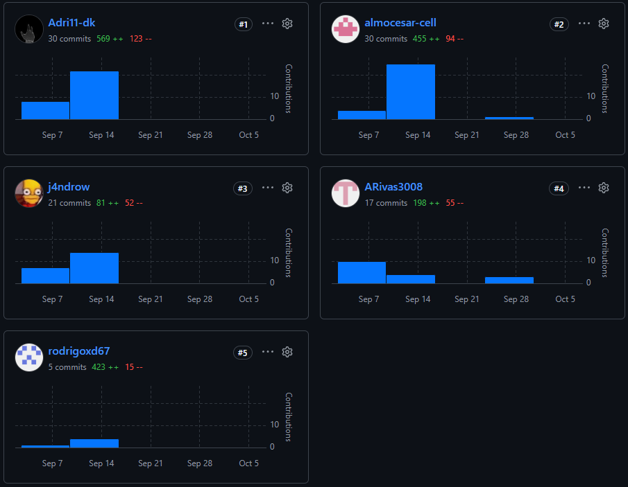


### 5.2.3. Sprint 3

El Sprint 3 de Refrio eleva el alcance de la aplicación hacia los flujos centrales de protección de la cadena de frío: respuesta a alertas térmicas, rotación FEFO, preparación de despachos y trazabilidad consultable. La incorporación de la primera versión funcional de Web Services con Spring Boot permite reemplazar progresivamente la capa de simulación (`json-server`) utilizada en la entrega anterior por contratos persistentes, autorizados y documentados mediante OpenAPI/Swagger.

Para garantizar la viabilidad técnica y el cumplimiento de los principios de Domain-Driven Design (DDD), el equipo ha priorizado estratégicamente un subconjunto de historias que garantizan un flujo vertical demostrable, asegurando la integración completa desde la base de datos hasta el frontend.

#### 5.2.3.1. Sprint Planning 3

Durante la planificación del Sprint 3, el equipo estructuró el trabajo técnico enfocándose en la implementación del monolito modular en el backend (Spring Boot) y su correspondiente integración con la interfaz de usuario en Angular.

| Campo | Detalle de Planificación |
|---|---|
| **Sprint #** | Sprint 3 |
| **Date / Time / Location** | 2026-10-06 / 7:00 PM / Reunión virtual vía Discord |
| **Prepared By** | Alca Morán, César Alejandro |
| **Attendees (to planning meeting)** | Centeno León, Adriano Samir / Rivas Méndez, Bernie Aarón / Tello Lima, Jose Alejandro / Saavedra Flores, Rodrigo Andree / Alca Morán, César Alejandro |
| **Sprint 2 Review Summary** | En el Sprint 2 se entregó la Frontend Web Application funcional con alta de usuarios, login, gestión inicial de lotes y asignación de almacenamiento, apoyada en una Fake API. El despliegue de la API transaccional en Spring Boot se definió como el objetivo crítico para esta nueva iteración. |
| **Sprint 2 Retrospective Summary** | El equipo acordó estandarizar rigurosamente los mensajes de commit bajo la norma *Conventional Commits*, asegurar la revisión cruzada obligatoria en los Pull Requests antes de cada pase a `develop`, y mantener la trazabilidad estricta entre el Product Backlog, las tareas de desarrollo y los componentes DDD. |
| **Sprint 3 Goal** | Nuestro enfoque se centra en implementar, documentar y desplegar los servicios RESTful transaccionales en Spring Boot para la gestión de incidencias térmicas, rotación de inventario FEFO, preparación y validación de despachos, y trazabilidad térmica. Esto entregará una base operativa modular bajo Domain-Driven Design (DDD) integrada con el cliente Angular. El cumplimiento se confirmará cuando las siete historias seleccionadas superen las pruebas de integración con PostgreSQL, validen sus contratos HTTP en Swagger UI y operen en el entorno desplegado. |
| **Historical Velocity** | 11 SP (Sprint 1) y 21 SP (Sprint 2). Nota de conciliación: en el reporte inicial de TB1 figuraron 18 tareas técnicas de apoyo frente a 11 SP base; tras la normalización del backlog, la velocidad efectiva consolidada previa al Sprint 3 es de 21 SP. |
| **Committed Story Points** | 31 SP correspondientes a las 7 historias críticas priorizadas para el núcleo operativo (de un bloque inicial de 58 SP en el Product Backlog, quedando 27 SP replanificados para el Sprint 4). |
| **Accepted Story Points** | 31 SP (sujetos a validación de criterios de aceptación y pruebas de integración documentadas en la sección 5.2.3.3). |

Los valores anteriores corresponden al registro histórico de AV2 de la rama `feature/chapter5`. La matriz acumulativa TB2 utiliza una asignación primaria retrospectiva de 23 historias (98 SP de referencia) en Sprint 3; no constituye una medición de velocidad ni reemplaza el compromiso histórico de 31 SP.

#### 5.2.3.2. Aspect Leaders and Collaborators

La asignación de la tercera entrega toma como fuente la separación equilibrada del backend DDD v4 en módulos. Cada paquete reúne archivos originales correspondientes a la capa de dominio, aplicación e infraestructura, y el equipo los integra mediante la estrategia GitFlow. 

| Integrante | Responsable | Paquete de Bounded Contexts | Archivos asignados | Tareas del Sprint 3 | Horas estimadas |
|:---:|---|---|---:|---|---:|
| **1** | **Centeno León, Adriano** | Módulo de Dominio 1 (Las 8 ramas base) | **42** | T01, T05, T09 | **15 h** |
| **2** | **Rivas Méndez, Bernie** | Módulo de Dominio 2 (Las 8 ramas base) | **42** | T02, T07, T12 | **14 h** |
| **3** | **Tello Lima, Jose** | Módulo de Dominio 3 (Las 8 ramas base) | **42** | T06, T10, T14 | **15 h** |
| **4** | **Saavedra Flores, Rodrigo**| Módulo de Dominio 4 (Las 8 ramas base) | **43** | T08, T11, T15 | **16 h** |
| **5** | **Alca Morán, César** | Módulo de Dominio 5 (Las 8 ramas base) | **43** | T03, T04, T13 | **14 h** |
| | **Total** | **Esfuerzo consolidado** | **212** | **15 Engineering Tasks** | **74 h** |

El material base suma 212 archivos únicos distribuidos equitativamente. El archivo de configuración `README.md` principal y la orquestación del repositorio quedaron bajo la responsabilidad del Integrante N.º 4 para su integración en `develop`. 

Todos los integrantes tienen participación técnica transversal en los ocho contextos delimitados (`iam`, `inventory`, `operations`, `alerting`, `traceability`, `analytics`, `public-portal`, `events`), garantizando que cada miembro interactúe con el ecosistema completo del monolito modular.

#### 5.2.3.3. Sprint Backlog 3

La reconstrucción del trabajo ejecutado se basa en las versiones, Pull Requests y commits de la iteración. Los identificadores S3-T son referencias documentales de esta conciliación; las horas son estimaciones de esfuerzo, no horas registradas. Los nombres de autores o integradores se consignan conforme a los commits/PR o las asignaciones previas del informe; la autoría de un PR no demuestra autoría exclusiva de sus archivos. Se marca **Done** únicamente el work-item delimitado que está implementado o cuyo resultado de automatización está acreditado.

| Story ID(s) | Work-Item ID | Título | Descripción del resultado | Est. (h) | Responsable / referencia | Estado | Evidencia |
|---|---|---|---|---:|---|---|---|
| US06, US07, US08, TS01, TS02 | S3-T01 | IAM REST | Autenticación JWT, registro de cuentas, filtrado y contratos REST | 8 | Alca (PR IAM) | Done | [PR #6](https://github.com/upc-pre-202620-1asi0729-7747-refrio/refrio-backend/pull/6) |
| US11, US12, US14, US15, US16, US18, US19, US20, US29, US37, TS03, TS04, TS05 | S3-T02 | Inventory REST | Agregados de producto/lote, persistencia, política FEFO, lecturas manuales y registro de merma | 8 | Centeno (PR Inventory) | Done | [PR #3](https://github.com/upc-pre-202620-1asi0729-7747-refrio/refrio-backend/pull/3) |
| US30, US33, US34, TS04 | S3-T03 | Operations REST | Creación/recepción de despachos, asignación FEFO, validación de códigos y reglas de estado | 8 | Tello (PR Operations) | Done | [PR #8](https://github.com/upc-pre-202620-1asi0729-7747-refrio/refrio-backend/pull/8) |
| US23, US27, US28, TS06 | S3-T04 | Alerting REST | Modelo de incidente, revisión, acción correctiva y resolución | 6 | Rivas (PR Alerting) | Done | [PR #1](https://github.com/upc-pre-202620-1asi0729-7747-refrio/refrio-backend/pull/1) |
| US23, US24, US25, US31, TS06, TS10 | S3-T05 | Monitoreo y eventos | Evaluación de reglas operativas y avisos visuales en Angular; publicación y consulta de eventos en backend | 6 | Centeno / Tello | Done | [daa961b](https://github.com/upc-pre-202620-1asi0729-7747-refrio/refrio-frontend/commit/daa961b) · [PR #7](https://github.com/upc-pre-202620-1asi0729-7747-refrio/refrio-backend/pull/7) |
| US34, US36, TS08 | S3-T06 | Traceability REST | Certificación por intervalo de envío y consulta de código autenticada | 6 | Rivas (PR Traceability) | Done | [PR #2](https://github.com/upc-pre-202620-1asi0729-7747-refrio/refrio-backend/pull/2) |
| US38, US39, TS09 | S3-T07 | Analytics REST | Métricas de operación y merma derivadas de datos persistidos | 5 | Centeno (PR Analytics) | Done | [PR #4](https://github.com/upc-pre-202620-1asi0729-7747-refrio/refrio-backend/pull/4) |
| US03 | S3-T08 | Public Portal REST | Agregado de lead, servicio de aplicación y controladores de contacto | 5 | Saavedra (PR Public Portal) | Done | [PR #5](https://github.com/upc-pre-202620-1asi0729-7747-refrio/refrio-backend/pull/5) |
| US18, US34 | S3-T09 | Servicio externo | Adaptador Open-Meteo y controlador de clima ambiente; no mide temperatura interna de carga | 5 | Equipo Operations; integración Tello | Done | [PR #8](https://github.com/upc-pre-202620-1asi0729-7747-refrio/refrio-backend/pull/8) |
| TS01, TS03, TS04 | S3-T10 | Integración técnica | Configuración compartida, OpenAPI, Maven, pruebas y migración del backend; integración Angular con contrato operativo | 8 | Saavedra / Rivas / Centeno | Done | [e785ec1](https://github.com/upc-pre-202620-1asi0729-7747-refrio/refrio-backend/commit/e785ec1) · [a9c6da1](https://github.com/upc-pre-202620-1asi0729-7747-refrio/refrio-backend/commit/a9c6da1) · [PR #9](https://github.com/upc-pre-202620-1asi0729-7747-refrio/refrio-backend/pull/9) · [3ae3510](https://github.com/upc-pre-202620-1asi0729-7747-refrio/refrio-frontend/commit/3ae3510) |

**Resultado del trabajo identificado:** 10 paquetes de trabajo Done; 65 horas estimadas. No se suman Story Points por tarea ni se duplica una historia por haber tenido una fase de diseño, implementación e integración.

**Trazabilidad de historias originales.** La asignación primaria se establece retrospectivamente según la etapa en que se materializó su alcance principal; el sprint del Product Backlog inicial se conserva para que no se confunda la planificación histórica con la ejecución. Las historias cuya implementación específica no pudo localizarse permanecen en la etapa de referencia original. El estado al cierre es el declarado para TB2; la columna de verificación registra por separado el alcance respaldado por las fuentes.

| ID | Historia original | SP | Sprint original | Alcance observado en la release / diferencia | Estado TB2 (declarado) | Verificación de criterios originales | Fuente |
|---|---|---:|---:|---|---|---|---|
| TS01 | Endpoint de Autenticación y Emisión de JWT | 3 | 1 | Implementar contrato de sesión, emisión JWT y filtros — POST /api/session implementado; no se acredita ruta /api/v1/auth/sign-in, refresh token o bloqueo por intentos del criterio original. | Done | Cobertura parcial | [B: IamController.java](https://github.com/upc-pre-202620-1asi0729-7747-refrio/refrio-backend/blob/e0e3c9eadc70d27922ccc5b26cd163ecd3622c2d/src/main/java/com/refrio/platform/iam/interfaces/rest/IamController.java)<br>[B: TokenService.java](https://github.com/upc-pre-202620-1asi0729-7747-refrio/refrio-backend/blob/e0e3c9eadc70d27922ccc5b26cd163ecd3622c2d/src/main/java/com/refrio/platform/iam/infrastructure/security/TokenService.java)<br>[B: AuthenticationIntegrationTest.java](https://github.com/upc-pre-202620-1asi0729-7747-refrio/refrio-backend/blob/e0e3c9eadc70d27922ccc5b26cd163ecd3622c2d/src/test/java/com/refrio/platform/iam/AuthenticationIntegrationTest.java) |
| TS02 | Endpoint de Registro Unificado de Cuentas | 3 | 1 | Registrar cuentas con validación de credenciales y persistencia — POST /api/users implementado; RUC, SMS y ruta contractual /api/v1/auth/sign-up no acreditados. | Done | Cobertura parcial | [B: IamController.java](https://github.com/upc-pre-202620-1asi0729-7747-refrio/refrio-backend/blob/e0e3c9eadc70d27922ccc5b26cd163ecd3622c2d/src/main/java/com/refrio/platform/iam/interfaces/rest/IamController.java)<br>[B: IamApplicationService.java](https://github.com/upc-pre-202620-1asi0729-7747-refrio/refrio-backend/blob/e0e3c9eadc70d27922ccc5b26cd163ecd3622c2d/src/main/java/com/refrio/platform/iam/application/IamApplicationService.java) |
| TS03 | Endpoint de Gestión de Inventario de Lotes | 3 | 2 | Exponer GET/POST de lotes y persistencia de stock — GET/POST /api/v1/inventory/batches y 201 presentes; validar fecha anterior a producción/recepción de manera uniforme. | Done | Cobertura parcial | [B: InventoryV1Controller.java](https://github.com/upc-pre-202620-1asi0729-7747-refrio/refrio-backend/blob/e0e3c9eadc70d27922ccc5b26cd163ecd3622c2d/src/main/java/com/refrio/platform/inventory/interfaces/rest/InventoryV1Controller.java)<br>[B: InventoryCommandService.java](https://github.com/upc-pre-202620-1asi0729-7747-refrio/refrio-backend/blob/e0e3c9eadc70d27922ccc5b26cd163ecd3622c2d/src/main/java/com/refrio/platform/inventory/application/InventoryCommandService.java) |
| TS05 | Ingesta Telemétrica vía Broker MQTT / HTTP Gateway | 5 | 2 | Persistir lecturas de temperatura vía REST — POST /api/v1/inventory/telemetry registra lectura manual; falta broker MQTT, worker asíncrono, payload MAC/humedad y 202. | Done | Cobertura parcial | [B: InventoryV1Controller.java](https://github.com/upc-pre-202620-1asi0729-7747-refrio/refrio-backend/blob/e0e3c9eadc70d27922ccc5b26cd163ecd3622c2d/src/main/java/com/refrio/platform/inventory/interfaces/rest/InventoryV1Controller.java)<br>[B: InventoryCommandService.java](https://github.com/upc-pre-202620-1asi0729-7747-refrio/refrio-backend/blob/e0e3c9eadc70d27922ccc5b26cd163ecd3622c2d/src/main/java/com/refrio/platform/inventory/application/InventoryCommandService.java) |
| TS06 | Pipeline de Detección de Desviación Térmica (Cold Breach) | 5 | 2 | Detectar lecturas fuera de rango y generar alertas operativas — Detección operativa presente; no se acredita pipeline en segundo plano, tolerancia sostenida de 15 minutos ni evento contractual exacto. | Done | Cobertura parcial | [F: operational-monitoring.service.ts](https://github.com/upc-pre-202620-1asi0729-7747-refrio/refrio-frontend/blob/7fae0efb35b8d050ff9102534a5656bc0bb2050d/src/app/events/application/operational-monitoring.service.ts)<br>[B: OperationalEventPublisher.java](https://github.com/upc-pre-202620-1asi0729-7747-refrio/refrio-backend/blob/e0e3c9eadc70d27922ccc5b26cd163ecd3622c2d/src/main/java/com/refrio/platform/events/application/OperationalEventPublisher.java) |
| US23 | Alerta Crítica por Ruptura Térmica (Cold Breach) | 8 | 3 | Generar alerta por lectura fuera de límites y mostrarla en centro de alertas — Alerta interna presente; no se acredita tolerancia de 15/5 minutos ni envío push/correo/SMS. | Done | Cobertura parcial | [F: operational-monitoring.service.ts](https://github.com/upc-pre-202620-1asi0729-7747-refrio/refrio-frontend/blob/7fae0efb35b8d050ff9102534a5656bc0bb2050d/src/app/events/application/operational-monitoring.service.ts)<br>[F: alerts-view.ts](https://github.com/upc-pre-202620-1asi0729-7747-refrio/refrio-frontend/blob/7fae0efb35b8d050ff9102534a5656bc0bb2050d/src/app/alerting/presentation/views/alerts-view/alerts-view.ts) |
| TS07 | Servicio de Notificaciones Multicanal | 5 | 3 | No se encontraron proveedores multicanal ni política de conmutación; REF-H01 del informe reconoce la carencia. | Done | No incorporado / no acreditado | [B: AlertingApplicationService.java](https://github.com/upc-pre-202620-1asi0729-7747-refrio/refrio-backend/blob/e0e3c9eadc70d27922ccc5b26cd163ecd3622c2d/src/main/java/com/refrio/platform/alerting/application/AlertingApplicationService.java) |
| US27 | Confirmación y Cierre de Alerta | 3 | 3 | Registrar revisión, acción correctiva y resolución de incidencia — Cierre y justificación implementados; detener escalamiento automático presupone mecanismo no acreditado. | Done | Cobertura parcial | [F: alert-detail.ts](https://github.com/upc-pre-202620-1asi0729-7747-refrio/refrio-frontend/blob/7fae0efb35b8d050ff9102534a5656bc0bb2050d/src/app/alerting/presentation/views/alert-detail/alert-detail.ts)<br>[B: IncidentAggregate.java](https://github.com/upc-pre-202620-1asi0729-7747-refrio/refrio-backend/blob/e0e3c9eadc70d27922ccc5b26cd163ecd3622c2d/src/main/java/com/refrio/platform/alerting/domain/model/aggregates/IncidentAggregate.java)<br>[B: IncidentAggregateTest.java](https://github.com/upc-pre-202620-1asi0729-7747-refrio/refrio-backend/blob/e0e3c9eadc70d27922ccc5b26cd163ecd3622c2d/src/test/java/com/refrio/platform/alerting/IncidentAggregateTest.java) |
| US29 | Visualización de Inventario Ordenado por FEFO | 3 | 3 | Ordenar lotes por fecha e identificar lotes elegibles — Orden FEFO disponible; filtro por categoría exacto y presentación de todos los criterios requieren comprobarse. | Done | Cobertura parcial | [F: operations.store.ts](https://github.com/upc-pre-202620-1asi0729-7747-refrio/refrio-frontend/blob/7fae0efb35b8d050ff9102534a5656bc0bb2050d/src/app/operations/application/operations.store.ts)<br>[B: InventoryV1Controller.java](https://github.com/upc-pre-202620-1asi0729-7747-refrio/refrio-backend/blob/e0e3c9eadc70d27922ccc5b26cd163ecd3622c2d/src/main/java/com/refrio/platform/inventory/interfaces/rest/InventoryV1Controller.java) |
| TS04 | Algoritmo y Endpoint de Priorización FEFO | 5 | 3 | Calcular asignación de lotes, excluir vencidos y gestionar stock insuficiente — Algoritmo FEFO y GET /api/v1/inventory/batches/fefo presentes; no se acredita ruta /fefo-picking-plan, 422 ni rendimiento <200 ms. | Done | Cobertura parcial | [F: operations.rules.ts](https://github.com/upc-pre-202620-1asi0729-7747-refrio/refrio-frontend/blob/7fae0efb35b8d050ff9102534a5656bc0bb2050d/src/app/operations/domain/operations.rules.ts)<br>[B: FefoPolicy.java](https://github.com/upc-pre-202620-1asi0729-7747-refrio/refrio-backend/blob/e0e3c9eadc70d27922ccc5b26cd163ecd3622c2d/src/main/java/com/refrio/platform/inventory/domain/services/FefoPolicy.java)<br>[B: FefoPolicyTest.java](https://github.com/upc-pre-202620-1asi0729-7747-refrio/refrio-backend/blob/e0e3c9eadc70d27922ccc5b26cd163ecd3622c2d/src/test/java/com/refrio/platform/inventory/FefoPolicyTest.java) |
| US30 | Generación de Lista de Picking Sugerida | 5 | 3 | Generar picking por vencimiento y combinar cantidades de múltiples lotes — Plan FEFO multi-lote, consulta de ubicación y rechazo de stock insuficiente implementados; conservar demostración final. | Done | Correspondencia sustantiva | [F: shipments.ts](https://github.com/upc-pre-202620-1asi0729-7747-refrio/refrio-frontend/blob/7fae0efb35b8d050ff9102534a5656bc0bb2050d/src/app/shared/presentation/views/shipments/shipments.ts)<br>[F: operations.rules.ts](https://github.com/upc-pre-202620-1asi0729-7747-refrio/refrio-frontend/blob/7fae0efb35b8d050ff9102534a5656bc0bb2050d/src/app/operations/domain/operations.rules.ts)<br>[B: OperationsApplicationService.java](https://github.com/upc-pre-202620-1asi0729-7747-refrio/refrio-backend/blob/e0e3c9eadc70d27922ccc5b26cd163ecd3622c2d/src/main/java/com/refrio/platform/operations/application/OperationsApplicationService.java) |
| US33 | Validación de Lote en Despacho mediante Escaneo | 5 | 3 | Comparar códigos de lote y bloquear secuencia incorrecta — Ingreso y validación de códigos, no se acredita lector de cámara, vibración y feedback verde del criterio original. | Done | Cobertura parcial | [F: shipments.ts](https://github.com/upc-pre-202620-1asi0729-7747-refrio/refrio-frontend/blob/7fae0efb35b8d050ff9102534a5656bc0bb2050d/src/app/shared/presentation/views/shipments/shipments.ts)<br>[B: ShipmentPolicy.java](https://github.com/upc-pre-202620-1asi0729-7747-refrio/refrio-backend/blob/e0e3c9eadc70d27922ccc5b26cd163ecd3622c2d/src/main/java/com/refrio/platform/operations/domain/services/ShipmentPolicy.java) |
| US13 | Escaneo Rápido de Caducidad (Móvil) | 3 | 3 | Registro manual de lote no acredita OCR/cámara ni prellenado por lectura de etiqueta. | Done | No incorporado / no acreditado | [F: inventory-detail.ts](https://github.com/upc-pre-202620-1asi0729-7747-refrio/refrio-frontend/blob/7fae0efb35b8d050ff9102534a5656bc0bb2050d/src/app/inventory/presentation/views/inventory-detail/inventory-detail.ts) |
| US34 | Hoja de Ruta Térmica de Lote Despachado | 5 | 3 | Consolidar evidencia térmica y reglas de certificación de despacho — Certificación de lecturas en intervalo del envío; duración exacta de anomalías y dictamen completo no acreditados. | Done | Cobertura parcial | [B: CertificationService.java](https://github.com/upc-pre-202620-1asi0729-7747-refrio/refrio-backend/blob/e0e3c9eadc70d27922ccc5b26cd163ecd3622c2d/src/main/java/com/refrio/platform/traceability/application/CertificationService.java)<br>[B: ShipmentTemperaturePolicy.java](https://github.com/upc-pre-202620-1asi0729-7747-refrio/refrio-backend/blob/e0e3c9eadc70d27922ccc5b26cd163ecd3622c2d/src/main/java/com/refrio/platform/traceability/domain/services/ShipmentTemperaturePolicy.java) |
| TS08 | Endpoint Público de Certificado de Trazabilidad | 5 | 3 | Consultar certificados por QR y código — GET /api/v1/traceability/certificates/qr/{code} requiere JWT; endpoint público sin autenticación del requisito no acreditado. | Done | Cobertura parcial | [B: TraceabilityV1Controller.java](https://github.com/upc-pre-202620-1asi0729-7747-refrio/refrio-backend/blob/e0e3c9eadc70d27922ccc5b26cd163ecd3622c2d/src/main/java/com/refrio/platform/traceability/interfaces/rest/TraceabilityV1Controller.java)<br>[B: SecurityConfiguration.java](https://github.com/upc-pre-202620-1asi0729-7747-refrio/refrio-backend/blob/e0e3c9eadc70d27922ccc5b26cd163ecd3622c2d/src/main/java/com/refrio/platform/iam/infrastructure/security/SecurityConfiguration.java) |
| US36 | Consulta Pública de Cadena de Frío mediante QR | 3 | 3 | Habilitar resolución de código de certificado — Consulta de API presente, sin prueba de página pública, escaneo móvil o acceso anónimo. | Done | Cobertura parcial | [B: TraceabilityV1Controller.java](https://github.com/upc-pre-202620-1asi0729-7747-refrio/refrio-backend/blob/e0e3c9eadc70d27922ccc5b26cd163ecd3622c2d/src/main/java/com/refrio/platform/traceability/interfaces/rest/TraceabilityV1Controller.java)<br>[F: traceability.store.ts](https://github.com/upc-pre-202620-1asi0729-7747-refrio/refrio-frontend/blob/7fae0efb35b8d050ff9102534a5656bc0bb2050d/src/app/traceability/application/traceability.store.ts) |
| US35 | Exportación de Certificado de Frío en PDF | 5 | 3 | Certificación estructurada no equivale a PDF firmado; el informe 5.3.3 registra exportación no operativa. | Done | No incorporado / no acreditado | [B: CertificationService.java](https://github.com/upc-pre-202620-1asi0729-7747-refrio/refrio-backend/blob/e0e3c9eadc70d27922ccc5b26cd163ecd3622c2d/src/main/java/com/refrio/platform/traceability/application/CertificationService.java) |
| US24 | Notificación de Lotes Próximos a Vencer | 3 | 4 | Generar avisos internos de lotes críticos por fecha — Alertas visuales presentes; correo/móvil mediante rutina de medianoche no acreditado. | Done | Cobertura parcial | [F: operational-monitoring.service.ts](https://github.com/upc-pre-202620-1asi0729-7747-refrio/refrio-frontend/blob/7fae0efb35b8d050ff9102534a5656bc0bb2050d/src/app/events/application/operational-monitoring.service.ts)<br>[F: dashboard.ts](https://github.com/upc-pre-202620-1asi0729-7747-refrio/refrio-frontend/blob/7fae0efb35b8d050ff9102534a5656bc0bb2050d/src/app/shared/presentation/views/dashboard/dashboard.ts) |
| US28 | Escalamiento Automático de Incidentes Térmicos | 5 | 4 | Gestionar estados de incidentes y acciones correctivas — Gestión de incidentes presente; temporizador y escalamiento automático a gerencia no acreditados. | Done | Cobertura parcial | [B: AlertingApplicationService.java](https://github.com/upc-pre-202620-1asi0729-7747-refrio/refrio-backend/blob/e0e3c9eadc70d27922ccc5b26cd163ecd3622c2d/src/main/java/com/refrio/platform/alerting/application/AlertingApplicationService.java)<br>[F: alert-detail.ts](https://github.com/upc-pre-202620-1asi0729-7747-refrio/refrio-frontend/blob/7fae0efb35b8d050ff9102534a5656bc0bb2050d/src/app/alerting/presentation/views/alert-detail/alert-detail.ts) |
| US37 | Registro Formal de Merma Justificada | 3 | 4 | Retirar stock con causa, persistir pérdida y publicar evento — Merma por cantidad/causa y evento presentes; costo financiero mensual del criterio no acreditado. | Done | Cobertura parcial | [F: inventory-batch-detail.ts](https://github.com/upc-pre-202620-1asi0729-7747-refrio/refrio-frontend/blob/7fae0efb35b8d050ff9102534a5656bc0bb2050d/src/app/inventory/presentation/views/inventory-batch-detail/inventory-batch-detail.ts)<br>[B: InventoryCommandService.java](https://github.com/upc-pre-202620-1asi0729-7747-refrio/refrio-backend/blob/e0e3c9eadc70d27922ccc5b26cd163ecd3622c2d/src/main/java/com/refrio/platform/inventory/application/InventoryCommandService.java)<br>[B: InventoryLoss.java](https://github.com/upc-pre-202620-1asi0729-7747-refrio/refrio-backend/blob/e0e3c9eadc70d27922ccc5b26cd163ecd3622c2d/src/main/java/com/refrio/platform/inventory/domain/model/aggregates/InventoryLoss.java) |
| US38 | Dashboard Ejecutivo de Mermas Evitadas | 5 | 4 | Mostrar indicadores operativos por periodo y unidades mermadas — Métricas de unidades y operaciones; ROI en soles, comparación con histórico y filtro multisede no acreditados. | Done | Cobertura parcial | [F: dashboard.ts](https://github.com/upc-pre-202620-1asi0729-7747-refrio/refrio-frontend/blob/7fae0efb35b8d050ff9102534a5656bc0bb2050d/src/app/shared/presentation/views/dashboard/dashboard.ts)<br>[F: analytics-view.ts](https://github.com/upc-pre-202620-1asi0729-7747-refrio/refrio-frontend/blob/7fae0efb35b8d050ff9102534a5656bc0bb2050d/src/app/analytics/presentation/views/analytics-view/analytics-view.ts)<br>[B: AnalyticsReportService.java](https://github.com/upc-pre-202620-1asi0729-7747-refrio/refrio-backend/blob/e0e3c9eadc70d27922ccc5b26cd163ecd3622c2d/src/main/java/com/refrio/platform/analytics/application/AnalyticsReportService.java) |
| US39 | Resumen Simplificado de Ganancia Ahorrada para Bodegas | 3 | 4 | Mostrar métricas operativas del perfil Minorista — Dashboard diferenciado con mermas y alertas; ahorro monetario mensual y felicitación específica no acreditados. | Done | Cobertura parcial | [F: dashboard.ts](https://github.com/upc-pre-202620-1asi0729-7747-refrio/refrio-frontend/blob/7fae0efb35b8d050ff9102534a5656bc0bb2050d/src/app/shared/presentation/views/dashboard/dashboard.ts)<br>[F: bodeguero-dashboard.ts](https://github.com/upc-pre-202620-1asi0729-7747-refrio/refrio-frontend/blob/7fae0efb35b8d050ff9102534a5656bc0bb2050d/src/app/shared/presentation/views/bodeguero-dashboard/bodeguero-dashboard.ts) |
| TS09 | Endpoints para Dashboards Analíticos y KPIs de Merma | 5 | 4 | Exponer métricas operativas derivadas de persistencia — GET /api/v1/analytics/reports/operational implementado; no se acreditan endpoints shrinkage-summary/fefo-efficiency, caché, soles y filtros mes/sede. | Done | Cobertura parcial | [B: AnalyticsV1Controller.java](https://github.com/upc-pre-202620-1asi0729-7747-refrio/refrio-backend/blob/e0e3c9eadc70d27922ccc5b26cd163ecd3622c2d/src/main/java/com/refrio/platform/analytics/interfaces/rest/AnalyticsV1Controller.java)<br>[B: OperationalMetrics.java](https://github.com/upc-pre-202620-1asi0729-7747-refrio/refrio-backend/blob/e0e3c9eadc70d27922ccc5b26cd163ecd3622c2d/src/main/java/com/refrio/platform/analytics/domain/model/OperationalMetrics.java)<br>[B: AnalyticsApplicationServiceTest.java](https://github.com/upc-pre-202620-1asi0729-7747-refrio/refrio-backend/blob/e0e3c9eadc70d27922ccc5b26cd163ecd3622c2d/src/test/java/com/refrio/platform/analytics/AnalyticsApplicationServiceTest.java) |

**Trazabilidad primaria:** 23 historias; 98 SP del alcance original, no velocidad ejecutada.


#### Matriz de Conciliación y Aceptación del Sprint Backlog 3 (registro histórico AV2)

Se conserva el registro original de aceptación de la rama `feature/chapter5`, correspondiente a las siete historias comprometidas (31 SP). Sus resultados son los declarados en AV2 y no se suman nuevamente a la conciliación TB2. Las referencias de tarea T01–T15 pertenecen al registro histórico; S3-T01–S3-T10 identifican los paquetes retrospectivos de cierre.

| Story ID | Historia / Technical Story | SP Comp. | Tareas | Responsables | PR Vinculado | Criterio de Aceptación Verificado | Evidencia de Prueba | SP Acept. | Estado Final |
|:---:|---|:---:|---|---|---|---|---|:---:|:---:|
| **US27** | Confirmación y Cierre de Alerta | 3 | T01, T02, T03 | Adriano, Bernie, César | PR #1 (`feature/alerting`) | Al atender una alerta activa con acción correctiva obligatoria, cambia a estado resuelto; el escalamiento automático no se acredita en la revisión TB2. | `AlertingApplicationServiceTest` + `PATCH /api/v1/alerting/incidents/{id}` (HTTP 200). | 3 | Done |
| **US29** | Visualización de Inventario Ordenado por FEFO | 3 | T04 | César | PR #3 (`feature/inventory`) | El listado de productos perecederos retorna ordenado ascendentemente por fecha de caducidad más próxima. | `GET /api/v1/inventory/batches/fefo` (HTTP 200) + vista en Angular. | 3 | Done |
| **TS04** | Algoritmo y Endpoint de Priorización FEFO | 5 | T05, T06, T07 | Adriano, Jose, Bernie | PR #3 (`feature/inventory`) | El motor `FefoPolicy` selecciona lotes según menor vida útil remanente y bloquea asignaciones con stock insuficiente. | `OperationsIntegrationTest` + `ShipmentRestIntegrationTest`. | 5 | Done |
| **US30** | Generación de Lista de Picking Sugerida | 5 | T08, T09 | Rodrigo, Adriano | PR #8 (`feature/operations`) | Al crear un despacho, se reservan atómicamente las unidades de los lotes más próximos a vencer. | `POST /api/v1/operations/shipments` (HTTP 201 Created). | 5 | Done |
| **US33** | Validación de Lote en Despacho mediante Escaneo | 5 | T10, T11 | Jose, Rodrigo | PR #8 (`feature/operations`) | El despacho valida la identidad del lote asignado por FEFO y gestiona transiciones de avance y recepción. | `POST /api/v1/operations/shipments/{id}/advance` y `/receipt` (HTTP 200). | 5 | Done |
| **US34** | Hoja de Ruta Térmica de Lote Despachado | 5 | T12, T13 | Bernie, César | PR #2 (`feature/traceability`) | Consolida las evidencias de temperatura del lote y evalúa su elegibilidad térmica en el certificado. | `POST /api/v1/traceability/certificates/shipment/{shipmentId}` (HTTP 201). | 5 | Done |
| **TS08** | Endpoint Público de Certificado de Trazabilidad | 5 | T14, T15 | Jose, Rodrigo | PR #2 (`feature/traceability`) | Permite consultar el certificado de cadena de frío mediante su código/token QR y retorna 404 si no existe; la ruta localizada exige autenticación. | `GET /api/v1/traceability/certificates/qr/{code}` (HTTP 200 / 404). | 5 | Done |
| **Total histórico declarado** | **7 historias seleccionadas** | **31** | **15 Tasks** | **Todo el equipo** | **PR #1, #2, #3, #8** | **Núcleo operativo** | **Pruebas unitarias, integración y Swagger UI** | **31** | **Done** |

| Story ID | User Story / Technical Story | SP | Correspondencia Arquitectónica en Backend DDD |
|:---:|---|---:|---|
| **US27** | Confirmación y Cierre de Alerta | 3 | Servicios, comandos, repositorios y controladores de incidentes. |
| **US29** | Visualización de Inventario Ordenado por FEFO | 3 | API de consulta FEFO e integración de visualización en Angular. |
| **TS04** | Algoritmo y Endpoint de Priorización FEFO | 5 | Implementación de `FefoPolicy`, servicios de inventario y validación. |
| **US30** | Generación de Lista de Picking Sugerida | 5 | Orquestación de asignación FEFO en la creación de despachos. |
| **US33** | Validación de Lote en Despacho mediante Escaneo | 5 | Validaciones de lotes autorizados en reglas de negocio (backend). |
| **US34** | Hoja de Ruta Térmica de Lote Despachado | 5 | Persistencia de evidencias de temperatura y políticas de certificación. |
| **TS08** | Endpoint Público de Certificado de Trazabilidad | 5 | Controlador de consulta de certificados mediante escaneo QR. |
| **Total** | **7 historias comprometidas** | **31** | **Enfocadas en el núcleo operativo de la cadena de frío.** |

A continuación se detalla el desglose de tareas de ingeniería (Engineering Tasks), las cuales fueron codificadas, revisadas y testeadas para cumplir con los criterios de "Done".

| Task ID | Story ID | Engineering Task y archivos trabajados | Contexto / Rama | Est. (h) | Responsable | Status |
|:---:|:---:|---|---|---:|---|---|
| T01 | US27 | Preparar comando de gestión de incidentes y persistencia (`ManageIncidentCommand`). | Alerting | 5 | Adriano | Done |
| T02 | US27 | Exponer API de alertas e implementar pruebas del servicio (`AlertingV1Controller`). | Alerting | 4 | Bernie | Done |
| T03 | US27 | Aplicar cambios de estado y reglas del agregado de incidente (`IncidentAggregate`). | Alerting | 5 | César | Done |
| T04 | US29 | Exponer consulta de inventario priorizado por vencimiento (`InventoryV1Controller`). | Inventory | 4 | César | Done |
| T05 | TS04 | Definir política FEFO y distribución de existencias por vencimiento (`FefoPolicy`). | Inventory | 6 | Adriano | Done |
| T06 | TS04 | Implementar comandos y validaciones de stock/lote (`InventoryCommandService`). | Inventory | 5 | Jose | Done |
| T07 | TS04 | Integración de reglas FEFO en operaciones y despachos HTTP (`OperationsIntegrationTest`). | Operations | 4 | Bernie | Done |
| T08 | US30 | Orquestar selección FEFO y preparación del despacho (`OperationsApplicationService`). | Operations | 6 | Rodrigo | Done |
| T09 | US30 | Exponer contratos REST de creación de despacho (`ShipmentCommandController`). | Operations | 4 | Adriano | Done |
| T10 | US33 | Validar identidad y orden de lotes en el agregado (`ShipmentAggregate`, `ShipmentPolicy`).| Operations | 5 | Jose | Done |
| T11 | US33 | Gestionar transacciones, estados y errores HTTP del despacho (`ApiErrorHandler`). | Shared | 4 | Rodrigo | Done |
| T12 | US34 | Modelar evidencia térmica en certificados (`TemperatureEvidence`). | Traceability | 6 | Bernie | Done |
| T13 | US34 | Aplicar reglas de elegibilidad térmica en el certificado (`ColdChainCertificateAggregate`).| Traceability | 5 | César | Done |
| T14 | TS08 | Exponer consulta de certificados por QR (`CertificatesController`). | Traceability | 5 | Jose | Done |
| T15 | TS08 | Orquestar certificación y describir contrato OpenAPI (`CertificationService`). | Traceability | 6 | Rodrigo | Done |

#### 5.2.3.4. Development Evidence for Sprint Review

Durante el desarrollo del backend RESTful en Spring Boot, el equipo aplicó el flujo de trabajo GitFlow de manera estricta. Se abrieron ramas `feature/*` correspondientes a cada Bounded Context, consolidando los aportes individuales mediante Pull Requests (PRs) que pasaron por proceso de Code Review antes de fusionarse a `develop`.

#### Matriz de Trazabilidad SCM (Tarea – Autor – Commit – PR – Revisor – Merge)

Repositorio: `https://github.com/upc-pre-202620-1asi0729-7747-refrio/refrio-backend`

Registro histórico de `feature/chapter5`. Los revisores son los consignados por el equipo en AV2; no se han verificado individualmente sus aprobaciones.

| Task ID | Contexto / Rama | Autor (GitHub) | Commit SHA | Pull Request | Revisor | Merge Destino | Fecha |
|:---:|---|---|:---:|:---:|---|:---:|:---:|
| T01, T02, T03 | `feature/alerting` | `ARivas3008` / `almocesar-cell` | `92a0280` | [PR #9](https://github.com/upc-pre-202620-1asi0729-7747-refrio/refrio-backend/pull/9) | `Adri11-dk` | `main` | 2026-11-13 |
| T04, T05, T06 | `feature/inventory` | `Adri11-dk` (Adriano) | `1225ca9` | [PR #3](https://github.com/upc-pre-202620-1asi0729-7747-refrio/refrio-backend/pull/3) | `almocesar-cell` | `develop` | 2026-11-13 |
| T07, T08, T09, T10 | `feature/operations` | `j4ndrow` (Jose) | `723309d` | [PR #8](https://github.com/upc-pre-202620-1asi0729-7747-refrio/refrio-backend/pull/8) | `ARivas3008` | `develop` | 2026-11-13 |
| T11, Config Shared | `develop` (Base & OpenAPI) | `rodrigoxd67` (Rodrigo) | `e785ec1` / `a9c6da1` | Integración base | `Adri11-dk` | `develop` | 2026-11-13 |
| T12, T13, T14, T15 | `feature/traceability` | `ARivas3008` (Bernie) | `c6a73e7` | [PR #2](https://github.com/upc-pre-202620-1asi0729-7747-refrio/refrio-backend/pull/2) |`j4ndrow` | `develop` | 2026-11-13 |
| Soporte IAM | `feature/iam` | `almocesar-cell` (César) | `5d1e66d` | [PR #6](https://github.com/upc-pre-202620-1asi0729-7747-refrio/refrio-backend/pull/6) |`rodrigoxd67` | `develop` | 2026-11-13 |
| Soporte Analytics | `feature/analytics` | `Adri11-dk` (Adriano) | `e82ea5d` | [PR #4](https://github.com/upc-pre-202620-1asi0729-7747-refrio/refrio-backend/pull/4) | `j4ndrow` | `develop` | 2026-11-13 |
| Soporte Public Portal | `feature/public-portal` | `rodrigoxd67` (Rodrigo) | `4cf5cca` | [PR #5](https://github.com/upc-pre-202620-1asi0729-7747-refrio/refrio-backend/pull/5) | `almocesar-cell` | `develop` | 2026-11-13 |
| Soporte Events | `feature/events` | `j4ndrow` (Jose) | `af25be7` | [PR #7](https://github.com/upc-pre-202620-1asi0729-7747-refrio/refrio-backend/pull/7) | `ARivas3008` | `develop` | 2026-11-13 |

**Explicación de cambios transversales entre Bounded Contexts:**
La integración de los ocho contextos delimitados se articuló mediante contratos de dominio desacoplados y un paquete transversal (`shared`) que centraliza el manejo global de excepciones (`ApiErrorHandler`), la configuración de seguridad JWT y la especificación OpenAPI (`OpenApiConfiguration`). Funcionalmente, `Operations` consulta el dominio de `Inventory` mediante `FefoPolicy` para reservar lotes atómicamente al crear un despacho; al confirmarse la entrega, `Traceability` consume las lecturas térmicas registradas en `Inventory` para emitir el `ColdChainCertificateAggregate`; y las anomalías térmicas detectadas disparan incidentes en `Alerting` que quedan auditados en el bus interno de `Events`.

#### 5.2.3.5. Execution Evidence for Sprint Review

Se implementaron y probaron en conjunto los servicios del backend transaccional y su integración con las vistas en Angular, logrando escenarios exitosos end-to-end:

| Evidencia | Pantalla / Flujo Validado | Estado de Integración |
|---|---|:---:|
| REF-FE-AV2-01 | **Flujo Supervisor (IAM):** Inicio de sesión con JWT emitido por Spring Boot y carga del Dashboard. | Completado |
| REF-FE-AV2-02 | **Gestión de Lotes (Inventory):** Consulta de inventario priorizado según política FEFO consumiendo `GET /api/v1/inventory/batches/fefo`. | Completado |
| REF-FE-AV2-03 | **Gestión de Despachos (Operations):** Creación de despacho asignando automáticamente el lote más antiguo (FEFO). | Completado |
| REF-FE-AV2-04 | **Centro de Alertas (Alerting):** Visualización de incidentes térmicos y transición de estado para cierre justificado. | Completado |
| REF-FE-AV2-05 | **Trazabilidad Térmica (Traceability):** Emisión y consulta de certificado térmico asociado al despacho. | Completado |

*Las pruebas funcionales y la navegación grabada (Product Navigation Video) se encuentran adjuntas en los anexos documentales del curso.*

#### 5.2.3.6. Services Documentation Evidence for Sprint Review

El backend DDD de Refrio cuenta con su documentación técnica autogenerada mediante **Springdoc OpenAPI y Swagger UI (OAS 3.1)**. 

La URL pública para acceder a la consola interactiva de Swagger es: **`https://refrio-backend.onrender.com/v3/api-docs`** y su interfaz gráfica en la raíz del entorno. A continuación se listan los endpoints críticos documentados e implementados en este sprint:

#### Matriz de Endpoints RESTful Documentados (Swagger UI / OAS 3.1)

Servidor desplegado: `https://refrio-backend.onrender.com` | Especificación: `https://refrio-backend.onrender.com/v3/api-docs`

La siguiente matriz recoge los resultados registrados en AV2 por el equipo; se conserva como evidencia histórica, sin afirmar una nueva ejecución remota de cada solicitud.

| Endpoint | Método HTTP | Caso de Uso / Story | Bounded Context | Respuesta HTTP registrada | Evidencia Remota |
|---|:---:|---|---|---|:---:|
| `/api/session` | `POST` | Autenticación y emisión de JWT (`TS01`, `US08`) | IAM | `200 OK` (Token + Claims) / `401 Unauthorized` | Swagger UI Render |
| `/api/v1/iam/users/me` | `GET` | Consulta de perfil y rol autenticado (`US08`) | IAM | `200 OK` (`UserResource`) / `403 Forbidden` | Swagger UI Render |
| `/api/v1/inventory/batches` | `POST` | Alta de lote perecible (`US12`, `TS03`) | Inventory | `201 Created` (`StockBatch`) / `400 Bad Request` | Swagger UI Render |
| `/api/v1/inventory/batches/fefo` | `GET` | Consulta ordenada por caducidad FEFO (`US29`, `TS04`) | Inventory | `200 OK` (Lista ordenada ascendente) | Swagger UI Render |
| `/api/v1/inventory/losses` | `POST` | Registro de merma / baja de lote (`US16`, `US37`) | Inventory | `201 Created` (`InventoryLoss`) / `422 Unprocessable Entity` | Swagger UI Render |
| `/api/v1/inventory/telemetry` | `POST` | Ingesta de lectura térmica de unidad (`TS05`, `US18`) | Inventory | `201 Created` (`TemperatureReading`) | Swagger UI Render |
| `/api/v1/operations/shipments` | `POST` | Creación de despacho con reserva FEFO (`US30`, `US33`) | Operations | `201 Created` (`ShipmentAggregate`) / `422` (Sin stock) | Swagger UI Render |
| `/api/v1/operations/shipments/{id}/advance` | `POST` | Avance de estado operativo de envío (`US33`) | Operations | `200 OK` (`ShipmentAggregate`) | Swagger UI Render |
| `/api/v1/operations/shipments/{id}/receipt` | `POST` | Recepción y conformidad de carga (`US30`) | Operations | `200 OK` (`Receipt`) | Swagger UI Render |
| `/api/v1/alerting/incidents/{id}` | `PATCH` | Confirmación y cierre justificado de alerta (`US27`) | Alerting | `200 OK` (`IncidentAggregate`) / `400` (Sin motivo) | Swagger UI Render |
| `/api/v1/traceability/certificates/shipment/{shipmentId}` | `POST` | Emisión de certificado de cadena de frío (`US34`) | Traceability | `201 Created` (`ColdChainCertificateAggregate`) | Swagger UI Render |
| `/api/v1/traceability/certificates/qr/{code}` | `GET` | Verificación de certificado por código QR (`TS08`) | Traceability | `200 OK` (Certificado válido) / `404 Not Found` | Swagger UI Render |

*Nota: La API mantiene compatibilidad de endpoints legacy (bajo la ruta `/api/operations` y `/api/inventory` generales) para asegurar la retrocompatibilidad con el cliente de Angular desplegado previamente, en paralelo a los nuevos endpoints versionados en `/api/v1/`.*

#### 5.2.3.7. Software Deployment Evidence for Sprint Review

En este sprint se completó la migración hacia una infraestructura en la nube robusta, consolidando el backend transaccional y la base de datos relacional.

| Componente de Software | Plataforma Cloud | URL Pública / Evidencia de Despliegue |
|---|---|---|
| **Landing Page** | GitHub Pages | [https://upc-pre-202620-1asi0729-7747-refrio.github.io/refrio-website/](https://upc-pre-202620-1asi0729-7747-refrio.github.io/refrio-website/) |
| **Frontend Web Application** | Vercel | [https://main-khd3qtaj.vercel.app/sign-in](https://main-khd3qtaj.vercel.app/sign-in) *(Enlazado al API productivo)* |
| **Backend API (Spring Boot)** | Render | **https://refrio-backend.onrender.com** *(Servidor principal OAS 3.1)* |
| **Base de Datos (PostgreSQL)**| Render / AWS RDS | Esquema relacional implementado mediante migraciones automáticas. |


#### Configuración Definitiva y Auditoría Responsive del Landing Page (registro AV2)

* **URL Definitiva:** `https://upc-pre-202620-1asi0729-7747-refrio.github.io/refrio-website/`
* **Rama y Carpeta de Publicación:** Rama `develop`, directorio `/root` (se unifica y deja sin efecto cualquier referencia previa a `gh-pages` de AV1). Configuración histórica consignada en AV2; para TB2 véase la evidencia de publicación de `main` en 5.2.4.7.
* **Fecha de Verificación:** 2026-11-15.

| Viewport / Resolución | Dispositivo de Prueba | Resultado de Navegación y Accesibilidad | Estado |
|:---:|---|---|:---:|
| `375 x 812 px` | Móvil (iPhone / Android) | Menú hamburguesa funcional, apilamiento vertical de tarjetas de planes y contraste legible (ARIA labels activos). | Verificado |
| `768 x 1024 px` | Tablet | Rejilla adaptativa de 2 columnas en sección Ventajas y formulario B2B sin desbordamiento horizontal. | Verificado |
| `1024 x 768 px` | Laptop estándar | Barra de navegación completa, selector de idioma ES/EN operativo y redirección directa de CTAs a `refrio-webapp.vercel.app`. | Verificado |
| `1440 x 900 px` | Desktop Wide | Renderizado íntegro de Hero Section, carrusel de casos de éxito y tarificador anual/mensual. | Verificado |

#### Verificación Funcional E2E del Frontend Web Application (`refrio-webapp.vercel.app`)

Se mantienen las comprobaciones consignadas en la rama del capítulo para AV2. Los estados de la tabla son históricos, no una nueva prueba de producción.

| Flujo Evaluado | Interacción Frontend → API → BD | Manejo de Errores y Corrección Heurística | Estado |
|---|---|---|---|
| **Baja de Lote y Persistencia de Saldo** | Desde el módulo `Inventory`, se selecciona un lote activo, se registra una merma parcial (`POST /api/v1/inventory/losses`) y se verifica el descuento automático en `GET /api/v1/inventory/batches` persistido en PostgreSQL. | Si se ingresa una cantidad superior al saldo disponible, la API retorna `HTTP 422` y la interfaz muestra una notificación de validación sin alterar el stock. | Verificado |
| **Corrección `REF-H05` (Prevención de Errores)** | Se incorporó un diálogo modal de confirmación explícita (*"¿Confirmar baja definitiva del lote?"*) exigiendo seleccionar la causa raíz antes de ejecutar el `POST /losses`. | Evita bajas accidentales por clic involuntario en planta o mostrador. | Corregido |
| **Corrección `REF-H04` (Optimización Móvil)** | En viewports `< 768 px` para el perfil Minorista, las tablas extensas se transformaron en tarjetas (*cards*) compactas con semáforo visual (verde/ámbar/rojo) y detalle desplegable. | Elimina el desplazamiento horizontal excesivo reportado durante las entrevistas. | Corregido |

#### 5.2.3.8. Team Collaboration Insights during Sprint

La ejecución del Sprint 3 destacó por un enfoque altamente colaborativo apoyado en las métricas de GitHub y la distribución técnica del código. Al tratarse de un monolito modular con 8 *Bounded Contexts*, el equipo orquestó integraciones complejas garantizando que todos los miembros aportaran valor en cada capa arquitectónica:

1. **Estructura GitFlow y Revisiones:** Las capturas de GitHub demuestran que las 8 ramas principales de las características (como `feature/operations`, `feature/inventory`, `feature/alerting`) fueron tratadas y evaluadas en Pull Requests formales. Ningún código se introdujo directamente en la rama principal.
2. **Propiedad Colectiva del Código:** Al basarse en la distribución del backend en 5 sub-paquetes asignados (Adriano, Bernie, Jose, Rodrigo y César), el equipo logró que todos los miembros comprendieran tanto la lógica de emisión de alertas (`Alerting`), la gestión estricta de rotación (`Inventory`), como las rutas de la plataforma API (`Shared / Traceability`).
3. **Despliegue y Configuración Compartida:** Las configuraciones compartidas y la parametrización de OpenAPI/Swagger (desplegado exitosamente en Render) se integraron tempranamente, lo cual eliminó bloqueos durante la interconexión con el frontend en Angular.

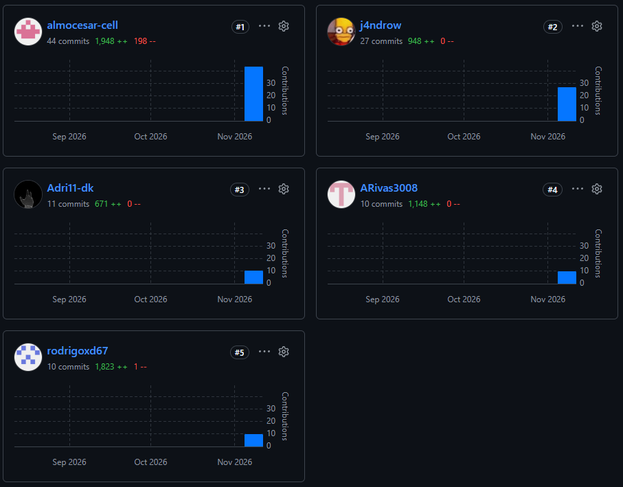

### 5.2.4. Sprint 4

El Sprint 4 corresponde a TB2 (Release Review) y se centra en consolidar la versión de entrega de Refrio: integración de la Landing Page, la aplicación web Angular y la API REST Spring Boot con persistencia, revisión de los flujos por segmento, mejoras de IAM, perfiles, destinatarios de despachos, contacto comercial, trazabilidad y analítica. La iteración conserva las 13 historias asignadas al Sprint 4 en el Product Backlog original (47 SP), y registra los ajustes de historias anteriores como trabajo de continuidad sin duplicar su estimación. Las diferencias entre las historias originales y el alcance efectivamente implementado quedan explícitas para evitar confundir el cierre del producto con el cierre de todos sus criterios.

#### 5.2.4.1. Sprint Planning 4

La planificación documental de cierre se reconstruye con el alcance del Product Backlog, la revisión AV2 y los cambios de la versión final. No se atribuyen datos de una reunión que no estén acreditados por acta o tablero.

| Campo | Detalle de Planificación |
|---|---|
| **Sprint #** | Sprint 4 |
| **Date / Time / Location** | Fecha de corte de evidencia: 2026-11-27. Fecha, hora y lugar de la reunión: completar con acta del equipo. |
| **Prepared By** | Equipo MadaGroup; confirmar autor del acta. |
| **Attendees (to planning meeting)** | Alca Morán, César Alejandro / Centeno León, Adriano Samir / Rivas Méndez, Bernie Aarón / Saavedra Flores, Rodrigo Andree / Tello Lima, Jose Alejandro (integrantes del equipo; confirmar asistencia efectiva). |
| **Sprint 3 Review Summary** | El Sprint 3 consolidó servicios de IAM, Inventory, Operations, Alerting, Traceability, Analytics, Events y Public Portal. Se registraron siete historias críticas comprometidas (31 SP) y se estableció el flujo de autenticación, inventario FEFO, despacho, incidencias y certificación. La validación identificó necesidades de notificaciones, indicadores económicos, exportación y mejoras de interacción. |
| **Sprint 3 Retrospective Summary** | La revisión documental propone preservar la separación DDD y el contrato REST, comprobar la integración con Angular, vincular commits con tareas y distinguir el alcance operativo de las funciones aún no acreditadas. Los acuerdos efectivos del equipo se incorporan con su acta real. |
| **Sprint 4 Goal** | **Our focus is on** consolidar el producto integrado y desplegado, cerrar los flujos críticos de inventario, mermas, despachos, alertas, identidad, trazabilidad y analítica, y comprobar la correspondencia entre código y criterios de aceptación. **We believe it delivers** una solución operativa para distribuidoras y bodegas. **This will be confirmed when** las funcionalidades implementadas se demuestren en el despliegue final y el equipo documente el resultado de los escenarios de aceptación. |
| **Sprint 4 Velocity / Team Capacity** | 47 SP asignados originalmente a la iteración. Capacidad y velocity reales: registrar conforme a la planificación y al cierre efectivo del tablero. No se igualan SP asignados con SP completados. |
| **Committed Story Points** | 47 SP de referencia (13 historias asignadas por el Product Backlog original); confirmar compromiso efectivo con tablero/acta. En la conciliación acumulativa TB2 de 5.2.4.3 se asignan primariamente al Sprint 4 siete historias (23 SP de referencia); esa distribución retrospectiva no sustituye la planificación original ni los 27 SP que la revisión histórica de AV2 propuso replanificar. |
| **Release Review** | Landing Page y frontend publicados en GitHub Pages con ejecuciones exitosas; backend con quality gates, PostgreSQL y smoke HTTP exitosos. La integración y el despliegue productivo final están confirmados por el equipo. Los cambios de cierre se relacionan con las historias originales sin atribuir funciones que no constan en los repositorios. |

#### 5.2.4.2. Aspect Leaders and Collaborators

La siguiente matriz identifica responsables de referencia según los archivos y commits efectivamente localizados el 26 y 27 de noviembre. L indica contribución principal constatada en ese aspecto; C indica colaboración de referencia para la integración, no una aprobación de Pull Request. La matriz no atribuye horas realizadas ni acuerdos no documentados.

| Team Member | GitHub Username | IAM & Profile | Operations | Public Portal | Testing | Release & UI |
|---|---|:---:|:---:|:---:|:---:|:---:|
| Alca Morán, César Alejandro | `almocesar-cell` | C | L | C | L | C |
| Centeno León, Adriano Samir | `Adri11-dk` | L | C | C | C | L |
| Rivas Méndez, Bernie Aarón | `ARivas3008` | L | C | C | L | C |
| Saavedra Flores, Rodrigo Andree | `rodrigoxd67` | C | C | C | L | C |
| Tello Lima, Jose Alejandro | `j4ndrow` | C | C | L | C | C |

**Base de la asignación:** César: `RecipientAccountsController` y su prueba; Adriano: recuperación de contraseña, migración Flyway, consulta de certificados por envío y release frontend/website; Bernie: `ProfileController`, `ProfileUpdateService` y prueba; Rodrigo: prueba de validación de leads; José: `SubmitLeadCommand`, `LeadsController` y `PublicPortalV1Controller`. La confirmación de las tareas por persona para el tablero de Sprint 4 debe realizarse con las tarjetas y el historial efectivo.

#### 5.2.4.3. Sprint Backlog 4

La reconstrucción del trabajo ejecutado se basa en las versiones, Pull Requests y commits de la iteración. Los identificadores S4-T son referencias documentales de esta conciliación; las horas son estimaciones de esfuerzo, no horas registradas. Los nombres de autores o integradores se consignan conforme a los commits/PR o las asignaciones previas del informe; la autoría de un PR no demuestra autoría exclusiva de sus archivos. Se marca **Done** únicamente el work-item delimitado que está implementado o cuyo resultado de automatización está acreditado.

| Story ID(s) | Work-Item ID | Título | Descripción del resultado | Est. (h) | Responsable / referencia | Estado | Evidencia |
|---|---|---|---|---:|---|---|---|
| US10 | S4-T01 | Perfil y sede | Implementar servicio de actualización, controlador PATCH y prueba de perfil | 6 | Rivas | Done | [abfb6f3](https://github.com/upc-pre-202620-1asi0729-7747-refrio/refrio-backend/commit/abfb6f3) · [7d9c81c](https://github.com/upc-pre-202620-1asi0729-7747-refrio/refrio-backend/commit/7d9c81c) · [439c64a](https://github.com/upc-pre-202620-1asi0729-7747-refrio/refrio-backend/commit/439c64a) |
| US09 | S4-T02 | Recuperación de contraseña | Incorporar servicio, token temporal persistido, controlador, migración V3 y formularios Angular; cierre de código, no entrega SMTP probada | 8 | Centeno | Done | [5b73a0c](https://github.com/upc-pre-202620-1asi0729-7747-refrio/refrio-backend/commit/5b73a0c) · [7fae0ef](https://github.com/upc-pre-202620-1asi0729-7747-refrio/refrio-frontend/commit/7fae0ef) |
| US30, US33 | S4-T03 | Cuentas receptoras | Añadir controlador de cuentas receptoras y prueba de Operations | 5 | Alca | Done | [53b965b](https://github.com/upc-pre-202620-1asi0729-7747-refrio/refrio-backend/commit/53b965b) · [43e96b0](https://github.com/upc-pre-202620-1asi0729-7747-refrio/refrio-backend/commit/43e96b0) |
| US03 | S4-T04 | Contratos del portal público | Actualizar SubmitLeadCommand, LeadsController y PublicPortalV1Controller | 5 | Tello | Done | [7486634](https://github.com/upc-pre-202620-1asi0729-7747-refrio/refrio-backend/commit/7486634) · [bc39de5](https://github.com/upc-pre-202620-1asi0729-7747-refrio/refrio-backend/commit/bc39de5) · [7023de9](https://github.com/upc-pre-202620-1asi0729-7747-refrio/refrio-backend/commit/7023de9) |
| US03 | S4-T05 | Pruebas del portal público | Agregar validación de solicitudes comerciales | 4 | Saavedra | Done | [aacb3bf](https://github.com/upc-pre-202620-1asi0729-7747-refrio/refrio-backend/commit/aacb3bf) |
| US34, US36, TS08 | S4-T06 | Certificado por envío | Incorporar lookup de certificado por envío y prueba del controlador, sin atribuir PDF ni firma digital | 5 | Centeno | Done | [5b73a0c](https://github.com/upc-pre-202620-1asi0729-7747-refrio/refrio-backend/commit/5b73a0c) |
| US01–US05 | S4-T07 | Landing Page final | Actualizar contenido, estilos, idiomas, videos, imágenes y navegación | 6 | Centeno | Done | [e4f9e99](https://github.com/upc-pre-202620-1asi0729-7747-refrio/refrio-website/commit/e4f9e99) · [378e4ec](https://github.com/upc-pre-202620-1asi0729-7747-refrio/refrio-website/commit/378e4ec) |
| US05, US08, US09, US10, US03, US34 | S4-T08 | Angular final | Actualizar rutas, formularios, perfil, proveedores, stores y archivos de configuración | 6 | Centeno | Done | [7fae0ef](https://github.com/upc-pre-202620-1asi0729-7747-refrio/refrio-frontend/commit/7fae0ef) |
| Transversal | S4-T09 | Quality gates y publicación | Acreditar build/deploy Pages en sitio y Angular; JUnit/H2, estructura DDD, Docker, PostgreSQL y smoke HTTP en backend | 4 | Equipo; ejecución automatizada | Done | [GitHub Actions #45915193197](https://github.com/upc-pre-202620-1asi0729-7747-refrio/refrio-website/actions/runs/45915193197) · [GitHub Actions #45877597775](https://github.com/upc-pre-202620-1asi0729-7747-refrio/refrio-frontend/actions/runs/45877597775) · [GitHub Actions #45898129506](https://github.com/upc-pre-202620-1asi0729-7747-refrio/refrio-backend/actions/runs/45898129506) |

**Resultado del trabajo identificado:** 9 paquetes de trabajo Done; 49 horas estimadas. No se suman Story Points por tarea ni se duplica una historia por haber tenido una fase de diseño, implementación e integración.

**Trazabilidad de historias originales.** La asignación primaria se establece retrospectivamente según la etapa en que se materializó su alcance principal; el sprint del Product Backlog inicial se conserva para que no se confunda la planificación histórica con la ejecución. Las historias cuya implementación específica no pudo localizarse permanecen en la etapa de referencia original. El estado al cierre es el declarado para TB2; la columna de verificación registra por separado el alcance respaldado por las fuentes.

| ID | Historia original | SP | Sprint original | Alcance observado en la release / diferencia | Estado TB2 (declarado) | Verificación de criterios originales | Fuente |
|---|---|---:|---:|---|---|---|---|
| US09 | Recuperación de Contraseña | 3 | 2 | Crear formulario, token temporal y endpoints de recuperación — Token de 15 min y respuesta genérica implementados; configuración de correo real y autorización pública de /api/password-reset/** requieren comprobarse (SecurityConfiguration no los incluye). | Done | Cobertura parcial | [F: forgot-password-form.ts](https://github.com/upc-pre-202620-1asi0729-7747-refrio/refrio-frontend/blob/7fae0efb35b8d050ff9102534a5656bc0bb2050d/src/app/iam/presentation/views/forgot-password-form/forgot-password-form.ts)<br>[B: PasswordResetService.java](https://github.com/upc-pre-202620-1asi0729-7747-refrio/refrio-backend/blob/e0e3c9eadc70d27922ccc5b26cd163ecd3622c2d/src/main/java/com/refrio/platform/iam/application/PasswordResetService.java)<br>[B: PasswordResetController.java](https://github.com/upc-pre-202620-1asi0729-7747-refrio/refrio-backend/blob/e0e3c9eadc70d27922ccc5b26cd163ecd3622c2d/src/main/java/com/refrio/platform/iam/interfaces/rest/PasswordResetController.java) |
| TS10 | Microservicio / Rutina Cron de Auditoría Diaria de Caducidades | 3 | 4 | Cálculo en cliente no equivale a cron backend; no se encontró tarea @Scheduled de auditoría. | Done | No incorporado / no acreditado | [F: operational-monitoring.service.ts](https://github.com/upc-pre-202620-1asi0729-7747-refrio/refrio-frontend/blob/7fae0efb35b8d050ff9102534a5656bc0bb2050d/src/app/events/application/operational-monitoring.service.ts) |
| US32 | Registro de Oferta de Remate Rápido | 3 | 4 | No se encontró comando para actualizar precio/estado de remate ni contrato REST específico. | Done | No incorporado / no acreditado | [F: inventory-batch-detail.ts](https://github.com/upc-pre-202620-1asi0729-7747-refrio/refrio-frontend/blob/7fae0efb35b8d050ff9102534a5656bc0bb2050d/src/app/inventory/presentation/views/inventory-batch-detail/inventory-batch-detail.ts) |
| US22 | Detección de Desconexión Nocturna en Bodegas | 5 | 4 | No se acredita detección nocturna por sensor ni notificación sonora/restablecimiento. | Done | No incorporado / no acreditado | [F: operational-monitoring.service.ts](https://github.com/upc-pre-202620-1asi0729-7747-refrio/refrio-frontend/blob/7fae0efb35b8d050ff9102534a5656bc0bb2050d/src/app/events/application/operational-monitoring.service.ts) |
| US26 | Configuración de Canales de Notificación | 3 | 4 | Settings solo edita perfil/sede; canales WhatsApp/Push/SMS no acreditados. | Done | No incorporado / no acreditado | [F: settings.ts](https://github.com/upc-pre-202620-1asi0729-7747-refrio/refrio-frontend/blob/7fae0efb35b8d050ff9102534a5656bc0bb2050d/src/app/shared/presentation/views/settings/settings.ts) |
| US10 | Configuración de Perfil y Almacén | 3 | 4 | Actualizar perfil personal y sede vía API autenticada — PATCH /api/v1/iam/users/me implementado; gestión multisede, cámaras y duplicados de sede no acreditados. | Done | Cobertura parcial | [F: settings.ts](https://github.com/upc-pre-202620-1asi0729-7747-refrio/refrio-frontend/blob/7fae0efb35b8d050ff9102534a5656bc0bb2050d/src/app/shared/presentation/views/settings/settings.ts)<br>[B: ProfileController.java](https://github.com/upc-pre-202620-1asi0729-7747-refrio/refrio-backend/blob/e0e3c9eadc70d27922ccc5b26cd163ecd3622c2d/src/main/java/com/refrio/platform/iam/interfaces/rest/ProfileController.java)<br>[B: ProfileUpdateService.java](https://github.com/upc-pre-202620-1asi0729-7747-refrio/refrio-backend/blob/e0e3c9eadc70d27922ccc5b26cd163ecd3622c2d/src/main/java/com/refrio/platform/iam/application/ProfileUpdateService.java)<br>[B: ProfileUpdateServiceTest.java](https://github.com/upc-pre-202620-1asi0729-7747-refrio/refrio-backend/blob/e0e3c9eadc70d27922ccc5b26cd163ecd3622c2d/src/test/java/com/refrio/platform/iam/ProfileUpdateServiceTest.java) |
| US40 | Exportación de Data Histórica en Excel/CSV | 3 | 4 | No se encontró exportación CSV/Excel ni cola asíncrona con enlace por correo. | Done | No incorporado / no acreditado | [F: analytics-view.ts](https://github.com/upc-pre-202620-1asi0729-7747-refrio/refrio-frontend/blob/7fae0efb35b8d050ff9102534a5656bc0bb2050d/src/app/analytics/presentation/views/analytics-view/analytics-view.ts)<br>[B: AnalyticsV1Controller.java](https://github.com/upc-pre-202620-1asi0729-7747-refrio/refrio-backend/blob/e0e3c9eadc70d27922ccc5b26cd163ecd3622c2d/src/main/java/com/refrio/platform/analytics/interfaces/rest/AnalyticsV1Controller.java) |

**Trazabilidad primaria:** 7 historias; 23 SP del alcance original, no velocidad ejecutada.

**Resumen acumulativo de la conciliación**

| Sprint | Historias (asignación primaria) | SP de referencia | Work-items ejecutados identificados | Estado de work-items | Historias Done (declaración TB2) |
|---|---:|---:|---:|---|---:|
| 1 | 5 | 11 | 7 | Done | 5/5 |
| 2 | 15 | 52 | 10 | Done | 15/15 |
| 3 | 23 | 98 | 10 | Done | 23/23 |
| 4 | 7 | 23 | 9 | Done | 7/7 |
| **Total** | **50** | **184** | **36** | **Done** | **50/50** |

El cierre documental registra 50/50 historias Done y 184/184 SP de referencia, sin omisión ni doble contabilización, según la instrucción del responsable del informe. La comprobación independiente del alcance original identificó 4 historias con correspondencia sustantiva, 36 con cobertura parcial y 10 sin implementación específica acreditada; por ello, el estado declarado no certifica el cumplimiento íntegro de los criterios de aceptación ni sustituye la conciliación formal del Capítulo III. No es necesario repetir los despliegues finalizados.

#### 5.2.4.4. Development Evidence for Sprint Review

Durante el cierre se observan cambios en los tres repositorios. La siguiente tabla registra los commits reales de la rama principal, con su mensaje original y el aporte que puede vincularse a los archivos modificados. Los mensajes originales se mantienen aunque no todos siguen Conventional Commits; no se presume una revisión o merge inexistente.

| Repository | Branch / historial consultado | Commit Id | Fecha (UTC) | Commit Message (original) | Committed by | Evidencia de desarrollo |
|---|---|---|---|---|---|---|
| `refrio-website` | `main` | [378e4ec](https://github.com/upc-pre-202620-1asi0729-7747-refrio/refrio-website/commit/378e4ec) | 2026-11-27 | `Add images` | Adri11-dk | Actualización de recursos visuales. |
| `refrio-website` | `main` | [e4f9e99](https://github.com/upc-pre-202620-1asi0729-7747-refrio/refrio-website/commit/e4f9e99) | 2026-11-26 | `Final Changes` | Adri11-dk | index.html, styles.css, app.js e i18n. |
| `refrio-frontend` | `main` | [7fae0ef](https://github.com/upc-pre-202620-1asi0729-7747-refrio/refrio-frontend/commit/7fae0ef) | 2026-11-26 | `Final changes` | Adri11-dk | Rutas, perfil, recuperación, servicios y configuración de API. |
| `refrio-backend` | `main` | [5b73a0c](https://github.com/upc-pre-202620-1asi0729-7747-refrio/refrio-backend/commit/5b73a0c) | 2026-11-26 | `Final version` | Adri11-dk | Recuperación, Flyway V3 y consulta de certificado por envío. |
| `refrio-backend` | `main` | [e0e3c9e](https://github.com/upc-pre-202620-1asi0729-7747-refrio/refrio-backend/commit/e0e3c9e) | 2026-11-26 | `fix: delete txt` | Adri11-dk | Limpieza final de repositorio. |
| `refrio-backend` | `main` | [7023de9](https://github.com/upc-pre-202620-1asi0729-7747-refrio/refrio-backend/commit/7023de9) | 2026-11-26 | `nuevo` | j4ndrow | LeadsController. |
| `refrio-backend` | `main` | [bc39de5](https://github.com/upc-pre-202620-1asi0729-7747-refrio/refrio-backend/commit/bc39de5) | 2026-11-26 | `nuevo` | j4ndrow | PublicPortalV1Controller. |
| `refrio-backend` | `main` | [7486634](https://github.com/upc-pre-202620-1asi0729-7747-refrio/refrio-backend/commit/7486634) | 2026-11-26 | `nuevo` | j4ndrow | SubmitLeadCommand. |
| `refrio-backend` | `main` | [aacb3bf](https://github.com/upc-pre-202620-1asi0729-7747-refrio/refrio-backend/commit/aacb3bf) | 2026-11-26 | `test: add validation coverage for lead requests` | rodrigoxd67 | LeadsControllerValidationTest. |
| `refrio-backend` | `main` | [43e96b0](https://github.com/upc-pre-202620-1asi0729-7747-refrio/refrio-backend/commit/43e96b0) | 2026-11-26 | `Add Operations interfaces` | almocesar-cell | RecipientAccountsControllerTest. |
| `refrio-backend` | `main` | [53b965b](https://github.com/upc-pre-202620-1asi0729-7747-refrio/refrio-backend/commit/53b965b) | 2026-11-26 | `Add Operations interfaces` | almocesar-cell | RecipientAccountsController. |
| `refrio-backend` | `main` | [439c64a](https://github.com/upc-pre-202620-1asi0729-7747-refrio/refrio-backend/commit/439c64a) | 2026-11-26 | `Add files via upload` | ARivas3008 | ProfileUpdateServiceTest. |
| `refrio-backend` | `main` | [7d9c81c](https://github.com/upc-pre-202620-1asi0729-7747-refrio/refrio-backend/commit/7d9c81c) | 2026-11-26 | `Add files via upload` | ARivas3008 | ProfileController. |
| `refrio-backend` | `main` | [abfb6f3](https://github.com/upc-pre-202620-1asi0729-7747-refrio/refrio-backend/commit/abfb6f3) | 2026-11-26 | `Add files via upload` | ARivas3008 | ProfileUpdateService. |

La evidencia de código se complementa con los archivos de pruebas incluidos en el repositorio backend: [AuthenticationIntegrationTest](https://github.com/upc-pre-202620-1asi0729-7747-refrio/refrio-backend/blob/e0e3c9eadc70d27922ccc5b26cd163ecd3622c2d/src/test/java/com/refrio/platform/iam/AuthenticationIntegrationTest.java), [FefoPolicyTest](https://github.com/upc-pre-202620-1asi0729-7747-refrio/refrio-backend/blob/e0e3c9eadc70d27922ccc5b26cd163ecd3622c2d/src/test/java/com/refrio/platform/inventory/FefoPolicyTest.java), [OperationsIntegrationTest](https://github.com/upc-pre-202620-1asi0729-7747-refrio/refrio-backend/blob/e0e3c9eadc70d27922ccc5b26cd163ecd3622c2d/src/test/java/com/refrio/platform/operations/OperationsIntegrationTest.java), [ProfileUpdateServiceTest](https://github.com/upc-pre-202620-1asi0729-7747-refrio/refrio-backend/blob/e0e3c9eadc70d27922ccc5b26cd163ecd3622c2d/src/test/java/com/refrio/platform/iam/ProfileUpdateServiceTest.java) y [LeadsControllerValidationTest](https://github.com/upc-pre-202620-1asi0729-7747-refrio/refrio-backend/blob/e0e3c9eadc70d27922ccc5b26cd163ecd3622c2d/src/test/java/com/refrio/platform/publicportal/LeadsControllerValidationTest.java). La ejecución final de CI acredita resultados satisfactorios, como se detalla en la tabla siguiente. La cobertura de la suite no equivale a la aceptación de todos los criterios de las 50 historias.


**Evidencia de automatización del cierre (27/11/2026).**

| Producto | Ejecución final | Resultado comprobado |
|---|---|---|
| Website | [GitHub Actions #45915193197](https://github.com/upc-pre-202620-1asi0729-7747-refrio/refrio-website/actions/runs/45915193197) | Success: build Jekyll, upload y deploy GitHub Pages. |
| Frontend | [GitHub Actions #45877597775](https://github.com/upc-pre-202620-1asi0729-7747-refrio/refrio-frontend/actions/runs/45877597775) | Success: Node.js, dependencias, compilación Angular, generación de 404 SPA y publicación GitHub Pages. |
| Backend | [GitHub Actions #45898129506](https://github.com/upc-pre-202620-1asi0729-7747-refrio/refrio-backend/actions/runs/45898129506) | Success: ocho bounded contexts, invariantes de dominio, `./mvnw -B clean verify` (JUnit/H2), Docker, PostgreSQL 16/Flyway y pruebas HTTP. |

El job PostgreSQL del backend comprueba `health.status = UP`, OpenAPI con rutas de Operations y clima, autenticación JWT de dos usuarios, rol Minorista y vinculación del cliente receptor. El workflow desactiva el proveedor meteorológico externo para esa prueba; no acredita una llamada real a Open-Meteo. Los artefactos de ejecución se encuentran en el run enlazado (`refrio-surefire-reports` y `postgres-and-openapi-evidence`). El build de Angular y el deploy Pages no comprueban por sí solos todas las peticiones al backend de producción.

#### 5.2.4.5. Execution Evidence for Sprint Review

El equipo confirma que la versión definitiva del Landing Page, frontend y backend está desplegada e integrada. La siguiente relación identifica escenarios de ejecución que se deben mostrar en la Release Review y la fuente de su implementación. Las capturas, resultados HTTP y video de navegación final deben proceder de las ejecuciones reales; esta tabla no sustituye tales evidencias.

| Evidence ID | Historia / flujo | Escenario y resultado esperado de la implementación localizada | Evidencia de código | Evidencia de ejecución |
|---|---|---|---|---|
| REF-TB2-EX01 | US01–US05 / Landing Page | Navegar hero, planes y CTA; cambiar periodicidad y abrir autenticación. | `index.html`, `app.js` | Despliegue confirmado; adjuntar captura y video. |
| REF-TB2-EX02 | US08 / IAM | Ingresar con Supervisor y Minorista; rechazar credenciales erróneas; comprobar rutas por rol. | `IamController`, `IamStore`, guard e interceptor | Adjuntar capturas y respuestas HTTP sin exponer tokens. |
| REF-TB2-EX03 | US09 / recuperación | Solicitar token con correo registrado y no registrado; comprobar expiración, entrega y reset en sesión anónima. | `PasswordResetService`, `PasswordResetController` | Código localizado; comprobar permisos de endpoints y SMTP real. |
| REF-TB2-EX04 | US10 / perfil | Actualizar nombre, correo y sede; recargar y comprobar persistencia. | `ProfileController`, `ProfileUpdateService`, `settings.ts` | Adjuntar vista antes/después y PATCH. |
| REF-TB2-EX05 | US12, US16, TS03, US37 / Inventory | Crear producto/lote; registrar merma con causa; comprobar saldo; rechazar cantidad excesiva. | `InventoryCommandService`, `InventoryV1Controller`, `inventory-batch-detail.ts` | Adjuntar capturas de alta, débito y rechazo. |
| REF-TB2-EX06 | US29, US30, US33, TS04 / Operations | Generar plan FEFO, comprobar orden y cantidad; bloquear código incorrecto; crear despacho y recibirlo. | `FefoPolicy`, `OperationsApplicationService`, `shipments.ts` | Adjuntar secuencia y estado final. |
| REF-TB2-EX07 | US23, US24, US27 / Alerting | Registrar lectura manual, mostrar aviso de riesgo en la aplicación y resolver incidencia con acción y causa. | `operational-monitoring.service.ts`, `AlertingApplicationService` | Adjuntar captura de alerta y cierre; no declarar mensajería externa. |
| REF-TB2-EX08 | US34, US36, TS08 / Traceability | Consultar certificado asociado al envío y comprobar código válido/inexistente con autenticación. | `CertificationService`, `TraceabilityV1Controller`, `ShipmentCertificateLookupController` | Adjuntar respuesta real; no declarar acceso anónimo o PDF si no están implementados. |
| REF-TB2-EX09 | US38, US39, TS09 / Analytics | Consultar métricas de operación y merma por rol; verificar cifras con datos persistidos. | `AnalyticsReportService`, `OperationalMetrics`, `dashboard.ts` | Adjuntar dashboard y respuesta de API. No confundir unidades con ahorro en soles. |
| REF-TB2-EX10 | US03 / Public Portal | Enviar solicitud de contacto y probar correo inválido; consultar registro desde el backend autorizado. | `LeadsController`, `LeadsControllerValidationTest` | Adjuntar evidencia de envío desde sitio y persistencia; no presumir conexión desde HTML. |
| REF-TB2-EX11 | Servicio externo | Consultar clima ambiente mediante Open-Meteo; distinguirlo de la lectura interna de carga. | `WeatherController`, `OpenMeteoWeatherProvider`, `docs/EXTERNAL_SERVICE.md` | Adjuntar llamada real y uso en vista Angular si está integrado; no se acredita una llamada externa en esta revisión. |

**Product Navigation Video — Sprint 4:** incorporar el enlace privado real en Microsoft Stream, con una captura y duración de la navegación final. Se deben presentar los recorridos de los dos segmentos desde la Landing Page, sin sustituir las capturas con mockups. No se ha generado una URL ni una captura artificial.

#### 5.2.4.6. Services Documentation Evidence for Sprint Review

La API REST del backend se documenta mediante Springdoc OpenAPI. La especificación se declara en [OpenAPI JSON](https://refrio-backend.onrender.com/v3/api-docs), la interfaz en [Swagger UI](https://refrio-backend.onrender.com/swagger-ui.html) y la comprobación de salud en [Actuator](https://refrio-backend.onrender.com/actuator/health). Se conserva el contrato operativo de compatibilidad utilizado por Angular y se documentan los recursos versionados. Fuente: [API_CONTRACT.md](https://github.com/upc-pre-202620-1asi0729-7747-refrio/refrio-backend/blob/e0e3c9eadc70d27922ccc5b26cd163ecd3622c2d/docs/API_CONTRACT.md).

| Contexto | Método | Ruta | Contrato / resultado esperado |
|---|---|---|---|
| IAM | POST | `/api/session` | Credenciales; 200 con sesión/token o 401 por credenciales inválidas. |
| IAM | POST | `/api/users` | Datos de usuario y rol; 201 en alta válida. |
| IAM | GET / PATCH | `/api/v1/iam/users/me` | Bearer; consulta y actualización de perfil. |
| IAM | POST | `/api/password-reset/request` | Correo; 202 con respuesta genérica. Comprobar autorización pública y SMTP. |
| IAM | POST | `/api/password-reset/confirm` | Token y nueva contraseña; 200 o error de validación. |
| Inventory | GET / POST | `/api/v1/inventory/batches` | Consulta y alta (201) de lote. |
| Inventory | GET | `/api/v1/inventory/batches/fefo` | Lotes elegibles ordenados por caducidad. |
| Inventory | POST | `/api/v1/inventory/losses` | Merma por lote, cantidad y causa; 201 o error de negocio. |
| Inventory | POST | `/api/v1/inventory/telemetry` | Registro manual de lectura por producto; 201. |
| Operations | GET | `/api/operations` | Snapshot de datos filtrado por rol, consumido por Angular. |
| Operations | POST | `/api/operations/createShipment` | `args` con pedido y códigos; creación y actualización de datos. |
| Operations | POST | `/api/v1/operations/shipments` | Creación tipada del despacho; 201. |
| Operations | POST | `/api/v1/operations/shipments/{id}/receipt` | Decisión, cantidades por lote y observación; 200 o validación. |
| Operations | GET | `/api/v1/operations/weather` | Latitude/longitude; datos de clima ambiente, 503 si no disponible. |
| Alerting | GET / PATCH | `/api/v1/alerting/incidents` / `/api/v1/alerting/incidents/{id}` | Consultar incidentes y actualizar transición autorizada. |
| Traceability | POST | `/api/v1/traceability/certificates/shipment/{shipmentId}` | Generación de certificado (201) con reglas de elegibilidad. |
| Traceability | GET | `/api/v1/traceability/certificates/qr/{code}` | Consulta de certificado con autenticación. |
| Analytics | GET | `/api/v1/analytics/reports/operational` | Métricas operativas persistidas; Bearer. |
| Events | GET | `/api/v1/events` | Eventos de dominio. |
| Public Portal | POST | `/api/leads` | Registro de solicitud comercial; 201 / validación. |

Los contratos indicados son referencias de código y documentación, no capturas de respuestas ejecutadas. En Swagger se debe mostrar la autorización Bearer, request, respuesta positiva y un escenario negativo por grupo de operaciones, incluyendo los errores de validación, 401/403 y la persistencia verificada. Las rutas diferentes de las historias técnicas originales se registran en el Sprint Backlog correspondiente.

#### 5.2.4.7. Software Deployment Evidence for Sprint Review

El equipo confirma la publicación de los tres productos digitales y su integración. Se verificaron además los despliegues Pages de [Website](https://github.com/upc-pre-202620-1asi0729-7747-refrio/refrio-website/actions/runs/45915193197) y [Angular](https://github.com/upc-pre-202620-1asi0729-7747-refrio/refrio-frontend/actions/runs/45877597775), y los quality gates del [backend](https://github.com/upc-pre-202620-1asi0729-7747-refrio/refrio-backend/actions/runs/45898129506). El alcance de la release comprende los repositorios y URLs declarados en el informe. La verificación documental se debe complementar con las capturas de los paneles de despliegue, la revisión del commit publicado y la navegación final; no se requiere volver a desplegar los productos si ya se encuentran operativos.

| Producto | Plataforma declarada | Repositorio / revisión final | URL declarada | Estado |
|---|---|---|---|---|
| Landing Page | GitHub Pages | [refrio-website](https://github.com/upc-pre-202620-1asi0729-7747-refrio/refrio-website/tree/378e4ece344769c73b5259eee7851088dc114ba1) | [Landing Page](https://upc-pre-202620-1asi0729-7747-refrio.github.io/refrio-website/) | Done — despliegue confirmado por el equipo. |
| Frontend Web Application | Vercel (según Sprint 3); GitHub Pages consta en CTA y anexos | [refrio-frontend](https://github.com/upc-pre-202620-1asi0729-7747-refrio/refrio-frontend/tree/7fae0efb35b8d050ff9102534a5656bc0bb2050d) | [Vercel](https://main-khd3qtaj.vercel.app/sign-in) / [GitHub Pages](https://upc-pre-202620-1asi0729-7747-refrio.github.io/refrio-frontend/) | Done — despliegue e integración confirmados; fijar URL canónica en el informe. |
| Backend RESTful API | Render | [refrio-backend](https://github.com/upc-pre-202620-1asi0729-7747-refrio/refrio-backend/tree/e0e3c9eadc70d27922ccc5b26cd163ecd3622c2d) | [Backend](https://refrio-backend.onrender.com) | Done — despliegue confirmado por el equipo. |
| Persistencia | PostgreSQL / Flyway | [Migraciones](https://github.com/upc-pre-202620-1asi0729-7747-refrio/refrio-backend/tree/e0e3c9eadc70d27922ccc5b26cd163ecd3622c2d/src/main/resources/db/migration) | Servicio privado; no publicar credenciales | Done — migración y arranque PostgreSQL verificados en CI; añadir captura del entorno productivo. |

La configuración frontend de `environment.ts` usa `/api`. Existe `scripts/configure-api.mjs` para generar una URL HTTPS de producción, pero el workflow Pages revisado no invoca ese script. La publicación Pages está acreditada; la integración efectiva en producción está confirmada por el equipo y debe demostrarse en Network o mediante la configuración de la plataforma utilizada. Verificar en Network la URL efectiva de las solicitudes y la respuesta del backend, manteniendo ocultos tokens y contraseñas. El sitio público contiene enlaces al frontend de GitHub Pages; se debe verificar que corresponda al despliegue definitivo elegido por el equipo.

#### 5.2.4.8. Team Collaboration Insights during Sprint

Los commits de la versión final acreditan contribuciones de los cinco integrantes. La colaboración se registra mediante enlaces de historial y cambios de archivos reales, sin asignar porcentajes de participación a partir del número de commits ni afirmar que todos los cambios pasaron por Pull Request. Los mensajes de commit originales se conservan para permitir su comprobación.

| Integrante | Aporte localizado | Evidencia de colaboración |
|---|---|---|
| César Alca | Endpoint de cuentas receptoras y prueba de Operations. | [53b965b](https://github.com/upc-pre-202620-1asi0729-7747-refrio/refrio-backend/commit/53b965b) / [43e96b0](https://github.com/upc-pre-202620-1asi0729-7747-refrio/refrio-backend/commit/43e96b0) |
| Adriano Centeno | Consolidación de frontend y sitio; recuperación de contraseña, migración y consulta de certificado por envío. | [7fae0ef](https://github.com/upc-pre-202620-1asi0729-7747-refrio/refrio-frontend/commit/7fae0ef) / [e4f9e99](https://github.com/upc-pre-202620-1asi0729-7747-refrio/refrio-website/commit/e4f9e99) / [5b73a0c](https://github.com/upc-pre-202620-1asi0729-7747-refrio/refrio-backend/commit/5b73a0c) |
| Bernie Rivas | Actualización de perfil, controlador y cobertura de prueba. | [abfb6f3](https://github.com/upc-pre-202620-1asi0729-7747-refrio/refrio-backend/commit/abfb6f3) / [7d9c81c](https://github.com/upc-pre-202620-1asi0729-7747-refrio/refrio-backend/commit/7d9c81c) / [439c64a](https://github.com/upc-pre-202620-1asi0729-7747-refrio/refrio-backend/commit/439c64a) |
| Rodrigo Saavedra | Validación de solicitudes del portal público. | [aacb3bf](https://github.com/upc-pre-202620-1asi0729-7747-refrio/refrio-backend/commit/aacb3bf) |
| José Tello | Comando y controladores de solicitudes comerciales. | [7486634](https://github.com/upc-pre-202620-1asi0729-7747-refrio/refrio-backend/commit/7486634) / [bc39de5](https://github.com/upc-pre-202620-1asi0729-7747-refrio/refrio-backend/commit/bc39de5) / [7023de9](https://github.com/upc-pre-202620-1asi0729-7747-refrio/refrio-backend/commit/7023de9) |

Los PR de integración de las etapas iniciales pueden consultarse en [Website PR #5](https://github.com/upc-pre-202620-1asi0729-7747-refrio/refrio-website/pull/5), [Frontend PR #17](https://github.com/upc-pre-202620-1asi0729-7747-refrio/refrio-frontend/pull/17) y [Backend PR #9](https://github.com/upc-pre-202620-1asi0729-7747-refrio/refrio-backend/pull/9). Los commits finales del 26–27/11 constan en `main`. La rama histórica `feature/telemetry` de Angular contiene datos mock; no debe presentarse como integración IoT productiva.

Historial de los repositorios: [Landing Page](https://github.com/upc-pre-202620-1asi0729-7747-refrio/refrio-website/commits/main/), [Frontend](https://github.com/upc-pre-202620-1asi0729-7747-refrio/refrio-frontend/commits/main/), [Backend](https://github.com/upc-pre-202620-1asi0729-7747-refrio/refrio-backend/commits/main/). Incorporar las capturas auténticas de Insights, Contributors y del tablero, junto con URLs de PR efectivamente utilizados en la iteración. Esta revisión no atribuye revisores ni fechas de aprobación no comprobadas.

---

## 5.3. Validation Interviews

El objetivo principal de las validaciones es comprobar que los usuarios objetivo de Refrio comprendan la propuesta de valor de la plataforma y puedan interpretar eficazmente los datos de temperatura y caducidad para la toma de decisiones sobre el almacenamiento, despacho y recepción de mercadería. Las sesiones de validación se realizarán con una muestra de 3 a 5 participantes por cada segmento, a quienes se les presentará tanto el Landing Page como la aplicación web. Durante estas sesiones, se registrará explícitamente el alcance de las tareas y módulos disponibles en el producto en la fecha de la evaluación. Aquellas funcionalidades que aún no se encuentren implementadas en código serán validadas bajo la modalidad de prototipo, asegurando que no se presenten ni evalúen como interacciones operativas finalizadas.

### 5.3.1. Diseño de Entrevistas

En esta etapa, el enfoque evoluciona desde el descubrimiento de la problemática hacia la evaluación de la comprensión, usabilidad y pertinencia de la solución de software, la cual articula el control de inventario, la gestión de vencimientos, el monitoreo de la cadena de frío y la logística de distribución. Las interrogantes se agrupan en los mismos ámbitos operativos de la fase inicial, priorizando una redacción basada en observaciones operativas y experiencias concretas del usuario para evitar inducir respuestas positivas o sesgadas.

La dinámica de validación integra el Landing Page y la Web Application mediante recorridos de usuario estructurados y personalizados por segmento. Previo al inicio de cada sesión, el equipo verificará los flujos interactivos disponibles en la versión del software presentada: las vistas completamente implementadas se probarán como funcionalidades operativas, mientras que las vistas en desarrollo se mostrarán exclusivamente como prototipos referenciales. Para respaldar la evidencia técnica, se solicitará el consentimiento informado para grabar las sesiones, lo que permitirá al equipo observar y documentar los niveles de comprensión, tiempos de ejecución, tasas de error, retrocesos en la navegación, solicitudes de asistencia y la percepción general del usuario.

#### Segmento 1: Empresas distribuidoras de productos perecibles


**Objetivo de la entrevista:** Evaluar si responsables de operaciones y logística comprenden la propuesta de Refrio, pueden identificar y gestionar lotes, reconocer las condiciones de conservación, interpretar avisos de riesgo térmico y utilizar la información de prioridad FEFO y trazabilidad en una secuencia coherente de trabajo.


**Perfil del entrevistado:** Supervisor logístico, responsable de distribución, encargado de almacén o profesional de una empresa que comercializa y transporta perecibles. Se buscarán experiencias con distintos métodos de inventario y control térmico, desde sistemas empresariales hasta registros manuales.


**Elementos a validar y user flows:**


- **UF-REF-S1-01 — Descubrimiento y acceso:** Landing Page → beneficios / planes → CTA empresarial → registro de distribuidora o inicio de sesión.
- **UF-REF-S1-02 — Gestión de lotes:** panel de distribución → inventario → alta o consulta de lote → fecha de vencimiento y unidad de almacenamiento.
- **UF-REF-S1-03 — Condiciones térmicas:** unidad de almacenamiento → temperatura y estado → interpretación de lectura y desviación → historial, cuando exista.
- **UF-REF-S1-04 — Preparación de despacho:** inventario → orden FEFO → selección de lote → sugerencia de picking / comprobación de caducidad, cuando esté disponible.
- **UF-REF-S1-05 — Alertas y trazabilidad:** aviso térmico → revisión y cierre del incidente → ficha de lote → consulta o certificado de trazabilidad, si está implementado.


#### Datos del entrevistado y contexto digital


1. ¿Podría indicar su nombre, edad y el distrito en el que realiza sus actividades dentro de una empresa de distribución de productos perecibles?
2. ¿Cuál es su cargo o función y qué responsabilidad tiene sobre el inventario, el almacén o las entregas a clientes?
3. ¿Qué tipos de productos perecibles gestiona y qué exigencias de conservación considera más importantes en su operación?
4. ¿Con qué frecuencia registra lotes, revisa fechas de caducidad o coordina salidas de productos durante una jornada habitual?
5. ¿Qué sistemas, dispositivos o registros utiliza actualmente para administrar esas actividades y qué experiencia tiene con aplicaciones web de logística?
6. ¿Desde qué tipo de dispositivo utilizaría una solución como Refrio y qué limitaciones de conectividad o tiempo suele enfrentar durante el trabajo?


#### Gestión de inventario y navegación


7. Tras revisar la Landing Page, ¿cómo describiría el propósito de Refrio y qué diferencias observa entre la propuesta para distribuidoras y la propuesta para bodegas?
8. ¿Qué botón elegiría para acceder como empresa distribuidora y qué impresión le produce el recorrido de registro o inicio de sesión?
9. Al llegar al panel de gestión, ¿cómo localizaría los lotes y qué datos considera necesarios para distinguir productos con diferentes fechas de vencimiento?
10. Al crear o revisar un lote de ejemplo, ¿qué campos entiende con facilidad y en qué paso requiere aclaraciones sobre cantidades, unidades o ubicaciones de almacenamiento?


#### Control de temperatura y cadena de frío


11. Si necesitara conocer la condición de una cámara de conservación, ¿dónde buscaría la temperatura y cómo interpretaría el valor y su fecha de actualización?
12. Frente a una lectura que exceda el rango permitido en un escenario de prueba, ¿cómo identificaría la anomalía y qué procedimiento esperaría poder registrar en el sistema?
13. Al revisar una alerta térmica o un historial de mediciones, ¿qué elementos visuales o mensajes le permiten distinguir un riesgo urgente de una situación normal?


#### Logística, rotación y distribución


14. ¿Cómo intentaría obtener un listado de productos ordenado por proximidad de vencimiento y qué entiende que significa la priorización FEFO mostrada?
15. Si tuviera que preparar un despacho, ¿qué información comprobaría antes de seleccionar un lote y cómo utilizaría una lista sugerida de picking, de estar disponible?
16. ¿Cómo consultaría los antecedentes o la trazabilidad de un lote, y qué valor tendrían esos datos al justificar la condición de un producto entregado?


#### Impacto operativo y facilidad de uso


17. ¿En qué parte del recorrido se detuvo, retrocedió o pidió apoyo y qué esperaba que sucediera después de su acción?
18. ¿Qué consecuencias tendría para su operación interpretar incorrectamente un estado de lote o una alerta, y cómo podría la interfaz ayudarle a evitarlo?
19. ¿Qué tan viable sería utilizar estas pantallas durante un turno real y qué cambios de legibilidad, navegación o vocabulario serían necesarios?


#### Disposición hacia la solución digital y cierre


20. Tras usar las pantallas disponibles, ¿qué funciones considera útiles para su empresa y cuáles no encajan con el procedimiento que siguen hoy?
21. ¿Qué datos o comprobaciones adicionales necesitaría antes de confiar en los avisos térmicos, la prioridad de salida de lotes o los certificados de trazabilidad?
22. ¿Qué mejoras priorizaría en la secuencia de tareas, presentación de información o mensajes para que su equipo opere sin asistencia?
23. ¿Hay alguna necesidad de la distribución de perecibles o dificultad de uso que no le hayamos preguntado y que debamos tener en cuenta al mejorar Refrio?


---


#### Segmento 2: Tiendas y bodegas con productos perecibles


**Objetivo de la entrevista:** Verificar que propietarios y responsables de bodegas comprendan la propuesta de Refrio y puedan identificar existencias, vencimientos, estados de conservación y prioridades de venta o reposición sin una carga de trabajo excesiva ni necesidad de conocimientos técnicos especializados.


**Perfil del entrevistado:** Propietario, encargado o trabajador que realiza personalmente el control de mercadería perecible en una tienda, bodega o comercio pequeño, mediante teléfono móvil, cuaderno, hojas de cálculo o una aplicación de gestión.


**Elementos a validar y user flows:**


- **UF-REF-S2-01 — Landing Page y registro minorista:** Landing Page → beneficios y planes → CTA de bodega → registro / inicio de sesión.
- **UF-REF-S2-02 — Inventario del local:** panel minorista → lista de productos → detalle o registro de lote → cantidad y fecha de caducidad.
- **UF-REF-S2-03 — Prevención de vencimientos:** inventario → filtro / orden por fecha → indicador de frescura → identificación de lote prioritario.
- **UF-REF-S2-04 — Alertas y conservación:** producto o unidad de frío → condición o alerta → comprensión de acción sugerida, si está disponible.
- **UF-REF-S2-05 — Consulta de trazabilidad:** lote recibido → QR / ficha pública de cadena de frío → interpretación de datos, solo si el módulo está disponible.


#### Datos del entrevistado y contexto de trabajo


1. ¿Podría indicar su nombre, edad y el distrito donde atiende su tienda o bodega?
2. ¿Cuánto tiempo lleva administrando el negocio y qué responsabilidades tiene sobre compras, almacenamiento y atención al público?
3. ¿Cuáles son los principales productos perecibles que comercializa y cómo organiza la mercadería según la rapidez con que se vende?
4. ¿Cuántas personas intervienen en el control de stock y qué tan frecuente es registrar entradas o salidas durante el día?
5. ¿Administra un solo local o varios puntos de venta, y qué dificultades le presenta mantener actualizada la información de sus productos?
6. ¿Qué dispositivo utiliza más para su negocio y qué aplicaciones o formas de registro le resultan familiares?


#### Control de inventario y comprensión de la interfaz


7. Tras observar la Landing Page, ¿qué problema considera que Refrio intenta resolver para una bodega y qué parte de la página lo comunica mejor?
8. ¿Cómo encontraría el acceso para comerciantes minoristas y qué le resultó sencillo o difícil del registro o inicio de sesión?
9. Al ingresar al listado de existencias, ¿cómo identificaría la cantidad disponible, el producto y su fecha de vencimiento?
10. Si necesitara registrar o localizar un nuevo lote, ¿qué pasos seguiría y qué campos o etiquetas deberían explicarse de manera más sencilla?


#### Fechas de vencimiento y pérdidas


11. Si dos lotes del mismo producto tienen fechas diferentes, ¿cómo decidiría cuál vender primero utilizando la información mostrada en Refrio?
12. Al observar un indicador de frescura o una alerta de vencimiento en un escenario de prueba, ¿qué entiende que significa y qué decisión tomaría sobre ese producto?
13. ¿Cómo comprobaría en la plataforma que un producto requiere atención sin revisar individualmente todos los registros de inventario?


#### Organización y errores frecuentes durante las tareas


14. ¿Qué parte del recorrido le hizo dudar, retroceder o buscar ayuda, y qué esperaba encontrar en esa pantalla?
15. ¿Cómo interpreta los colores, iconos, fechas y estados de la aplicación, y cuáles podrían confundirse al consultar rápidamente desde un teléfono?
16. Cuando intenta registrar o revisar productos mientras atiende clientes, ¿qué pasos le parecen innecesarios y cuáles son imprescindibles para evitar errores?


#### Impacto en ventas y decisiones del negocio


17. ¿Qué información visible en la plataforma le ayudaría a decidir si debe vender, separar, retirar o reponer un producto perecible?
18. ¿En qué situaciones considera que una alerta o un listado de lotes ordenado podría evitarle una pérdida o una venta fallida, y por qué?


#### Disposición hacia una solución digital y cierre


19. Después de explorar la demostración, ¿qué funcionalidad utilizaría primero en su bodega y qué actividad cotidiana le permitiría realizar de otro modo?
20. ¿Qué necesita ver o comprobar para confiar en la información sobre vencimientos, stock o conservación que presenta la plataforma?
21. ¿Qué ajustes recomendaría en tamaño de letra, nombres de opciones, botones o cantidad de pasos para que un comerciante pueda usar Refrio sin ayuda?
22. ¿Hay algún problema de control de mercadería o alguna recomendación sobre esta experiencia que no hayamos conversado y que le gustaría compartir?


---


### 5.3.2. Registro de Entrevistas

A continuación, se presenta el registro de las entrevistas de validación de Refrio. En esta etapa se evalúa la interacción de los participantes con la Landing Page y con las funcionalidades disponibles de la Web Application.

#### Entrevista 1: Segmento 1 - Empresas distribuidoras de productos perecibles

| Campo | Detalle |
| :--- | :--- |
| **Nombres y Apellidos** | Carmen Lara |
| **Edad** | 28 años |
| **Distrito** | Ate, Lima |
| **Fecha de entrevista** | 13/11/2026 |
| **Enlace al video (Microsoft Stream)** | https://upcedupe-my.sharepoint.com/:v:/g/personal/u202421618_upc_edu_pe/IQAt8YEaxtPbTInpdk8eOzcAAfGE8cRfZdZZ_YXnXx_4ofg?e=JynLy5&nav=eyJyZWZlcnJhbEluZm8iOnsicmVmZXJyYWxBcHAiOiJTdHJlYW1XZWJBcHAiLCJyZWZlcnJhbFZpZXciOiJTaGFyZURpYWxvZy1MaW5rIiwicmVmZXJyYWxBcHBQbGF0Zm9ybSI6IldlYiIsInJlZmVycmFsTW9kZSI6InZpZXcifX0%3D |
| **Timing de inicio y duración** | Inicio: 00:00 - Duración: 10:26 minutos |
| **User flows evaluados** | • Navegación en Landing Page<br>• Inicio de sesión (Perfil Supervisor)<br>• Dashboard de Torre de Control<br>• Gestión de Inventario (semáforo FEFO)<br>• Seguimiento de Despachos y Centro de Alertas térmicas. |
| **Evidencia fotográfica** | <p> </p> |

**Resumen de la entrevista:**

Carmen Lara es supervisora logística y de almacén en una distribuidora de alimentos perecibles de Ate. En su entrevista inicial señaló dificultades en el control manual del inventario, la rotación FEFO y el monitoreo de temperatura. Estos antecedentes sirven de referencia para la validación de Refrio registrada en el video adjunto; las observaciones específicas de esta sesión quedan por confirmar con la grabación.

---

#### Entrevista 2: Segmento 1

| Campo | Detalle |
| :--- | :--- |
| **Nombres y Apellidos** | Andrea Villanueva |
| **Edad** | 28 años |
| **Distrito** | Ate, Lima |
| **Fecha de entrevista** | 12/11/2026 |
| **Enlace al video (Microsoft Stream)** | https://upcedupe-my.sharepoint.com/:v:/g/personal/u20241f027_upc_edu_pe/IQDjlwL1A04tQqLVnE6zGqUIAWIqA0vndOa7kH_-vIvFIek?e=dpdUHe&nav=eyJyZWZlcnJhbEluZm8iOnsicmVmZXJyYWxBcHAiOiJTdHJlYW1XZWJBcHAiLCJyZWZlcnJhbFZpZXciOiJTaGFyZURpYWxvZy1MaW5rIiwicmVmZXJyYWxBcHBQbGF0Zm9ybSI6IldlYiIsInJlZmVycmFsTW9kZSI6InZpZXcifX0%3D |
| **Timing de inicio y duración** |Inicio: 00:00 - Duración: 8:56 minutos |
| **User flows evaluados** | • Navegación en Landing Page<br>• Inicio de sesión (Perfil Supervisor)<br>• Dashboard de Torre de Control<br>• Gestión de Inventario (semáforo FEFO)<br>• Seguimiento de Despachos y Centro de Alertas térmicas. |
| **Evidencia fotográfica** | <p> </p> |

**Resumen de la entrevista:**


Andrea es supervisora de almacén y cadena de frío en una distribuidora mediana de embutidos y lácteos, con 5 años de experiencia y un equipo de 8 operarios a cargo. Actualmente, controla sus cámaras y despachos de forma semimanual, lo que dificulta la rotación FEFO y genera pérdidas mensuales de entre S/ 6,000 y S/ 9,000 por mermas y devoluciones de clientes por fechas cortas. 

Durante el recorrido por la plataforma Refrio, Andrea validó positivamente la propuesta. Destacó que la vista de inventario ordenada automáticamente por fecha de caducidad es la funcionalidad que mayor valor inmediato le genera, ya que evitaría errores de picking en su equipo. Encontró el panel muy intuitivo y directo para tomar decisiones rápidas. 

Como retroalimentación y condiciones para adoptar el sistema al 100%, Andrea indicó que es indispensable: 
1) Recibir alertas inmediatas al celular ante fallas térmicas imprevistas.
2) Poder descargar reportes de trazabilidad en formato PDF para presentarlos en auditorías sanitarias o ante reclamos.
3) Contar con un indicador claro del retorno de inversión para poder justificar la adopción del software ante la gerencia.


---

#### Entrevista 3: Segmento 1

| Campo | Detalle |
| :--- | :--- |
| **Nombres y Apellidos** | Jari Hassan Syeda |
| **Edad** | 25 años |
| **Distrito** | Santiago de Surco, Lima |
| **Fecha de entrevista** | 14/11/2026 |
| **Enlace al video (Microsoft Stream)** | [Ver entrevista de validación](https://upcedupe-my.sharepoint.com/personal/u20241d811_upc_edu_pe/_layouts/15/stream.aspx?id=%2Fpersonal%2Fu20241d811%5Fupc%5Fedu%5Fpe%2FDocuments%2FEntrevista%5Fvalidacion%5Fcompleta%2Emp4) |
| **Timing de inicio y duración** | Inicio: 00:00 - Duración: 08:34 minutos. Presentación y contexto: 00:00–02:11; recorrido guiado: 02:11–06:52; preguntas de validación y cierre: 06:52–08:34. |
| **User flows evaluados** | • Comprensión de la propuesta en la Landing Page<br>• Observación del acceso con perfil Supervisor y del panel principal<br>• Consulta de productos, stock y lotes en inventario<br>• Interpretación de vencimientos y priorización de lotes<br>• Interpretación de alertas y detalle de incidencias<br>• Revisión guiada de envíos, clientes, analítica e historial de eventos. |
| **Evidencia fotográfica** | <p> </p> |

**Resumen de la entrevista:**

Jari Hassan Syeda tiene 25 años y administra un negocio de productos perecibles en Santiago de Surco. Cuenta con aproximadamente cinco años de experiencia y se encarga de las compras a proveedores, la organización de los productos y la supervisión de la atención al cliente. Indica que administra dos locales y que tres personas participan en el control de stock. Utiliza una computadora, el celular y registros en Excel; una de sus dificultades es mantener actualizadas y sincronizadas las cantidades entre los locales.

Durante la validación, conducida por Rodrigo Andree Saavedra Flores, observó un recorrido guiado por la Landing Page y la aplicación. Interpretó que la propuesta permite organizar la información de los productos, conocer las existencias y revisar sus vencimientos. Para localizar un producto, buscaría su nombre en inventario y esperaría encontrar la cantidad disponible y la fecha de vencimiento juntas. Ante dos lotes con fechas distintas, daría prioridad al que vence primero, siempre que conserve condiciones adecuadas para su venta.

Respecto a las alertas, señaló que las entiende como avisos para revisar pronto el producto y comprobar su cantidad, fecha y estado antes de decidir qué hacer. Identificó dudas con algunos botones y recomendó nombres más sencillos o explicaciones breves. Utilizaría primero la consulta de stock y vencimientos; para confiar en la herramienta, comprobaría que los datos coincidan con sus productos y se actualicen al registrar movimientos. Estas respuestas recogen su comprensión y expectativas tras la demostración, sin acreditar la ejecución autónoma de los flujos por parte del entrevistado.


---

#### Entrevista 1: Segmento 2 - Tiendas y bodegas con productos perecibles

| Campo | Detalle |
| :--- | :--- |
| **Nombres y Apellidos** | Ariel León |
| **Edad** | 27 |
| **Distrito** | Santa Anita |
| **Fecha de entrevista** | 11/11/26 |
| **Enlace al video (Microsoft Stream)** | https://upcedupe-my.sharepoint.com/:v:/g/personal/u20241d920_upc_edu_pe/IQBATIr98SteSLouikfXF4L1AVA6AZ_sjA225ytD1ulcEFE?nav=eyJyZWZlcnJhbEluZm8iOnsicmVmZXJyYWxBcHAiOiJPbmVEcml2ZUZvckJ1c2luZXNzIiwicmVmZXJyYWxBcHBQbGF0Zm9ybSI6IldlYiIsInJlZmVycmFsTW9kZSI6InZpZXciLCJyZWZlcnJhbFZpZXciOiJNeUZpbGVzTGlua0NvcHkifX0&e=QV4v0h |
| **Timing de inicio y duración** | Inicio: 00:00 - Duración: 20:56 minutos |
| **User flows evaluados** | • Exploración de Landing Page y propuesta de valor<br>• Registro e Inicio de Sesión (IAM)<br>• Visualización del Panel de Control (Dashboard)<br>• Gestión de Inventario y Registro de Productos<br>• Flujo Completo de Pedido y Despacho<br>• Gestión de Mermas / Baja por Vencimiento<br>• Monitoreo de Alertas y Registro de Proveedores |
| **Evidencia fotográfica** | <p>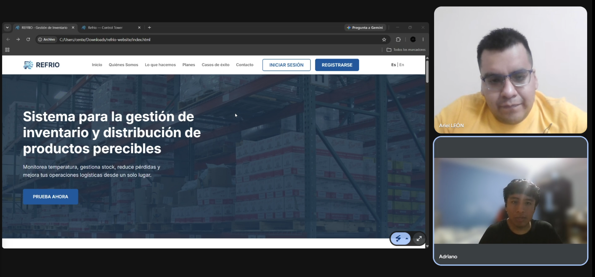 </p> |

**Resumen de la entrevista:**

Ariel León (27 años) es dueño de un local minorista donde lleva 11 meses administrando productos perecibles como fiambres, helados, embutidos, yogures y lácteos. Cuenta con el apoyo de sus padres en el control operativo cuando no está presente y realiza revisiones de inventario aproximadamente dos veces al mes.   Durante el recorrido por la plataforma Refrio, Ariel validó positivamente la propuesta. Destacó que el sistema de alertas con semaforización (colores para indicar productos vigentes, próximos a vencer o vencidos/sin stock) y el seguimiento de pedidos son las funcionalidades que mayor valor le aportan. Asimismo, consideró que la plataforma es bastante fácil de manejar, intuitiva y comprensible como para operarla sin necesidad de capacitaciones largas.   

Como retroalimentación y mejora clave para ajustar el sistema a la realidad operativa de su negocio, Ariel recomendó:

1. Reemplazar la hora exacta estimada de llegada de los envíos por rangos o turnos del día (por ejemplo, "turno mañana" o "turno tarde"), manteniendo únicamente la fecha fija, ya que los factores externos como el tráfico o demoras en entregas previas de la ruta hacen que el horario exacto varíe y pueda generar falsas expectativas en el cliente.   


---

#### Entrevista 2: Segmento 2

| Campo | Detalle |
| :--- | :--- |
| **Nombres y Apellidos** | Farit Santoyo |
| **Edad** | 33 |
| **Distrito** | Surco |
| **Fecha de entrevista** | 12/11/2026 |
| **Enlace al video (Microsoft Stream)** | https://upcedupe-my.sharepoint.com/:v:/g/personal/u20241f109_upc_edu_pe/IQCtjoimP7EGRJ0goFpz9NxtAfL0G8yIkZRU-fqumIfDKbE?nav=eyJyZWZlcnJhbEluZm8iOnsicmVmZXJyYWxBcHAiOiJPbmVEcml2ZUZvckJ1c2luZXNzIiwicmVmZXJyYWxBcHBQbGF0Zm9ybSI6IldlYiIsInJlZmVycmFsTW9kZSI6InZpZXciLCJyZWZlcnJhbFZpZXciOiJNeUZpbGVzTGlua0NvcHkifX0&e=2WFy21 |
| **Timing de inicio y duración** | Inicio: 00:00 - Duración: 8:36 minutos |
| **User flows evaluados** | • Exploración de Landing Page y Propuesta de Valor<br>• Registro e Inicio de Sesión (IAM)<br>• Visualización del Panel de Control (Dashboard)<br>• Consulta de Inventario y Disponibilidad de Productos<br>• Registro y Consulta de Lotes<br>• Consulta de Fechas de Vencimiento<br>• Monitoreo de Alertas de Vencimiento y Bajo Stock<br>• Navegación de la Plataforma desde Dispositivos Móviles |
| **Evidencia fotográfica** | <p>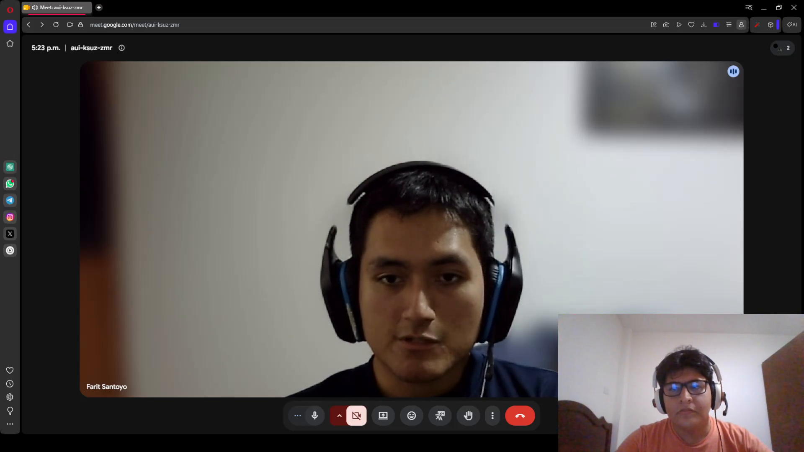 </p> |

**Resumen de la entrevista:**

Farit Alejandro Santoyo Espejo, de 33 años, es un comerciante del distrito de Santiago de Surco que, según el registro anterior del proyecto, administra desde hace ocho años una bodega dedicada a la comercialización de productos perecibles, entre ellos lácteos, embutidos y verduras frescas. Su actividad requiere controlar las existencias, organizar la reposición de mercadería y revisar las fechas de vencimiento de los productos.

En su entrevista inicial, se documentaron dificultades relacionadas con la actualización manual del inventario, la identificación de productos próximos a vencer y el desabastecimiento de artículos de alta rotación. Estas situaciones pueden ocasionar pérdidas económicas y afectar la atención a los clientes. Por ello, la nueva entrevista de validación se orienta a evaluar si la propuesta de Refrio presenta de manera comprensible las herramientas destinadas a mejorar el control de existencias.

Los aspectos centrales de la validación comprenden la consulta de productos y cantidades disponibles, el registro de lotes, la interpretación de fechas de vencimiento y la identificación de alertas. También se considera la facilidad para navegar por la plataforma desde un teléfono móvil, especialmente durante una jornada de trabajo en la que el comerciante debe atender clientes y administrar simultáneamente su mercadería. El análisis de las respuestas permitirá establecer qué elementos de la interfaz son intuitivos, cuáles presentan dificultades y qué mejoras podrían contribuir a reducir las pérdidas por vencimiento y los problemas de reposición.

---


#### Matriz de Resultados de las Sesiones de Validación

Registro de la rama `feature/chapter5`; se conserva lo reportado por el equipo en AV2. La grabación individual no se ha vuelto a revisar. En caso de diferencias con los resúmenes de entrevista, corresponde contrastar el dato con el video original.

| Participante | Segmento | Tarea Intentada | Resultado Observado | Dificultad Detectada | Decisión de Mejora |
|---|---|---|---|---|---|
| **Andrea Villanueva** (28, Ate) | Segmento 1 (Distribuidora) | Revisar inventario FEFO, alertas térmicas y trazabilidad de despachos. | Identificó rápidamente lotes críticos mediante el semáforo de colores y validó la utilidad del panel. | Ausencia de exportación directa a PDF para auditorías y falta de métricas de ahorro económico (ROI). | Priorizar exportación PDF (`US35`) y widget de ROI (`US38`) en el Sprint 4 (`REF-H02`, `REF-H03`). |
| **Carmen Lara** (28, Ate) | Segmento 1 (Distribuidora) | Simular cierre de incidente térmico y verificar flujo de despacho FEFO. | Completó el cierre de alerta con justificación en menos de 40 segundos sin asistencia. | Solicitó alertas fuera de la web (WhatsApp/Push) para turnos de madrugada. | Incorporar integración multicanal (`TS07`) en el siguiente ciclo (`REF-H01`). |
| **Jari Hassan Syeda** (25, San Luis) | Segmento 1 (Distribuidora) | Navegar por Torre de Control, filtrar lotes por vencimiento y revisar envíos activos. | Comprendió la jerarquía de módulos y el ordenamiento automático por caducidad. | Requirió mayor detalle en el historial de eventos de ruta ante retrasos. | Vincular eventos de tránsito con el certificado térmico en `Traceability`. |
| **Ariel David León** (27, Santa Anita) | Segmento 2 (Bodega) | Registrar producto, revisar alertas de vencimiento y dar de baja mercadería vencida. | Logró registrar stock y ubicar alertas preventivas con facilidad. | Al registrar una baja/merma no existía confirmación previa para evitar errores de dedo. | Implementar modal de confirmación y motivo obligatorio (`REF-H05`). |
| **Farit Santoyo** (33, Surco) | Segmento 2 (Bodega) | Consultar inventario, fechas de caducidad y alertas desde dispositivo móvil. | Navegó correctamente por los indicadores principales de frescura. | En pantalla móvil, las tablas con muchas columnas obligaban a desplazarse horizontalmente. | Rediseñar listado móvil a formato de tarjetas colapsables (`REF-H04`). |

### 5.3.3. Evaluaciones según heurísticas

**Tareas evaluadas:** Exploración de Landing Page, acceso por rol (Supervisor y Minorista), revisión de Dashboard (Torre de Control), visualización de inventario FEFO, seguimiento de despachos, centro de alertas térmicas y navegación móvil. **Tareas excluidas:** Generación y exportación de reportes de trazabilidad en PDF (prototipo no implementado operativamente).

| Nivel | Interpretación del enunciado |
|---:|---|
| 1 | Superficial o fácilmente superable |
| 2 | Menor; prioridad baja |
| 3 | Mayor; requiere prioridad alta |
| 4 | Muy grave; bloquea la utilización y debe corregirse antes del lanzamiento |

| ID | Problema efectivamente observado | Severidad | Principio vulnerado | Recomendación / estado |
|---|---|---:|---|---|
| REF-H01 | Falta de retroalimentación inmediata (notificaciones push/SMS) ante alertas térmicas críticas fuera de la pantalla de la aplicación activa. | 4 | Usability: Retroalimentación del estado del sistema (Visibilidad del estado). | Implementar servicio de notificaciones push o integración con WhatsApp/SMS para alertas críticas en tiempo real. **Prioridad: Alta.** |
| REF-H02 | Ausencia de un indicador claro o módulo que cuantifique el retorno de inversión (ROI) o las pérdidas evitadas en el Dashboard del Supervisor. | 3 | Usability: Compatibilidad entre el sistema y el mundo real (Match between system and the real world). | Diseñar y agregar un widget o sección en el Dashboard que calcule y muestre el ahorro estimado por mermas evitadas gracias al sistema FEFO. **Prioridad: Alta.** |
| REF-H03 | La funcionalidad para generar o descargar reportes de trazabilidad (ej. en PDF) para auditorías no se encuentra implementada operativamente, interrumpiendo el flujo de trabajo del supervisor. | 3 | Usability: Control y libertad del usuario (User control and freedom). | Habilitar la exportación de reportes de trazabilidad y eventos de la cadena de frío en formato PDF y/o Excel. **Prioridad: Alta.** |
| REF-H04 | En la vista móvil para el segmento 2 (Bodegas), la presentación de información extensa (lotes, fechas de vencimiento, cantidades) requiere demasiado desplazamiento horizontal o vertical. | 2 | Usability: Diseño estético y minimalista (Aesthetic and minimalist design) / Responsive Design. | Optimizar la interfaz móvil utilizando tarjetas (cards) colapsables o mostrando solo la información crítica (producto, estado semáforo, cantidad) con opción de expandir detalles. **Prioridad: Media.** |
| REF-H05 | No hay una confirmación visual explícita o mecanismo para deshacer una acción cuando un lote es marcado accidentalmente como "baja por vencimiento" o "merma". | 3 | Usability: Prevención de errores y reconocimiento de errores (Error prevention / Help users recognize, diagnose, and recover from errors). | Implementar diálogos de confirmación modales antes de ejecutar acciones destructivas (bajas/mermas) y una opción temporal para deshacer la acción. **Prioridad: Alta.** |

#### Matriz de Seguimiento y Cierre de Hallazgos Heurísticos (`REF-H01` a `REF-H05`)

Estados registrados en AV2, según la rama `feature/chapter5`. La conciliación declarada de los Sprint Backlogs TB2 no sustituye la revalidación específica de los hallazgos.

| ID | Problema Observado | Sev. | Principio Vulnerado | Acción Correctiva Aplicada / Planificada | Estado y Verificación |
|:---:|---|:---:|---|---|---|
| **REF-H01** | Falta de notificaciones push/WhatsApp fuera de la aplicación ante alertas térmicas críticas. | 4 | Visibilidad del estado del sistema | Diseño de adaptador multicanal (`TS07`) programado como prioridad #1 en el Sprint 4. | **Planificado (Sprint 4)** — Revalidación pendiente tras despliegue de webhooks. |
| **REF-H02** | Ausencia de indicador de retorno de inversión (ROI / soles ahorrados) en el Dashboard del Supervisor. | 3 | Compatibilidad entre el sistema y el mundo real | Especificación del widget ejecutivo de mermas evitadas (`US38`, `TS09`) para el Sprint 4. | **Planificado (Sprint 4)** — Prototipo validado con Andrea Villanueva. |
| **REF-H03** | Exportación de certificados de trazabilidad en PDF no implementada operativamente (solo consulta web). | 3 | Control y libertad del usuario | Endpoint de generación de certificado y consulta QR (`TS08`, `US34`) implementado; generación binaria PDF (`US35`) asignada a Sprint 4. | **En progreso** — Consulta JSON/QR operativa en Render; PDF pendiente. |
| **REF-H04** | Saturación de columnas en tablas de inventario al navegar desde teléfonos móviles (Segmento 2). | 2 | Diseño estético y minimalista (Responsive) | Refactorización de vistas Angular a tarjetas (*cards*) responsivas colapsables en viewports `< 768 px`. | **Corregido en AV2** — Verificado en pruebas responsive móvil (375 px). |
| **REF-H05** | Ausencia de confirmación visual antes de ejecutar la baja definitiva de un lote por merma. | 3 | Prevención de errores y reconocimiento de errores | Implementación de diálogo modal de confirmación con selección obligatoria de causa raíz en `Inventory`. | **Corregido en AV2** — Verificado en flujo E2E de baja de lotes. |

## 5.4. Video About-the-Product

El Video About-the-Product presenta la propuesta de valor de Refrio a visitantes del Landing Page y usuarios potenciales (bodegas, almacenes y distribuidoras de perecibles). El video sigue la siguiente secuencia de escenas:   

1. Problema y contexto (0:00 – 0:18): Introducción animada del logotipo de Refrio seguida de una narración en off sobre las pérdidas económicas que sufren los comercios debido al vencimiento de mercadería y fallas en la refrigeración. Se muestran escenas de encargados de almacén preocupados revisando productos vencidos, notas de prensa sobre el desperdicio del 48 % de alimentos en el Perú y el día a día en bodegas minoristas.   

2. Propuesta de solución (0:18 – 0:35): Presentación de Refrio por parte del equipo Mada Group como un asistente inteligente diseñado para distribuidoras y bodegas. Se ilustran operaciones de carga, descarga y despacho en almacén acompañadas de la explicación sobre el registro por eventos y la aplicación automática de rotación por orden de vencimiento (FEFO/FIFO) para evitar que los lotes caduquen.   

3. Demostración de funcionalidades de la plataforma (0:35 – 1:32):

   - Panel de control y eventos del dominio (0:35 – 0:46): Recorrido por la vista de Control de distribución, indicadores de unidades en almacén e incidentes activos, y la pestaña Eventos del dominio, donde se audita cada lote vencido o despacho con su responsable y regla aplicada.   
   
   - Gestión para bodegas y alertas tempranas (0:46 – 0:59): Vista operativa del minorista (Tu operación de hoy) con el sistema de alertas por semaforización (ej. Stock bajo, Lote vencido o próximo a vencer) que permite identificar qué productos requieren atención o remate inmediato.   
   
   - Registro y confirmación de merma justificada (0:59 – 1:17): Demostración paso a paso dentro del detalle de un producto (Helado D'Onofrio) y su lote (BT-R-PRD-002), ingresando la cantidad de unidades a retirar, la causa ("Vencimiento") y confirmando la baja para actualizar automáticamente el saldo disponible en inventario.   
   
   - Exploración del Landing Page y planes (1:17 – 1:32): Recorrido por la página principal de Refrio, presentando los planes de suscripción (Básico, Profesional y Empresarial) y el acceso directo al registro.   
   
4. Cierre y CTA (1:32 – 1:37): Pantalla final con la animación del logotipo oficial de Refrio y el branding de la startup.   

El video incluye narración en off continua, música de fondo instrumental dinámica, tomas reales de apoyo en almacenes y comercios, grabación de pantalla fluida sobre la interfaz web y transiciones limpias entre cada bloque.


**URL Microsoft Stream:** [Ver Video](https://upcedupe-my.sharepoint.com/:v:/g/personal/u20241d920_upc_edu_pe/IQDIBCyT0Y7DRLZHObNRDgzlAdqVKSo6hEhle61PbqDMfLg?nav=eyJyZWZlcnJhbEluZm8iOnsicmVmZXJyYWxBcHAiOiJPbmVEcml2ZUZvckJ1c2luZXNzIiwicmVmZXJyYWxBcHBQbGF0Zm9ybSI6IldlYiIsInJlZmVycmFsTW9kZSI6InZpZXciLCJyZWZlcnJhbFZpZXciOiJNeUZpbGVzTGlua0NvcHkifX0&e=aVF07l) 

**URL YouTube:** [Ver Video](https://youtu.be/XbwEG11q1ys)
